# CivicAI

**A Multimodal AI-Based Multi-Department Civic Issue Detection, Prioritization and Resolution Platform**
(B.Tech CSE final-year project)

Citizens report a civic problem such as a pothole, an overflowing drain or an open manhole with a photo, a short
description and a map pin. CivicAI's AI engine reads the photo and the text together, decides what the issue is,
scores its severity and priority, links duplicate reports and routes the complaint to the right department and
officer. The officer fixes it and uploads before and after photos that the AI checks, the citizen rates the work,
and administrators follow everything on live dashboards, hotspot maps and reports.

Every step below is real code working on a real database:

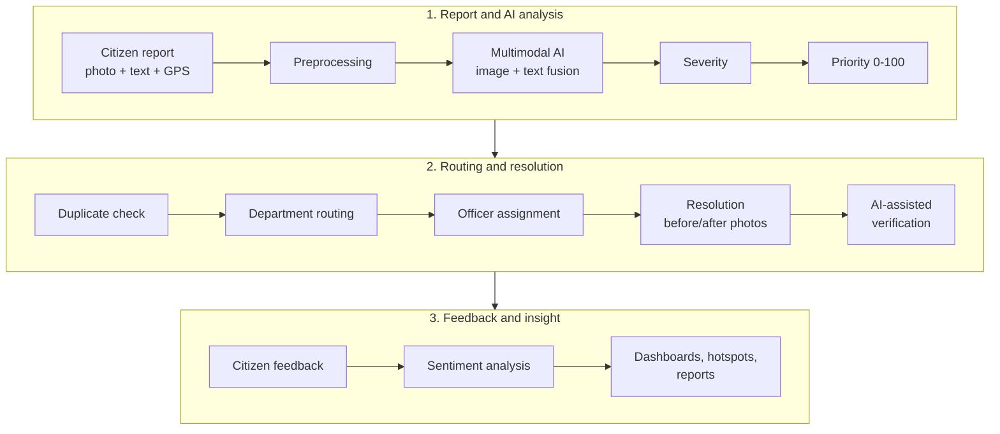

A complaint moves through the statuses `submitted → analyzed → assigned → accepted → in_progress → resolved →
verified → closed`, and can also be `rejected` or `reopened`.

> **Demo AI Mode.** Out of the box the AI engine runs with `MODEL_MODE=demo`: transparent OpenCV heuristics,
> TF-IDF + logistic regression and a sentiment lexicon instead of trained deep-learning weights. Every result says
> so (`is_demo: true` in the API, a "Demo AI Mode" badge in the web app). `MODEL_MODE=production` switches to
> pretrained models (CLIP, Sentence-Transformers, RoBERTa). A YOLOv8 detector is supported and has a training
> script, but no trained weights are included. See [AI modes](#ai-modes).

## Contents

- [Screenshots](#screenshots)
- [Features](#features)
- [Tech stack](#tech-stack)
- [Architecture](#architecture)
- [Repository structure](#repository-structure)
- [Quick start on Windows](#quick-start-on-windows)
- [Share with your team (ngrok)](#share-with-your-team-ngrok)
- [Manual setup](#manual-setup)
- [MySQL setup](#mysql-setup)
- [Demo accounts](#demo-accounts)
- [AI modes](#ai-modes)
- [Running the tests](#running-the-tests)
- [Deployment](#deployment)
- [Documentation](#documentation)
- [Troubleshooting](#troubleshooting)
- [Licence and acknowledgements](#licence-and-acknowledgements)

## Screenshots

All screenshots show the final demo dataset (160 complaints over 180 days, created by `seed_demo`) in the light
theme at 1440 px, unless the caption says otherwise.

| | |
|---|---|
| 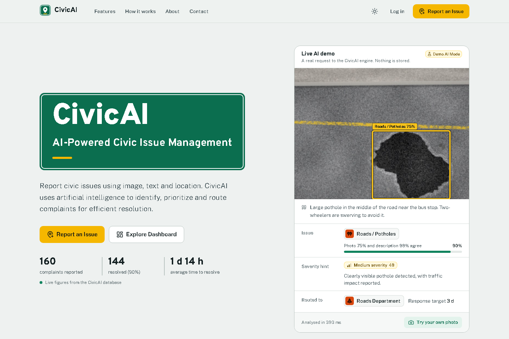<br/>**Landing page.** The hero runs a live request to the AI engine (`POST /api/ai/demo/`, nothing is stored) and shows live figures from the database. | 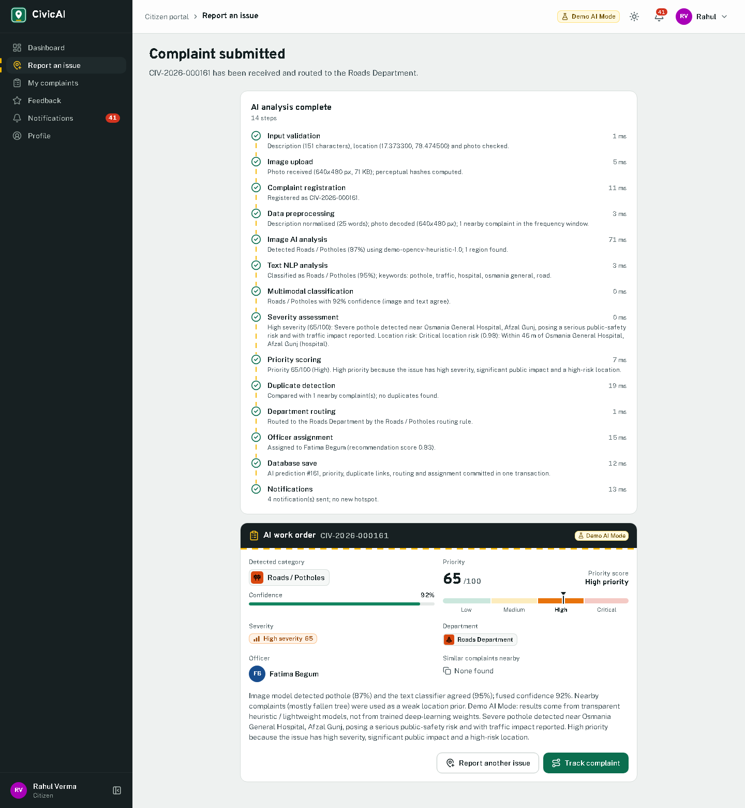<br/>**Report an issue, after *Analyze & Submit*.** The 14 pipeline steps with their timings and the AI work order: category, confidence, severity, priority, department and officer. Taken on a private copy of the demo database, so the presented data keeps its 160 complaints. |
| 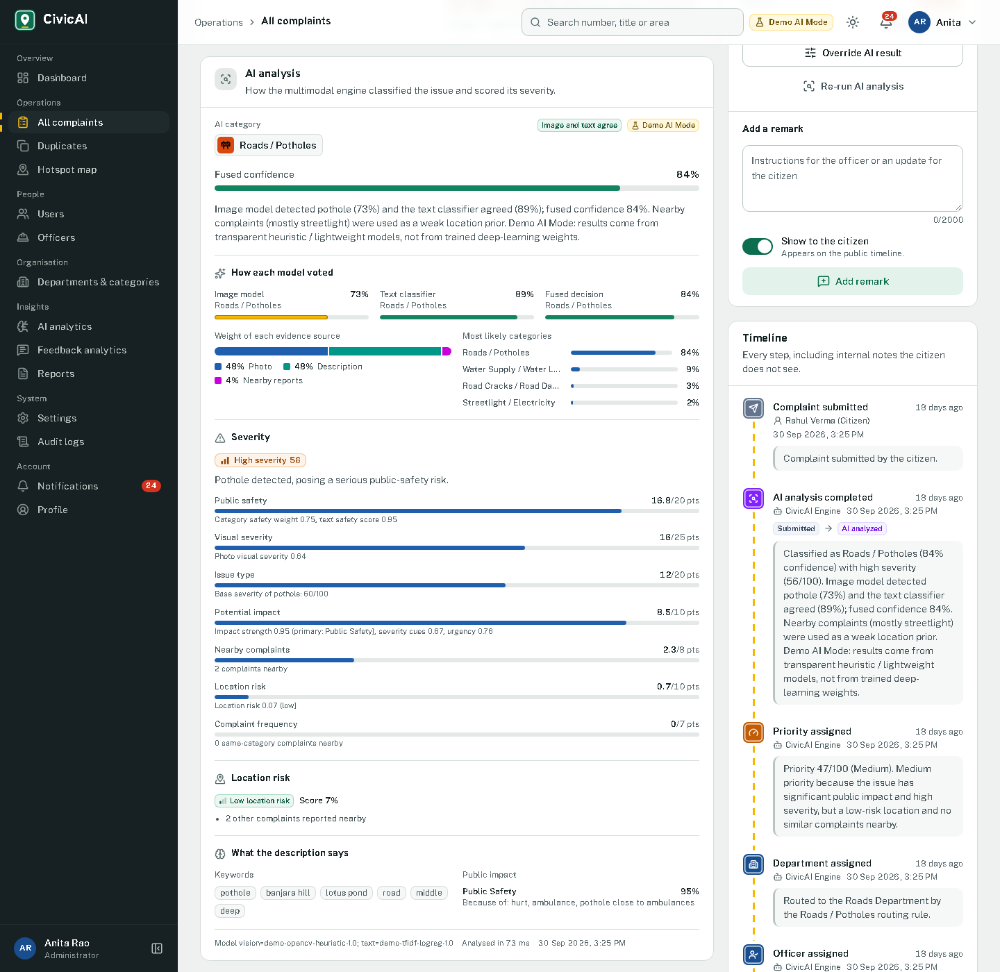<br/>**Complaint CIV-2026-000141 (administrator view).** How the image model and the text classifier voted, the fused confidence, the severity factors and the start of the timeline. | 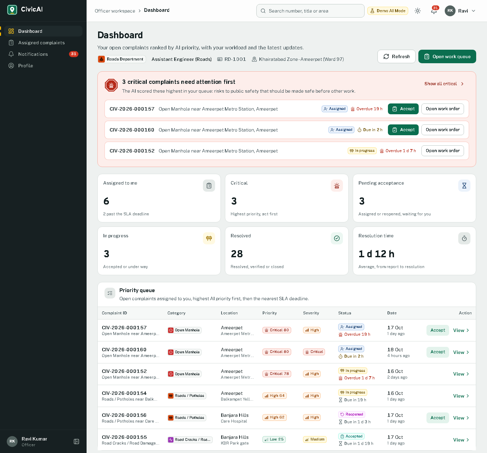<br/>**Officer dashboard (Roads Department).** Critical complaints first, KPI cards and the queue ranked by AI priority. |
| 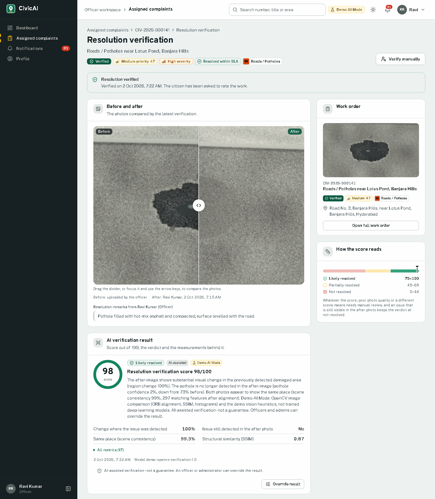<br/>**Resolution verification.** Before/after slider and the AI-assisted verdict (98/100, likely resolved) with the measurements behind it. | 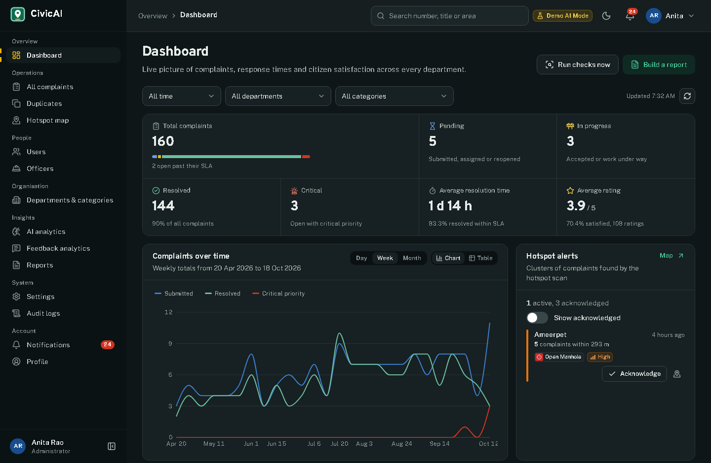<br/>**Administrator dashboard (dark theme).** KPIs, weekly trend and hotspot alerts, all computed from the database. |
| 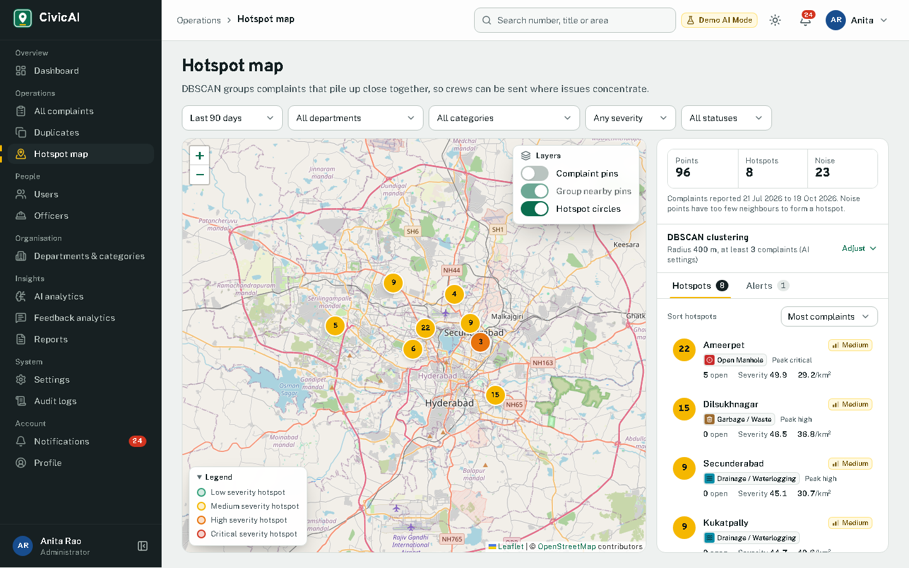<br/>**Hotspot map.** DBSCAN clusters of the last 90 days (radius 400 m, at least 3 complaints): 8 hotspots from 96 complaints. | 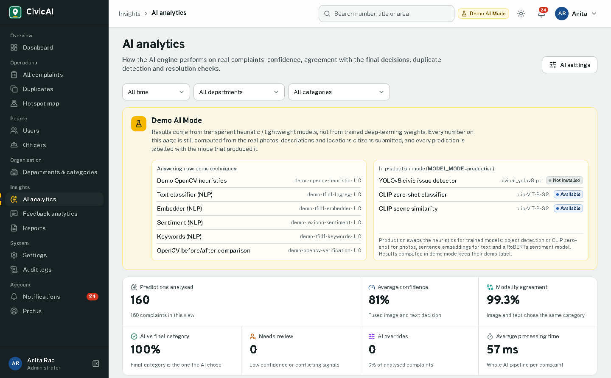<br/>**AI analytics.** Which techniques answer in Demo AI Mode, which production models are installed, and live confidence and agreement figures. |
| 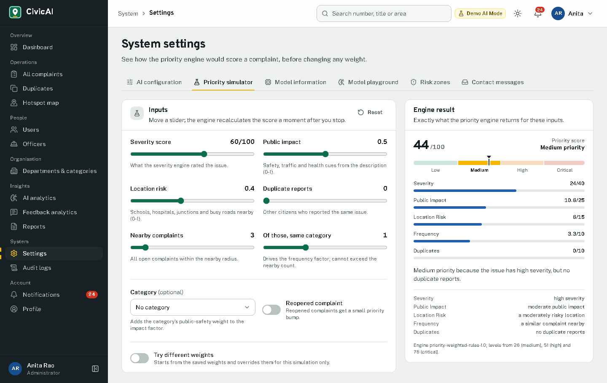<br/>**System settings, priority simulator.** The priority engine's score and its five weighted components for any inputs; nothing is stored. | 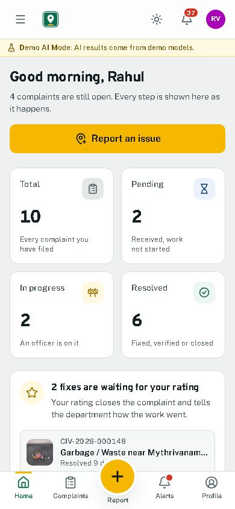<br/>**Citizen dashboard on a 390 px phone**, with the bottom tab bar and the raised Report button. |

## Features

### For citizens

- Register, log in, edit the profile and photo. Civic points reward participation: 10 for a report, 15 when its fix
  is verified and 5 for rating the work.
- Report an issue in four steps (Photo, Details, Location, Review): drag-and-drop or camera photo, description,
  optional category and title, and the location from GPS ("Use my location"), a map click or a place search. The
  address is filled in by reverse geocoding (OpenStreetMap Nominatim, called through the backend).
- While the form is filled in, the AI suggests a category (`POST /api/ai/classify/`) and the review step warns about
  similar reports nearby (`POST /api/ai/duplicates/`). Neither call stores anything.
- *Analyze & Submit* runs the whole pipeline in one request and shows each step and the resulting AI work order.
- My complaints with search and filters; a complaint page with the AI analysis, priority breakdown, before/after
  evidence, verification result and timeline; a tracking page that refreshes every 30 seconds; notifications.
- Rate a finished job (1-5 stars and a comment, analysed for sentiment), which closes the complaint, or reopen it
  within 14 days (`REOPEN_WINDOW_DAYS`).
- A phone layout with a bottom tab bar, light and dark themes, and an installable PWA. The service worker caches
  the app shell only, never API data or uploaded photos.

### For officers

- Dashboard with the critical complaints first, KPI cards, the priority queue, workload against capacity, recent
  activity and duplicate reports to review.
- Assigned complaints ("Assigned to me" or "My department"): search, filters, sort by priority, list or map view.
- Work order: the photo with the AI's detection boxes, the AI analysis, the priority breakdown, the location with
  OpenStreetMap and Google Maps directions, the citizen's contact details and the timeline.
- Accept, reject with a reason, start work, add public or internal remarks.
- Resolution update with before and after photos. AI-assisted verification runs automatically; the verification
  page can run it again, record a manual verdict that overrides the AI, or request manual review.

### For administrators

- Dashboard: KPIs, charts by category, department, status, severity and priority, resolution times, ratings,
  hotspot alerts and a "Run checks now" button (SLA check and hotspot scan).
- All complaints as a list or map. Complaint management: reassign with ranked officer recommendations, change the
  status, close or reopen, override the AI (audit-logged), re-run the AI analysis, verify manually.
- Duplicate review: confirm or reject each pair; duplicates are linked, never deleted automatically.
- Users, officers (with a workload drawer), departments, categories and the routing table. A new category works
  without code changes: its keywords and vision labels feed the AI engine.
- AI analytics, hotspot map, feedback analytics (sentiment by department, category and time), five reports
  (summary, complaints, departments, officers, feedback) as JSON preview, CSV or PDF, the audit log, and system
  settings: AI configuration, priority simulator, model information, a model playground, risk zones and contact
  messages.

### AI capabilities

| Capability | Code | Demo mode (default) | Production mode |
|---|---|---|---|
| Image analysis: 9 classes with boxes | `backend/ai/vision/` | OpenCV colour, texture and shape heuristics; confidence capped at 0.75 | YOLOv8 when trained weights exist, otherwise CLIP ViT-B/32 zero-shot with an approximate region |
| Text analysis: category, keywords, impacts, severity cues; Hinglish and Telugu words normalised | `backend/ai/nlp/` | TF-IDF + logistic regression | all-MiniLM-L6-v2 sentence embeddings + logistic regression |
| Multimodal fusion | `backend/ai/multimodal/` | Confidence-weighted late fusion (image 0.55, text 0.45, plus weak priors); disagreement is flagged for review | Same |
| Severity 0-100 with a written reason | `backend/ai/severity/` | Seven weighted factors: visual 25 %, issue type 20 %, public safety 20 %, location 10 %, impact 10 %, nearby complaints 8 %, frequency 7 % | Same |
| Priority 0-100 with an explanation | `backend/ai/priority/` | Severity 40 + public impact 25 + location risk 15 + frequency 10 + duplicates 10 (weights editable); low up to 25, medium 26-50, high 51-75, critical 76+ | Same |
| Duplicate detection | `backend/ai/duplicate/` | Text 0.40, image 0.30, location 0.30 within 300 m and 30 days, flagged at 0.72; TF-IDF text similarity, pHash/dHash/aHash and colour histograms, GPS distance | Adds sentence embeddings and CLIP image embeddings |
| Location risk and hotspots | `backend/ai/geospatial/` | Risk zones (schools, hospitals, junctions ...) and DBSCAN with the haversine metric (400 m, at least 3 complaints) | Same |
| Resolution verification | `backend/ai/verification/` | ORB alignment, SSIM, histograms, change in the detected region and re-detection of the issue; likely resolved from 70, partially resolved from 45 | Adds CLIP scene similarity |
| Feedback sentiment | `backend/ai/nlp/sentiment.py` | Lexicon with negation and intensifiers | cardiffnlp/twitter-roberta-base-sentiment-latest |
| Officer recommendation | `backend/apps/assignments/` | Workload, distance, availability and track record | Same |

The numbers above are the default AI configuration; administrators can change weights and thresholds in System
settings. [docs/AI_ENGINE.md](docs/AI_ENGINE.md) explains each component in depth.

## Tech stack

`requirements.txt` and `package.json` declare minimum versions (for example `Django>=5.2,<6.0`, `"react":
"^19.3.1"`). The table lists the versions installed on the development machine (`pip list` and
`package-lock.json`, 18 October 2026).

| Layer | Technology |
|---|---|
| Backend | Python 3.13.3, Django 5.2.18, Django REST Framework 3.18.3, Simple JWT 5.5.1 (rotation and blacklist), django-filter 26.2, django-cors-headers 4.9.0, WhiteNoise 6.12.0, gunicorn (Linux deployments) |
| Database | MySQL 8.0.42 through mysqlclient 2.3.0 (Windows) or PyMySQL 1.2.3 (elsewhere), dj-database-url 3.1.2; SQLite as a local fallback |
| AI and data | NumPy 2.4.3, pandas 3.0.1, SciPy 1.17.1, scikit-learn 1.8.0, OpenCV (opencv-python-headless 5.0.0.93), ImageHash 4.3.2, Pillow 12.1.1 |
| Production AI (`requirements-ml.txt`) | PyTorch 2.14.0, Transformers 5.17.0, Sentence-Transformers 6.1.0; Ultralytics (YOLOv8) is listed but not installed on the development machine |
| Reports and jobs | ReportLab 5.0.1 (PDF), Celery 5.6.3 + redis 8.1.0 (optional; a built-in scheduler is the default) |
| Frontend | React 19.3.1, React Router 7.18.4, Vite 7.3.7, Tailwind CSS 4.3.3, Axios 1.20.0, Framer Motion 12.43.0, Recharts 3.10.1, Leaflet 1.9.4, React-Leaflet 5.0.0, leaflet.markercluster 1.5.3, Lucide React 1.59.0, date-fns 4.4.0, ESLint 9.39.5 |
| Maps | OpenStreetMap tiles; Nominatim geocoding through the backend |
| Tests | Django test runner (unittest); pytest 9.1.1 and Playwright 1.64.0 for the end-to-end suite |

## Architecture

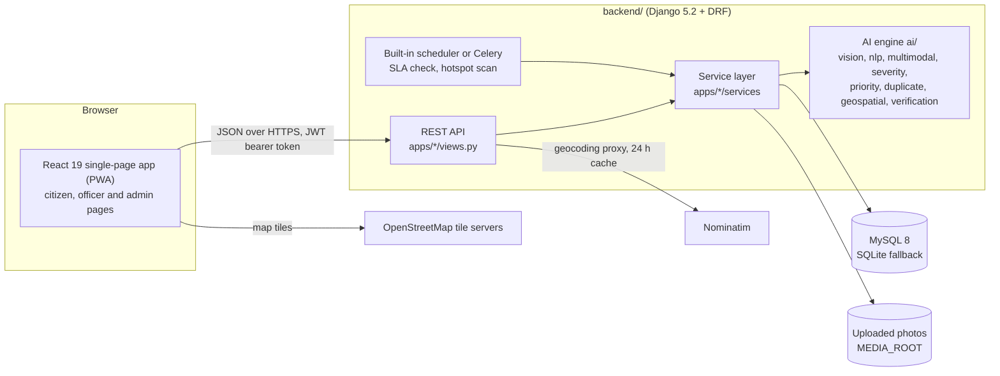

The AI engine in `backend/ai/` has no Django imports: the Django apps collect the inputs (photo, text, nearby
complaints, risk zones, AI configuration), call the engine and store its output. The API has 117 endpoints, listed
with their permission levels in [docs/API_ENDPOINTS.md](docs/API_ENDPOINTS.md).
[docs/ARCHITECTURE.md](docs/ARCHITECTURE.md) describes the data model and the main flows.

## Repository structure

```
civic project/
├── README.md              this file
├── render.yaml            Render blueprint for the API
├── setup.ps1              first-time setup on Windows
├── start-dev.ps1          starts the API (port 8000) and the web app (port 5173)
├── share.ps1              shares the app through one public HTTPS link (ngrok)
├── backend/               Django project and AI engine (see backend/README.md)
│   ├── config/            settings, URLs, WSGI/ASGI, Celery
│   ├── apps/              core, accounts, departments, officers, complaints, assignments,
│   │                      feedback, notifications, analytics, audit
│   ├── ai/                AI engine and its unit tests (ai/tests/)
│   ├── scripts/           setup_mysql, train_text_classifier, train_yolo, evaluate_vision,
│   │                      generate_sample_images, import_real_photos, smoke_test_api
│   ├── sample_data/       270 generated sample photos with labels, 134 real street photos (real_images/), reports
│   ├── ml_models/         model caches and the text classifier reports (weights are git-ignored)
│   └── requirements.txt, requirements-ml.txt, .env.example, build.sh, gunicorn.conf.py, Procfile
├── frontend/              React + Vite web app
│   ├── src/               pages (public, citizen, officer, admin, shared), components, services,
│   │                      context, hooks, utils
│   ├── public/            manifest, service worker, icons, sample photos for the landing demo
│   └── package.json, vite.config.js, vercel.json, .env.example
├── e2e/                   Playwright end-to-end tests (see e2e/README.md)
└── docs/                  specification, API reference, guides and screenshots
```

## Quick start on Windows

You need Python 3.11 or newer (developed on 3.13.3) and Node.js 20.19+ or 22.12+ (Vite 7's requirement; developed
on 22.19). MySQL is optional for a first run.

```powershell
powershell -ExecutionPolicy Bypass -File .\setup.ps1
powershell -ExecutionPolicy Bypass -File .\start-dev.ps1
```

`setup.ps1` creates `backend\venv`, installs `requirements.txt`, writes `backend\.env` from `.env.example` with fresh
`SECRET_KEY` and `JWT_SECRET` values and `DB_ENGINE=sqlite`, runs `migrate`, `init_civicai --keep-existing` and
`seed_demo --reset`, then runs `npm install` and creates `frontend\.env`. An existing `backend\.env` is left
unchanged. Options: `-NoSeed` skips the demo data, `-WithML` also installs `requirements-ml.txt` for production AI.

`start-dev.ps1` opens two PowerShell windows: the API on <http://localhost:8000> (health check at
`/api/health/`, Django admin at `/admin/`) and the web app on <http://localhost:5173>.

## Share with your team (ngrok)

`share.ps1` puts the app on one public HTTPS link that works on any device, phones included. One-time setup:
`winget install Ngrok.Ngrok`, a free account at <https://dashboard.ngrok.com/signup>, then
`ngrok config add-authtoken <your authtoken>`. After that:

```powershell
powershell -ExecutionPolicy Bypass -File .\share.ps1
```

It builds the web app with `VITE_API_URL=/api`, then opens three windows: a second API on port 8001 with
`DEBUG=False`, the build on port 4173 (`vite preview`, which forwards `/api` and `/media` to that API), and ngrok.
It then prints the link and copies it to the clipboard. `start-dev.ps1` can keep running alongside it. The link works
only while those windows stay open and the PC is online, and every visitor uses this PC's database. While the ngrok
window is open, Windows does not put the PC to sleep when idle (the screen still turns off). Closing the lid or
choosing Sleep still suspends it, so for an always-on link keep the laptop plugged in and set Control Panel → Power
Options → "Choose what closing the lid does" → **When plugged in: Do nothing**. Running `share.ps1` again replaces a
previous share. On the first visit ngrok shows a notice page; click **Visit Site**. Because the link is HTTPS, "Use my
location" and app install work too.

## Manual setup

The same steps by hand, in PowerShell. On Linux or macOS use `venv/bin/python` and `cp` instead of
`venv\Scripts\python.exe` and `copy`.

```powershell
cd backend
python -m venv venv
venv\Scripts\python.exe -m pip install -r requirements.txt
copy .env.example .env
# edit .env: SECRET_KEY and JWT_SECRET (long random strings, for example from
#   venv\Scripts\python.exe -c "import secrets; print(secrets.token_urlsafe(50))")
# and the database: DB_ENGINE=sqlite for a quick start, or the MySQL settings below
venv\Scripts\python.exe manage.py migrate
venv\Scripts\python.exe manage.py init_civicai --keep-existing
venv\Scripts\python.exe manage.py seed_demo --reset       # optional: the demo data (see below)
venv\Scripts\python.exe manage.py runserver 8000
```

- `init_civicai` installs the reference data: 7 departments, 9 categories with routing, keywords and vision labels,
  the AI configuration and 12 Hyderabad risk zones. With `--keep-existing` it only adds missing rows.
- `seed_demo --reset` builds the demo dataset through the real services (submission with AI analysis, assignment,
  resolution with AI verification, feedback with sentiment, duplicates, SLA and hotspot alerts): 160 complaints
  over 180 days, 16 officers, 16 citizens and 1 administrator. It took 71 s on MySQL on the development laptop.
  `--reset` first deletes every `@civicai.local` account and everything it owns, so running it again rebuilds the
  dataset with new complaint numbers and dates relative to that moment (`--seed` and `--anchor` reproduce one
  exactly). Do not run it on the database you are going to present.

Frontend, in a second terminal:

```powershell
cd frontend
npm install
copy .env.example .env     # VITE_API_URL=http://localhost:8000/api
npm run dev                # http://localhost:5173
```

`npm run build` writes the production build to `frontend\dist`, and `npm run lint` runs ESLint.

## MySQL setup

MySQL 8 is the main database; the code avoids database-specific features so that SQLite works as a fallback.

1. Make sure the MySQL server (the `MySQL80` Windows service) is running.
2. In `backend\.env` set `DB_ENGINE=mysql` and `DATABASE_NAME`, `DATABASE_USER`, `DATABASE_PASSWORD`,
   `DATABASE_HOST`, `DATABASE_PORT`.
3. Create the database and fill it, from `backend\`:

```powershell
venv\Scripts\python.exe scripts\setup_mysql.py --migrate --seed    # create `civicai` (utf8mb4), tables, reference and demo data
venv\Scripts\python.exe scripts\setup_mysql.py --copy-sqlite       # or copy every row of civicai.sqlite3 instead (--replace overwrites)
venv\Scripts\python.exe scripts\setup_mysql.py --create-user civicai --migrate   # optional: a dedicated MySQL user
```

Without options the script only creates the database. `--copy-sqlite` keeps every primary key, so complaint numbers
and logins stay the same; photos are not copied because both databases use the same `backend\media` folder.

**Drivers.** `requirements.txt` installs mysqlclient on Windows only (its wheels need no compiler there) and PyMySQL
everywhere. `config/settings.py` uses mysqlclient when it can be imported and otherwise installs PyMySQL in its
place, which is what happens on Linux hosts such as Render. The two drivers differ in their TLS options; see
[docs/DEPLOYMENT.md](docs/DEPLOYMENT.md#cloud-mysql).

Set `DB_ENGINE=sqlite` to switch back to `backend\civicai.sqlite3` (`SQLITE_NAME` changes the file).

## Demo accounts

`seed_demo` creates these accounts. They are for local demonstrations only; change or remove them before any real
use.

| Role | E-mail | Password | Notes |
|---|---|---|---|
| Administrator | `admin@civicai.local` | `Admin@12345` | Anita Rao |
| Officer | `roads.officer1@civicai.local` | `Officer@12345` | Ravi Kumar, Roads Department (RD-1001) |
| Officer | `roads.officer2`, `roads.officer3`, `waste.officer1` to `3`, `drain.officer1`/`2`, `elec.officer1`/`2`, `water.officer1`/`2`, `parks.officer1`/`2`, `gen.officer1`/`2` (all `@civicai.local`) | `Officer@12345` | 16 officers in 7 departments; `waste.officer3` is marked unavailable |
| Citizen | `citizen@civicai.local` | `Citizen@12345` | Rahul Verma, 10 complaints with a full history |
| Citizen | `citizen1@civicai.local` to `citizen15@civicai.local` | `Citizen@12345` | |

The development server's login page has a "Demo accounts" panel that fills these in. A production build
(`npm run build`) leaves the passwords out of the bundle, so a deployed site does not show the panel.

## AI modes

| | Demo mode (`MODEL_MODE=demo`, default) | Production mode (`MODEL_MODE=production`) |
|---|---|---|
| Needs | `requirements.txt` only | also `requirements-ml.txt` and about 1.6 GB of downloaded models |
| Photos | OpenCV heuristics | YOLOv8 if `ml_models/yolo/civicai_yolov8.pt` exists, otherwise CLIP ViT-B/32 zero-shot |
| Text | TF-IDF + logistic regression | all-MiniLM-L6-v2 embeddings + logistic regression |
| Sentiment | Lexicon | cardiffnlp/twitter-roberta-base-sentiment-latest |
| Duplicates, verification | Hashes, histograms, OpenCV metrics | adds sentence and CLIP embeddings |
| Labelling | `is_demo: true`, demo model versions, "Demo AI Mode" badge | real model versions; any fallback to a demo technique is reported as `fallback_reason` |

To switch to production mode:

```powershell
cd backend
venv\Scripts\python.exe -m pip install -r requirements-ml.txt
# set MODEL_MODE=production in backend\.env, then download and load the models once:
venv\Scripts\python.exe manage.py warmup_ai --strict
```

On the development laptop the production models took 17 s to load from the local cache and the AI engine then used
about 0.8 GB of memory, against about 0.2 GB in demo mode ([docs/DEPLOYMENT.md](docs/DEPLOYMENT.md#production-ai-mode)
has the measurement).

**Training the text classifier.** `scripts/train_text_classifier.py --mode demo` (or `--mode production`) trains
on `ai/nlp/data/complaint_corpus.csv` (864 synthetic, template-generated complaints), saves the model cache used at
run time and writes `ml_models/nlp/report_<mode>.json`. The honest figure is the accuracy on 90 hand-written
challenge complaints that were never used for training: **91.1 %** in demo mode and **92.2 %** in production mode.
The 100 % / 98.8 % on the template hold-out only shows that the model learned the templates.

**Training YOLO.** No YOLO weights are shipped, so production mode currently classifies photos with CLIP zero-shot
(61.1 % on the 90 generated sample photos, against 98.9 % for the demo heuristics, which were designed around those
same synthetic photos). To add a detector, install `requirements-ml.txt`, convert a labelled dataset (RDD2022 road
damage, Roboflow pothole sets, TACO litter; see the notes in `scripts/train_yolo.py`) to the classes in
`ai/vision/dataset.yaml`, then run:

```powershell
venv\Scripts\python.exe scripts\train_yolo.py --check-only        # validate the dataset only
venv\Scripts\python.exe scripts\train_yolo.py --data ai/vision/dataset.yaml --epochs 100
```

The best checkpoint is copied to `ml_models/yolo/civicai_yolov8.pt`, where production mode picks it up.
`--prepare-samples` trains on the synthetic sample photos to test the pipeline only; such a model says nothing about
real street photos and should not be presented as one.

**What "Demo AI Mode" means.** Demo mode is a complete, honest implementation of every step with lightweight
techniques; it is not a trained deep-learning system, and the web app says so wherever an AI result appears. The
evaluation photos are generated by `scripts/generate_sample_images.py`, and the text corpus is synthetic, so most
accuracy figures measure the pipeline on its own data. The demo data shows 134 real, credited street photos
(`backend/sample_data/real_images/CREDITS.md`); on them the demo image heuristic reaches only 22.4 % and CLIP 64.2 %,
so demo mode lets the description decide. [docs/TESTING.md](docs/TESTING.md#evaluation-scripts) lists every measured
number.

## Running the tests

Results of 18 October 2026 on the development laptop:

| Layer | Command (from the folder shown) | Result |
|---|---|---|
| Backend API, services and AI engine (`backend/`) | `venv\Scripts\python.exe manage.py test --noinput` | 707 tests, all passed: 55 s on in-memory SQLite, 62 s on MySQL 8.0.42 |
| AI engine only, no Django (`backend/`) | `venv\Scripts\python.exe -m unittest discover -s ai/tests -t .` | 224 tests, all passed (19 s) |
| Live API smoke test (`backend/`) | `venv\Scripts\python.exe scripts\smoke_test_api.py --base http://127.0.0.1:8001/api ...` (a copy, see below) | 97 of 97 checks passed against a private copy of the demo data |
| Browser end-to-end tests (repository root) | `python -m pytest e2e -v` | 112 tests, all passed (226 s, against a private copy of the final demo data) |
| Frontend static checks (`frontend/`) | `npm run lint` and `npm run build` | 0 lint problems; build without warnings |

The test runner uses the database `DB_ENGINE` selects: an in-memory database with `DB_ENGINE=sqlite`, or a temporary
`test_<DATABASE_NAME>` database on MySQL (the MySQL user needs the right to create it). The smoke test and most
end-to-end tests create data, so run them against a copy of the database served on another port, never against the
database you present; [docs/TESTING.md](docs/TESTING.md#working-on-a-copy-of-the-demo-database) shows how to make
one in a few commands. The same page describes every layer, the last bug the browser tests caught and the evaluation
scripts.

Before the last fixes, a final verification repeated the test layers. 706 of 706 backend tests passed on MySQL and on
SQLite, and 97 of 97 smoke checks passed. The hotspot badge test failed in both browser runs: 111 of 112 end-to-end
tests on a private API, and 93 of the 94 read-only end-to-end tests against the presentation server (see
[docs/TESTING.md](docs/TESTING.md#final-verification)). The hotspot map was then fixed to move overlapping badges
apart. The table above shows the runs made after that fix
([details](docs/TESTING.md#after-the-final-verification)).

## Deployment

The intended free-tier setup is the API on Render (`render.yaml`, `backend/build.sh`, `gunicorn.conf.py`), the web
app on Vercel (`frontend/vercel.json`, `VITE_API_URL`) and a cloud MySQL 8 database (`DATABASE_URL`). The
configuration files are checked by `backend/apps/core/test_deploy.py`, but a live deployment needs your own
Render, Vercel and database accounts, so it was not carried out during development. Two limits matter for a
demonstration: the free Render instance has 512 MB of memory, so it runs demo mode, and its disk is not persistent,
so uploaded photos disappear when the service restarts. [docs/DEPLOYMENT.md](docs/DEPLOYMENT.md) is the
step-by-step guide.

## Documentation

| File | Contents |
|---|---|
| [docs/REQUIREMENTS.md](docs/REQUIREMENTS.md) | The original requirement specification |
| [docs/BUILD_SPEC.md](docs/BUILD_SPEC.md) | Engineering contract: data model, AI interfaces, API contract, design system |
| [docs/API_ENDPOINTS.md](docs/API_ENDPOINTS.md) | All 117 REST endpoints with methods and permission levels |
| [docs/ARCHITECTURE.md](docs/ARCHITECTURE.md) | Architecture, data model and main flows |
| [docs/AI_ENGINE.md](docs/AI_ENGINE.md) | The AI engine component by component |
| [docs/USER_GUIDE.md](docs/USER_GUIDE.md) | How citizens, officers and administrators use the platform |
| [docs/REQUIREMENTS_TRACEABILITY.md](docs/REQUIREMENTS_TRACEABILITY.md) | Each requirement mapped to its implementation and evidence |
| [docs/TESTING.md](docs/TESTING.md) | Test layers, latest results and evaluation numbers |
| [docs/DEPLOYMENT.md](docs/DEPLOYMENT.md) | Render, Vercel and cloud MySQL |
| [docs/VIVA_GUIDE.md](docs/VIVA_GUIDE.md) | Preparation for the viva |
| [docs/screenshots/](docs/screenshots/) | The screenshots of this README and, with the `guide-` prefix, those of the user guide |
| [backend/README.md](backend/README.md) | Backend reference: every setting, MySQL, AI modes, background jobs, security |
| [e2e/README.md](e2e/README.md) | The Playwright end-to-end suite |

## Troubleshooting

**Port already in use.** `runserver` stops with "Error: That port is already in use". Find the process with
`netstat -ano | findstr :8000` and close it, or start the API on another port and point `VITE_API_URL` at it. Vite
does not stop when port 5173 is taken: it moves to the next free port (5174, ...), and the API then rejects the
requests because that origin is not in `CORS_ALLOWED_ORIGINS` (see CORS below).

**MySQL: "Access denied for user" (error 1045).** `DATABASE_USER` or `DATABASE_PASSWORD` in `backend\.env` is wrong.
"Unknown database 'civicai'" (1049) means the database does not exist yet: run `scripts\setup_mysql.py`. "Can't
connect to MySQL server" (2003) usually means the `MySQL80` service is not running.

**Addresses show only coordinates (Nominatim 403).** The API log shows a line like `Nominatim reverse request
failed (403 ...) - check that NOMINATIM_USER_AGENT identifies this deployment with a real contact address`.
Nominatim blocks generic or placeholder user agents and clients that send more than about one request per second.
Set `NOMINATIM_USER_AGENT` to something like `CivicAI/1.0 (contact: you@your-college.edu)` and restart. Until then
the form falls back to the coordinates and says "Approximate address from the map. Please check it."; after a
failure the backend waits 60 s before calling Nominatim again. `GEOCODING_ENABLED=False` turns geocoding off.

**"Use my location" does not work.** Browsers only allow geolocation on `https://` pages and on
`http://localhost`. If you open the dev server from a phone through the network address (for example
`http://192.168.1.10:5173`), click the map or search for the place instead, or serve the app over HTTPS. Also check
that the browser has permission to use the location.

**CORS errors ("blocked by CORS policy" in the browser console).** The API only answers origins listed in
`CORS_ALLOWED_ORIGINS` (exact scheme, host and port, no trailing slash; the default allows port 5173).
`CORS_ALLOWED_ORIGIN_REGEXES=^http://(localhost|127\.0\.0\.1):[0-9]+$` allows every local port. Restart the API
after changing `.env`. For the Django admin over HTTPS, also add the origin to `CSRF_TRUSTED_ORIGINS`.

**HTTP 429 "Too Many Requests".** Rate limits protect login (20 per minute), the AI endpoints (60 per minute), the
public demo (12 per minute) and new complaints (6 per minute and 40 per day per citizen). Wait for the time in the
`Retry-After` header, or raise the `THROTTLE_*` settings for local testing (see `backend/README.md`).

## Licence and acknowledgements

**Academic project.** This repository is a B.Tech CSE final-year project and does not contain a licence file.

- Map data © [OpenStreetMap](https://www.openstreetmap.org/copyright) contributors, available under the Open
  Database License (ODbL). The maps use OpenStreetMap tiles through [Leaflet](https://leafletjs.com/), and
  addresses come from OpenStreetMap's Nominatim service under its usage policy.
- The production mode uses pretrained models published on Hugging Face: sentence-transformers/all-MiniLM-L6-v2,
  cardiffnlp/twitter-roberta-base-sentiment-latest and CLIP ViT-B/32 (sentence-transformers/clip-ViT-B-32).
- CivicAI is built on the open-source libraries listed under [Tech stack](#tech-stack).
