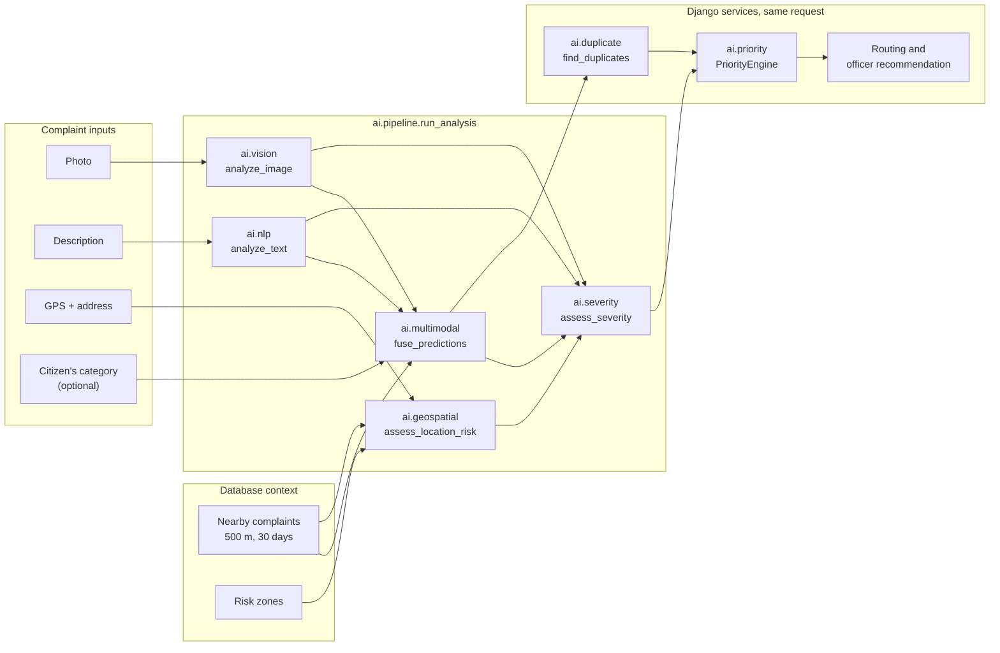

# CivicAI AI engine

This document explains every part of the CivicAI AI engine: what each module does, what goes in and comes out,
which technique it uses in demo mode and in production mode, and the exact formulas, weights and thresholds in the
code. It ends with an honest evaluation on the bundled data and with instructions for training real models.

The engine is the Python package [`backend/ai/`](../backend/ai). It contains no Django imports: the Django service
layer (`backend/apps/complaints/services/`) reads the database, passes plain dictionaries in, and stores the results.
How the engine fits into the whole platform is described in [ARCHITECTURE.md](ARCHITECTURE.md); the HTTP endpoints
are listed in [API_ENDPOINTS.md](API_ENDPOINTS.md).

Every number in this document was read from the code, from the evaluation reports in the repository, or measured
for this document on 18 October 2026 on the development laptop (Windows 11, Python 3.13.3, CPU only). Section 13
lists the commands that reproduce the measurements.

## Contents

1. [Overview](#1-overview)
2. [Modes and honesty rules](#2-modes-and-honesty-rules)
3. [Shared configuration](#3-shared-configuration)
4. [Vision](#4-vision-aivision)
5. [Text analysis (NLP)](#5-text-analysis-ainlp)
6. [Multimodal fusion](#6-multimodal-fusion-aimultimodal)
7. [Severity](#7-severity-aiseverity)
8. [Priority](#8-priority-aipriority)
9. [Duplicate detection](#9-duplicate-detection-aiduplicate)
10. [Geospatial: location risk and hotspots](#10-geospatial-aigeospatial)
11. [Resolution verification](#11-resolution-verification-aiverification)
12. [Pipeline, model information and officer recommendation](#12-pipeline-model-information-and-officer-recommendation)
13. [Evaluation](#13-evaluation)
14. [Configuration from the admin settings](#14-configuration-from-the-admin-settings)
15. [Training and retraining models](#15-training-and-retraining-models)
16. [Limitations](#16-limitations)

## 1. Overview

A complaint arrives with a photo (optional), a description, a GPS position and optionally the category the citizen
picked. The engine turns these into a category, a severity, a priority and a list of possible duplicates. Later in
the lifecycle it verifies the repair from before/after photos, scores the citizen's feedback and finds geographic
hotspots.



`ai.pipeline.run_analysis` runs the first six steps (preprocess, image, text, fusion, location risk, severity) for one
complaint. Priority, duplicate detection, department routing and officer assignment need database facts, so the
Django service layer runs them right afterwards (see the submission sequence in [ARCHITECTURE.md](ARCHITECTURE.md)).
Three engines run later in the lifecycle: `ai.verification` when an officer uploads before/after photos,
`ai.nlp.sentiment` when the citizen gives feedback, and `ai.geospatial.detect_hotspots` for the hotspot map and
alerts.

| Package | Purpose | Entry point | Demo technique | Production technique |
|---|---|---|---|---|
| `ai.vision` | Classify the photo, locate the defect | `analyze_image()` | OpenCV colour, texture and shape heuristics | YOLOv8 detector if installed and trained, else CLIP zero-shot |
| `ai.nlp` | Classify the text, keywords, impact, sentiment, embeddings | `analyze_text()`, `analyze_sentiment()`, `get_text_embedder()` | TF-IDF + logistic regression, lexicons | Sentence-Transformer embeddings + logistic regression, RoBERTa sentiment |
| `ai.multimodal` | One category decision from image + text + priors | `fuse_predictions()` | Confidence-weighted late fusion (same in both modes) | Same |
| `ai.severity` | Low / medium / high / critical severity with a reason | `assess_severity()` | Weighted factor model (same in both modes) | Same |
| `ai.priority` | 0-100 priority with breakdown and explanation | `PriorityEngine.calculate()` | Weighted rules (same in both modes) | Same |
| `ai.duplicate` | Find earlier reports of the same issue | `find_duplicates()` | TF-IDF text similarity, perceptual hashes, colour histograms, distance | MiniLM text similarity, CLIP image similarity added |
| `ai.geospatial` | Location risk and DBSCAN hotspots | `assess_location_risk()`, `detect_hotspots()` | Rules + DBSCAN (same in both modes) | Same |
| `ai.verification` | Was the issue fixed? | `verify_resolution()` | ORB alignment, SSIM, change maps, demo re-detection | Adds CLIP scene check and CLIP re-detection |
| `ai.pipeline` | Orchestrate one complaint | `run_analysis()` | | |
| `ai.model_info` | Model registry for the admin page | `get_model_info()` | | |

Severity, priority, fusion, location risk and hotspots are transparent rule-based or classical algorithms. They are
the same in both modes, so their numbers do not change when trained models are switched on; only their inputs do.

## 2. Modes and honesty rules

### Two modes

`MODEL_MODE` (environment variable, default `demo`) selects the technique. Every module reads it on every call with
`ai.config.get_model_mode()`, so tests can switch it without restarting.

- **Demo mode** needs no trained deep-learning weights. It uses deterministic, explainable techniques (OpenCV,
  scikit-learn TF-IDF, lexicons, perceptual hashing). The whole platform works end to end on a laptop.
- **Production mode** loads trained or pretrained models: YOLOv8 weights (`ultralytics`), Sentence-Transformers
  `all-MiniLM-L6-v2`, the Hugging Face sentiment model and CLIP. They need `requirements-ml.txt` (PyTorch) and a
  one-time download into `backend/ml_models/hf_cache/`; on this machine the cached files take about 580 MB (CLIP),
  90 MB (MiniLM) and 960 MB (RoBERTa sentiment).

The live demo database behind the presentation runs in demo mode: all 160 stored AI predictions have
`is_demo = true` (read from the database on 18 October 2026).

### Honesty rules in the code

1. **Demo results are always labelled.** Every result of a demo technique (vision, text, embeddings, keywords,
   sentiment, verification) carries `is_demo: true`, `mode: "demo"` and a `model_version` that starts with `demo-`
   (for example `demo-opencv-heuristic-1.0`, `demo-tfidf-logreg-1.0`, `demo-lexicon-sentiment-1.0`). Explanations
   start with or contain "Demo AI Mode", and the fusion explanation and the stored `AIPrediction.explanation` end
   with the fixed disclaimer from `ai/config.py`:
   *"Demo AI Mode: results come from transparent heuristic / lightweight models, not from trained deep-learning
   weights."* The web app shows a "Demo AI Mode" badge from `GET /api/system/config/` (`is_demo`, `demo_badge`).
2. **Demo confidences are capped.** The demo vision heuristics never report more than 75 % confidence
   (`DEMO_CONFIDENCE_CAP = 0.75`), because hand-made features are not a trained model.
3. **Filename hints are disclosed.** In demo mode a class keyword in the upload's file name (for example
   `pothole_03.jpg`) may raise the image confidence up to 90 % (`DEMO_HINT_CONFIDENCE_CAP = 0.90`). The explanation
   then says *"A filename hint was used ... (demo technique only)"*, and if the hint changed the decision it also
   states what the pixels alone pointed to. The public landing-page demo (`POST /api/ai/demo/`) and the evaluation
   script switch hints off.
4. **No silent fallback.** If a production model cannot be loaded or crashes during inference, the module uses the
   demo technique for that call, and the result carries `fallback_reason` (for example
   *"YOLO: the 'ultralytics' package is not installed; ..."*). A failed vision model load is not retried for
   600 seconds (`LOAD_RETRY_SECONDS`); a failed NLP backend load is remembered until the process restarts, so a
   missing download does not slow every request down.
5. **Real status, not claims.** `ai.common.registry` records the status of every lazily loaded model
   (`active`, `available`, `fallback`, `not_installed`, `weights_missing`, `error`). The admin "Model information"
   page shows these statuses, not hard-coded text.
6. **Never invent results.** When an AI component is missing the API answers HTTP 503
   `{"detail": "<Engine> unavailable.", "code": "service_unavailable"}`; when the AI step of a submission fails, the
   complaint is still saved, flagged `needs_manual_review` and the administrators are told.
7. **AI-assisted, not guaranteed.** Every verification result ends with *"AI-assisted verification - not a
   guarantee. Officers and admins can override the result."* Admins can also override category, severity and
   priority; the original `AIPrediction` row is kept unchanged so overrides can be counted.

### What is installed on this machine

Measured with `get_model_info()` on 18 October 2026, after one analysis had run in each mode (before first use,
production models show `available` instead of `active`):

| Model | Status in demo mode | Status in production mode |
|---|---|---|
| YOLOv8 civic issue detector | `not_installed` (no `ultralytics`, no weights) | `not_installed` |
| CLIP zero-shot classifier (`clip-ViT-B-32`) | `available` (weights cached) | `active` |
| Demo OpenCV heuristics | `active` | `available` (standby) |
| Text classifier | `active`, `demo-tfidf-logreg-1.0` | `active`, `st-all-MiniLM-L6-v2-logreg-1.0` |
| Text embedder | `active`, `demo-tfidf-embedder-1.0` | `active`, `sentence-transformers/all-MiniLM-L6-v2` |
| Sentiment | `active`, `demo-lexicon-sentiment-1.0` | `active`, `cardiffnlp/twitter-roberta-base-sentiment-latest` |
| Keyword extractor | `active`, `demo-tfidf-keywords-1.0` | `active`, KeyBERT-style ranking with MiniLM |
| Before/after comparison | `active`, `demo-opencv-verification-1.0` | `active`, `opencv-verification-1.0+clip-ViT-B-32` |

So in production mode on this machine the vision module uses CLIP, because YOLO has never been trained here
(section 15 explains how to train it).

## 3. Shared configuration

`backend/ai/config.py` holds the settings every module shares. All of them can be set as environment variables
(also read from `backend/.env`).

| Setting | Default | Meaning |
|---|---|---|
| `MODEL_MODE` | `demo` | `demo` or `production` |
| `MODEL_PATH` | `backend/ml_models` | Root folder for model files and caches |
| `YOLO_WEIGHTS` | `MODEL_PATH/yolo/civicai_yolov8.pt` | Trained YOLOv8 weights |
| `TEXT_EMBEDDING_MODEL` | `sentence-transformers/all-MiniLM-L6-v2` | Sentence embedder (classifier, duplicates, keywords) |
| `SENTIMENT_MODEL` | `cardiffnlp/twitter-roberta-base-sentiment-latest` | Production sentiment model |
| `CLIP_MODEL` | `clip-ViT-B-32` | Shared CLIP image/text encoder |
| `HF_CACHE_DIR` | `MODEL_PATH/hf_cache` | Hugging Face download cache |
| `AI_DEVICE` | `cpu` | Torch device |

The nine canonical classes (`CIVIC_CLASSES`) equal the slugs of the default categories: `pothole`, `garbage`,
`drainage`, `streetlight`, `water_leak`, `open_manhole`, `road_crack`, `fallen_tree`, `other`. Categories an admin
adds later are handled through their database `keywords` and `vision_labels` (sections 4 and 5), so no code
changes are needed.

Severity, priority and location risk use one level mapping, `score_to_level(score, thresholds)`, with inclusive
lower bounds: **0-25 low, 26-50 medium, 51-75 high, 76-100 critical** (`medium 26`, `high 51`, `critical 76`;
configurable, section 14).

Every image-handling module uses one loader, `ai.vision.preprocessing.load_image`. It accepts a file path, bytes, a
file-like object, a Pillow image or a NumPy array, applies the EXIF orientation (a portrait phone photo would
otherwise be analysed lying on its side) and returns an OpenCV BGR array. Images smaller than 16 px per side are
rejected.

## 4. Vision (`ai/vision`)

Files: `config.py` (every constant, with comments), `preprocessing.py`, `heuristics.py`, `model.py`,
`postprocessing.py`, `inference.py`, `dataset.yaml`.

### Contract

`analyze_image(image, *, filename_hint=None, categories=None)` returns (real output for
`sample_data/images/pothole/pothole_02.jpg` in demo mode, shortened):

```json
{
  "category": "pothole", "confidence": 0.75,
  "probabilities": {"pothole": 0.75, "other": 0.0908, "road_crack": 0.0373, "open_manhole": 0.0205, "...": "..."},
  "detected_objects": [{"label": "pothole", "confidence": 0.75, "box": [0.4719, 0.4188, 0.7656, 0.6667],
                        "area_ratio": 0.0728, "detector_label": "pothole", "approximate": false, "contrast": 1.0}],
  "bounding_boxes": [[0.4719, 0.4188, 0.7656, 0.6667]],
  "visual_severity": 0.585,
  "quality": {"width": 640, "height": 480, "blur_score": 260.2, "brightness": 0.386,
              "is_blurry": false, "is_dark": false},
  "model_version": "demo-opencv-heuristic-1.0", "mode": "demo", "is_demo": true, "fallback_reason": null,
  "explanation": "Demo AI Mode (OpenCV colour, texture and shape heuristics - not a trained model): classified as Pothole (75%), ahead of Other (9%). A dark irregular hole covering 5% of the photo with a lighter broken rim on grey road texture.",
  "model_name": "demo", "filename_hint_used": false
}
```

Boxes are normalised `[x1, y1, x2, y2]` in 0..1 with the origin at the top left, so the web app can draw them at
any size. `probabilities` covers all nine classes plus any admin category whose `vision_labels` match the model's
labels.

### Steps

1. **Load** the image (see section 3).
2. **Quality.** Sharpness is the variance of the Laplacian, averaged over the most detailed 25 % of 32 × 32 px
   tiles (so a sharp photo of a plain wall is not called blurry); below `20.0` the photo counts as blurry.
   Brightness is the mean luminance; below `0.25` the photo counts as dark.
3. **Resize** to at most 640 px on the longest side (`ANALYSIS_MAX_SIDE`).
4. **Model**: demo heuristics, or in production YOLOv8, then CLIP, then the demo heuristics with
   `fallback_reason`.
5. **Post-processing**: label-to-category mapping, confidence caps, boxes, visual severity, explanation.

### Demo technique: OpenCV heuristics

`ai/vision/heuristics.py` has one feature function per class. Each one looks for the issue's typical visual
pattern and returns a 0-1 score plus the pixel regions that produced it (these become the boxes in the UI).

Measurements are turned into 0-1 "truth values" with a linear `ramp(x, lo, hi)`. Essential cues are combined as a
soft AND, `t1^w1 × t2^w2 × ...` (a clearly missing essential cue rejects the pattern; a half-present one only lowers
it). Optional cues are bonuses, `base + (1 - base) × t`. All patterns except the streetlight one are multiplied by a
daylight gate `ramp(brightness, 0.15, 0.25)`, because night scenes make sky gradients look like water.

| Class | Pattern the function looks for (main essential cues) |
|---|---|
| `pothole` | Dark blob (value < 0.62 × road brightness, saturation < 0.35) covering 0.6-40 % of the image, with a lighter rim, moderate darkness, solid and not elongated, on grey textured asphalt; bonuses for gravel texture, size and an irregular outline |
| `open_manhole` | Near-black blob that matches a fitted ellipse very closely (IoU 0.86-0.95), with a brighter metal rim; `cv2.HoughCircles` adds support |
| `road_crack` | Thin dark lines found with a morphological black-hat (11 px), kept only if long, thin and wiggly; `HoughLinesP` segments must run in many directions (orientation entropy) |
| `garbage` | Many small saturated blobs (8-25 for full score) in many colour families (effective number of hue families 2.2-3.8 for full score) |
| `fallen_tree` | Green vegetation in the lower two thirds of the photo (a canopy lying on the road) with leafy texture; an elongated brown trunk lying sideways is a bonus |
| `streetlight` | Dark night scene + a tall vertical pole (paired parallel Hough edges reaching the ground) + no lit lamp near its top; a lit lamp reduces the score by up to 80 % |
| `drainage` | Large smooth water-coloured (brown, grey-blue or grey) region on the ground, pool-shaped; ripples are a bonus |
| `water_leak` | A fan of thin bright jets (morphological top-hat, 7 px) spreading in many directions; a pipe next to it is a bonus |
| `other` | No feature: a constant score of `0.30` (`DEMO_OTHER_BASE_SCORE`), so it wins when no defect pattern is convincing |

The class scores become probabilities with a softmax at temperature `0.2` (`DEMO_SOFTMAX_TEMPERATURE`; a score lead
of 0.2 multiplies the odds by e). The top probability is then capped at 0.75 and the excess is shared among the
other classes in proportion to their probabilities. With a filename hint the distribution is blended with a one-hot
vote, `p' = 0.5 × p + 0.5 × onehot(hint)`, and capped at 0.90.

### Production technique 1: YOLOv8

Used when the `ultralytics` package is installed **and** the weights file `YOLO_WEIGHTS` exists. Detection settings:
confidence 0.25, NMS IoU 0.45, input size 640, at most 50 detections. Detector class names are mapped to CivicAI
categories through `LABEL_SYNONYMS` in `ai/vision/config.py` (including public dataset codes: RDD2022 `D00`, `D10`,
`D20` → `road_crack`, `D40` → `pothole`; TACO litter names → `garbage`) and through each category's
`vision_labels`.

Image-level probabilities come from the boxes with a noisy-OR per label, `evidence = 1 - Π(1 - conf_i)` (two 60 %
boxes give 84 %). If the evidence sums to 1 or more it is normalised; otherwise the unexplained mass is split, half to
`other` and half uniformly over all classes, so a photo with no detection is "probably other" with an honest low
confidence.

### Production technique 2: CLIP zero-shot

Used when YOLO is not available. CLIP maps images and sentences into the same 512-dimensional space. Each class is
described by four prompts (`CLIP_PROMPTS`, for example *"a photo of a pothole on a road"*); the class embedding is
the normalised mean of its prompt embeddings ("prompt ensembling"). Admin categories get prompts from three
templates (*"a photo of {}"*, *"a photo of {} in a city street"*, *"a civic complaint photo showing {}"*) filled with
their name and vision labels, plus their description.

The photo is letterboxed to 224 × 224 (so nothing is cropped away), embedded, and compared with every class:
`probabilities = softmax(100 × cosine)`. CLIP does not localise, so the box is an approximate salient region:
spectral-residual saliency (Hou and Zhang, 2007), an Otsu threshold and the largest blob. Such boxes carry
`approximate: true` and the web app draws them dashed.

### Post-processing

- **Label mapping.** A label that maps to several categories shares its probability equally between them; unknown
  labels map to `other`.
- **Boxes.** Clipped to the image, merged by greedy non-maximum suppression (IoU 0.45), at most 6 objects. Boxes of
  other classes are kept when their probability is at least 0.25.
- **Visual severity** (0-1), used by the severity engine:

```text
area      = min(1, sqrt(total box area / 0.30 of the image))
contrast  = area-weighted region contrast of the boxes, where
            region contrast = min(1, |median(inside) - median(ring)| / 80 + 0.5 × |std(inside) - std(ring)| / 40)
count     = 1 - exp(-n / 2)                       n = number of boxes of the predicted class
visual_severity = (0.45 × area + 0.35 × contrast + 0.20 × count) × (0.6 + 0.4 × confidence)
visual_severity = 0.10 when no defect region was found
```

- **Explanation** names the technique, the decision and the runner-up (when it has at least 5 %), the evidence
  sentence of the feature function, whether a filename hint was used, and a warning for dark or blurry photos.

## 5. Text analysis (`ai/nlp`)

Files: `text_preprocessor.py`, `classifier.py`, `embedding.py`, `keyword_extractor.py`, `impact.py`,
`sentiment.py`, `lexicons.py` and `sentiment_lexicon.py` (vocabularies), `corpus.py`, `backends.py` (lazy model
loading), `data/` (corpora and their generator).

### Contract

`analyze_text(text, *, categories=None)`. Real output for the specification's example sentence in demo mode:

```json
{
  "category": "pothole", "confidence": 0.9599,
  "probabilities": {"pothole": 0.9599, "other": 0.0212, "fallen_tree": 0.0041, "...": "..."},
  "keywords": ["pothole", "traffic", "school", "entrance"],
  "impacts": [{"type": "public_safety", "label": "Public Safety", "score": 0.8, "evidence": ["school", "pothole close to school"]},
              {"type": "traffic", "label": "Traffic", "score": 0.8, "evidence": ["traffic"]}],
  "primary_impact": "Public Safety", "safety_score": 0.8, "urgency_score": 0.4,
  "severity_hint": "high", "severity_hint_score": 0.65,
  "location_mentions": ["school entrance"], "language": "en",
  "model_version": "demo-tfidf-logreg-1.0", "mode": "demo", "is_demo": true,
  "explanation": "Demo AI Mode: TF-IDF + logistic regression classified the text as Pothole (96%); keywords: pothole, traffic, school; potential impact: Public Safety."
}
```

The specification asks for "Category: Pothole, Severity: High, Potential Impact: Public Safety, Keywords: pothole,
school, traffic" for this sentence; all four are met. In production mode the same sentence gives pothole at 99 %
(`st-all-MiniLM-L6-v2-logreg-1.0`) with the same impacts and keywords.

### Preprocessing

`preprocess(text)` applies eight small steps:

1. Unicode NFKC normalisation, curly quotes unified, zero-width characters removed, case folding.
2. Noise cleanup: URLs, e-mail addresses, mentions and emoji removed; contractions expanded ("isn't" → "is not",
   so negations survive); digits glued to words split ("2weeks" → "2 weeks").
3. Tokenisation that keeps Devanagari and Telugu words together.
4. Language identification: script detection plus counts of romanised Hindi and Telugu marker words →
   `en`, `hi-en` (Hinglish), `te-en`, `hi`, `te` or `und`.
5. Synonym normalisation, phrases first: gaddha/khadda → pothole, kachra/chetta → garbage, nala → drain,
   bijli/current → electricity, paani/neeru → water, chettu → tree, big → large, outside → near.
6. Spelling correction to a domain word at Damerau-Levenshtein distance 1 (2 for words of 8+ letters) with the same
   first letter ("pothol" → pothole, "garbge" → garbage); known English words are protected.
7. Light lemmatisation (curated table plus plural stripping with exceptions).
8. Stopword removal (English plus romanised Hindi/Telugu), keeping negations and spatial words ("no water",
   "near school").

Example: *"Bhaiya yahan road mein itna bada gadda hai ki auto palat sakta hai"* is detected as `hi-en`, normalised
(bada → large, gadda → pothole) and classified as pothole (97 % demo, 99 % production).

### Text classifier

| | Demo | Production |
|---|---|---|
| Features | TF-IDF word 1-2 grams on the normalised lemmas + TF-IDF character 3-5 grams (`char_wb`, `min_df=2`) on the surface words; sublinear tf, L2 norm | `all-MiniLM-L6-v2` sentence embeddings (384 dimensions, L2-normalised) of the synonym-normalised text (English function words kept) |
| Classifier | `LogisticRegression(C=8.0, class_weight="balanced", max_iter=5000)` | `LogisticRegression(C=10.0, class_weight="balanced", max_iter=5000)` |
| Version string | `demo-tfidf-logreg-1.0` | `st-all-MiniLM-L6-v2-logreg-1.0` |
| Cache file | `ml_models/nlp/text_clf_demo.joblib` | `ml_models/nlp/text_clf_st.joblib` |

Both are trained on `ai/nlp/data/complaint_corpus.csv`. The cache stores a fingerprint of the classifier version,
the mode, the corpus SHA-256, the preprocessing code and vocabularies, the scikit-learn version, `C` and the embedding
model; if any of them changes, the model retrains automatically (under a second in demo mode). In demo mode the
explanation can name the word n-grams that pushed the decision (`evidence_terms`, coefficient × TF-IDF weight). A
result below 0.45 confidence adds "Low confidence: manual review is advisable."

**Keyword blending (both modes).** The active categories' database `keywords` are matched on lemmas (so
"stray dogs" matches "stray dog"; overlapping matches count once, longest first):

```text
k = 1 - exp(-Σ w)                 w = 1.0 per matched word, 1.5 per matched multi-word phrase
trained class:      score = p_model + 0.5 × k
admin-added class:  transfer = p_model(other) × max k ;  score = 0.5 × k + transfer × k / Σk ;  p(other) -= transfer
then all scores are renormalised to sum to 1
```

An admin-added category is treated as a specialisation of `other`, and its name and slug words also count as
keywords. This is why a new category works immediately without retraining. Measured in demo mode: with the nine
default categories plus a new "Stray Dogs" category (keywords "stray dogs", "dog bite", "dogs chasing"), the text
*"A pack of stray dogs near the school gate is chasing children every evening."* is classified as `stray_dogs` at
81 %; without that category the same text is `other` at 95 %.

### Text embeddings

`get_text_embedder()` returns an object with `encode(list)`, `similarity(a, b)` and `batch_similarity(query, texts)`,
all returning cosine similarities clipped to 0..1. It is used by duplicate detection and keyword ranking.

- **Demo:** two TF-IDF spaces fitted on the corpus (word 1-2 grams, at most 6,000 features; character 3-5 grams,
  at most 12,000 features), each L2-normalised and weighted so that `similarity = 0.6 × cos_word + 0.4 × cos_char`.
- **Production:** `all-MiniLM-L6-v2` cosine similarity. An inference error falls back to the demo embedder.

Measured on 18 October 2026:

| Pair | Demo | Production |
|---|---|---|
| "Large pothole near school." vs "Big road pothole outside school." | 0.8575 | 0.9746 |
| "Garbage not collected for a week" vs "Streetlight not working at night" | 0.0862 | 0.1595 |

### Keyword extraction

Candidates are 1-3 word n-grams inside runs of content words (split at stopwords, negations, numbers and generic
words), in normalised form, so "potholes" and "gaddha" both give "pothole".

```text
demo score = (1 + ln tf) × sqrt(idf) × (1 + 3 × domain) × position × length_factor
  idf          = ln((1 + N) / (1 + df)) + 1 over the complaint corpus (a phrase uses the mean of its words)
  domain       = civic dictionary weight 0..1 (1.0 category words, 0.8 hazards and sensitive places)
  position     = 1 + 0.25 × (1 - first_position / length)
  length_factor = 1.15 for known domain phrases ("open manhole", "live wire"), 1.1 for other phrases, 1 for words
production: relevance = 0.75 × cos(candidate, document) + 0.25 × domain
            MMR = 0.7 × relevance - 0.3 × max cos(candidate, already selected)
```

A candidate that contains, or is contained in, an already selected keyword is skipped. Up to 6 keywords are
returned. Example (demo): *"Open manhole near the bus stop, live wire hanging, children walk here daily."* → live
wire, open manhole, bus stop, child, hang, walk.

### Impact, urgency and the severity hint

`assess_impact()` (`impact.py`) is rule-based in both modes. It checks seven impact types: public safety, traffic,
health, environment, property, service disruption and accessibility. Each matched term has a weight; a type's
score is the noisy-OR `1 - Π(1 - w_i)`. A term preceded by a negator within three words of the same clause counts
30 % ("no accident yet" still signals risk).

```text
vulnerable people (school, hospital, children, elderly ...) mentioned:
    hazard categories (pothole, open manhole, road crack, fallen tree, streetlight): safety = noisy-OR(safety, 0.5)
    sanitation categories (garbage, drainage, water leak):                         health = noisy-OR(health, 0.35)
urgency  = noisy-OR(urgency words, escalation words, 0.75 × (1 - exp(-days / 21)), 0.5 × safety)
severity_hint = 0.50 × base_severity + 0.30 × harm + 0.08 × breadth + 0.06 × urgency
              + 0.06 × magnitude - 0.10 × minor
  harm / breadth = largest / second-largest impact score × importance
                   (safety 1.00, health 0.95, service 0.90, traffic 0.85, accessibility 0.85, property 0.80,
                    environment 0.75)
  critical hazards (live wire, electrocution, open manhole, fire, collapse, drowning, death):
                   hint >= 0.55, or >= 0.78 when vulnerable people are mentioned
```

`base_severity` is the category's `base_severity / 100` (section 7). Durations are parsed from phrases such as
"for 2 weeks" or "since yesterday".

### Sentiment of citizen feedback

`analyze_sentiment(text, rating=None)` returns `label` (positive / neutral / negative), `score` (-1..1),
`confidence`, `method` (`lexicon`, `transformer` or `rating_only`), `model_version`, `explanation`, `evidence` and
`rating_agreement`. The feedback service stores it on the `Feedback` row (`sentiment`, `sentiment_score`,
`sentiment_confidence`, `sentiment_model`, `is_demo`).

**Demo: a VADER-style lexicon** written for civic feedback (`sentiment_lexicon.py`):

| Rule | Value |
|---|---|
| Civic phrases, matched first | "resolved quickly" +2.8, "still not fixed" -2.8, "no action" -2.5, "waste of time" -2.8 |
| Words (English, Hinglish, romanised Telugu) | "good" 1.9, "excellent" 3.2, "bad" -2.5, "bekar" -2.4, "baagundi" 2.0 ... completion words such as "fixed" only +0.6 |
| Boosters / dampeners in the 3 preceding words | ±0.293, decaying ×1, ×0.95, ×0.9 with distance |
| ALL-CAPS word in mixed-case text | ±0.733 |
| Negation within 3 words in the same clause | valence × -0.74 ("not a waste of time" turns positive) |
| Negated service verb ("nobody responded") | -1.6 |
| "still" + problem state ("still leaking") | -1.8 |
| Contrast ("but", "however", "lekin", "kaani") | words before × 0.5, after × 1.5; concessive clauses × 0.5 |
| Exclamation marks | +0.292 each in the direction of the sum, at most 4 |
| Normalisation | `compound = s / sqrt(s² + 15)`; neutral when the compound score lies between -0.2 and +0.2 |

**Production:** `cardiffnlp/twitter-roberta-base-sentiment-latest` through a Hugging Face pipeline;
`score = p(positive) - p(negative)`, label = most probable class. Hinglish and Telugu sentiment words are translated
to English first (`TRANSLATIONS`), because the model was trained on English.

**Star rating rules (both modes):**

| Situation | Result |
|---|---|
| No text | Rating only: 1-2 negative, 3 neutral, 4-5 positive; `score = (rating - 3) / 2` |
| Neutral text + non-neutral rating | Label from `0.6 × text + 0.4 × rating`, confidence 0.5 |
| Text and rating agree | `score = 0.8 × text + 0.2 × rating`, confidence + 0.08 (at most 0.97) |
| Rating neutral, text not | Text label kept, confidence × 0.9 |
| Text and rating conflict | Text label kept (people mis-tap stars more often than they mis-write sentences), score × 0.75, confidence × 0.6 (at least 0.3) |

Examples measured on 18 October 2026:

| Feedback | Demo | Production |
|---|---|---|
| "The issue was resolved quickly." | positive, +0.59 | positive, +0.41 |
| "Road was repaired properly and quickly." | positive, +0.61 | positive, +0.81 |
| "Still not fixed, waste of time." | negative, -0.82 | negative, -0.90 |
| "The streetlight was repaired on Tuesday." | neutral, +0.15 | neutral, +0.34 |
| "Not a waste of time at all, good work." | positive, +0.76 | positive, +0.92 |
| No text, 2 stars | negative, -0.50 (rating only) | negative, -0.50 (rating only) |

If the sentiment module itself is unavailable, the feedback service labels the feedback from the stars alone and
stores `sentiment_model = "rating-fallback"`, so it is never presented as AI output.

## 6. Multimodal fusion (`ai/multimodal`)

`fuse_predictions(image_result, text_result, *, reported_category, location_prior, categories, config,
location_prior_count)` makes one category decision from the image, the text and two weak priors. It is a
confidence-weighted **late fusion** (a linear opinion pool): each modality produces its own probability distribution
first, and fusion combines the decisions, so the vision and NLP models stay independent and replaceable.

```text
P(c) = w_img × P_img(c) + w_txt × P_txt(c) + w_rep × [c = citizen's category] + w_loc × P_loc(c)

w_rep = 0.12 when the citizen picked a category, else 0
w_loc = 0.08 × (1 - exp(-n / 3))       n = categorised nearby complaints; P_loc = their category mix
mass  = 1 - w_rep - w_loc
a = 0.55 × conf_img × reliability_img      b = 0.45 × conf_txt × reliability_txt
w_img = mass × clamp(a / (a + b), 0.2, 0.8)       w_txt = mass - w_img
(only one modality present: it gets the whole mass)

reliability_img: × 0.6 blurry photo, × 0.7 dark photo (not for streetlight), × 0.5 demo heuristic (22.4 % on
                 real street photos, section 13) and a further × 0.6 when the demo heuristic is below 50 %
reliability (either): × share of its probability on active categories when its top class is not active

agreement bonus when image and text pick the same top class:
    p' = p + (1 - p) × 0.35 × min(conf_img × rel_img, conf_txt × rel_txt); other classes rescaled to sum to 1
```

The clamp to 0.2-0.8 is the "trust floor": when both modalities are present, neither gets less than 20 % of the
modality mass, so the system never blindly trusts one modality. The priors can tip a near-tie but cannot overrule
confident evidence (the configuration validator rejects `reported + location >= 0.5`).

`needs_review` is set, with the reasons listed in `review_reasons`, when:

- image and text are both confident (> 0.6) but disagree,
- the top two categories are less than 0.10 apart,
- the fused confidence is below `min_confidence` (default 0.30), or
- there was no image or text evidence at all.

`agreement` is `agree`, `disagree`, `single_modality` or `none`. When `categories` is given, the decision is
restricted to the active category slugs (admin categories included), so it always maps onto a real `CivicCategory`.

Output keys: `category`, `confidence`, `probabilities` (sorted, most likely first), `image_category`,
`image_confidence`, `text_category`, `text_confidence` (an absent modality reports `""` and `0.0`), `weights`
(`image`, `text`, `reported`, `location`), `agreement`, `needs_review`, `review_reasons`, `margin` (gap between the
top two), `explanation`, `method` and `version` (`late-fusion-linear-pool-1.0`).

**Worked example** (demo mode, photo `pothole_02.jpg` + the specification sentence, no citizen category, no nearby
complaints): image pothole 0.75, text pothole 0.9599.
`a = 0.55 × 0.75 = 0.4125`, `b = 0.45 × 0.9599 = 0.4320`, so `w_img = 0.488`, `w_txt = 0.512`. The pooled pothole
probability is `0.488 × 0.75 + 0.512 × 0.9599 = 0.857`; the agreement bonus adds `(1 - 0.857) × 0.35 × 0.75`, giving
**0.8948**. The explanation reads *"Image model detected pothole (75%) and the text classifier agreed (96%); fused
confidence 89%."* followed by the demo disclaimer.

## 7. Severity (`ai/severity`)

`assess_severity(*, category, category_profile, vision, text, location_risk, nearby_count, frequency_count,
duplicate_count, config)` returns `{"severity", "score" 0-100, "reason", "factors", "floor_applied",
"thresholds"}`. Each factor reports its `value`, effective `weight`, `contribution` in points, `label`, `available`
and a `detail` sentence, so the score can be audited line by line.

### Formula and default weights

```text
score = round(100 × Σ w_i × v_i)       v_i in 0..1, Σ w_i = 1 after redistribution
```

| Factor | Default weight | Value |
|---|---|---|
| Visual severity | 0.25 | `vision.visual_severity` (section 4) |
| Issue type | 0.20 | category `base_severity / 100` |
| Public safety | 0.20 | `0.55 × category public_safety_weight + 0.45 × text safety_score` (category alone without text) |
| Location risk | 0.10 | `location_risk.score` (section 10) |
| Potential impact | 0.10 | `0.60 × impact strength + 0.25 × severity_hint_score + 0.15 × urgency_score`; impact strength = `min(1, strongest impact + 0.1 × Σ other impact scores)` |
| Nearby complaints | 0.08 | `1 - exp(-nearby / 6)` (any category; 6 nearby → 0.63) |
| Complaint frequency | 0.07 | `1 - exp(-(same_category + 0.5 × duplicates) / 4)` (4 → 0.63) |

**Missing evidence is redistributed.** Without a photo, without a description or without a location assessment, that
factor's weight is shared proportionally by the others: a missing photo must not make an issue look less severe. A
blurry photo keeps 60 % of its visual weight and a dark one 70 % (darkness is expected for streetlight faults and
not penalised there).

**Hazard floor.** Categories with a public-safety weight of at least 0.9 (by default only `open_manhole`, 0.95) are
never rated below the high threshold. For example, an open manhole reported without a photo and with no risk factors
gets 51 / high with the reason *"Open manhole reported, posing a public-safety risk. Rated at least High because this
issue type is a serious public-safety hazard."*

**Reason sentence.** Built from the strongest factors, for example *"Pothole detected near Hyderabad Public School,
Begumpet, posing a serious public-safety risk and with traffic impact reported."* The adjective follows the final
level: "Severe ... detected" only for high or critical, "Minor ..." only for low.

Default category profiles (the same values `init_civicai` stores in the database, where admins can edit them):

| Category | Base severity | Public safety weight | Department | SLA |
|---|---|---|---|---|
| pothole | 60 | 0.75 | ROADS | 72 h (department) |
| garbage | 40 | 0.45 | WASTE | 48 h |
| drainage | 55 | 0.60 | DRAIN | 48 h |
| streetlight | 45 | 0.60 | ELEC | 48 h |
| water_leak | 50 | 0.40 | WATER | 24 h |
| open_manhole | 85 | 0.95 | ROADS, secondary DRAIN | 12 h (category) |
| road_crack | 40 | 0.50 | ROADS | 72 h |
| fallen_tree | 65 | 0.80 | PARKS | 24 h (category) |
| other | 30 | 0.30 | GEN | 96 h |

**Worked example** (continuing section 6; the point is 91 m from the mapped school zone "Hyderabad Public School,
Begumpet", address "Begumpet Main Road", no nearby complaints):

| Factor | Value | Weight | Points |
|---|---|---|---|
| Visual severity | 0.585 | 0.25 | 14.6 |
| Issue type | 0.60 | 0.20 | 12.0 |
| Public safety | 0.772 (0.55 × 0.75 + 0.45 × 0.8) | 0.20 | 15.4 |
| Location risk | 0.799 | 0.10 | 8.0 |
| Potential impact | 0.75 (0.6 × 0.88 + 0.25 × 0.65 + 0.15 × 0.4) | 0.10 | 7.5 |
| Nearby complaints | 0 | 0.08 | 0 |
| Complaint frequency | 0 | 0.07 | 0 |
| **Severity** | | | **58 → high** |

In the submission pipeline the severity is computed with `duplicate_count = 0`; duplicates found afterwards raise the
priority (section 8), not the severity.

## 8. Priority (`ai/priority`)

Files: `priority_engine.py` (`PriorityEngine`, `calculate_priority`, the explanation generator),
`priority_rules.py` (one pure function per component), `priority_config.py` (weights, thresholds, constants).
The calculation is never done inside a Django view; `apps/complaints/services/priority.py` gathers the facts and
stores every result as a new `PriorityScore` row.

### Formula and default weights

Each weight is the maximum number of points its component can give, so the weights add up to 100. Admins can change
them on the settings page, which requires the five weights to sum to 100; the engine itself (`PriorityConfig`) also
accepts any non-negative set and rescales it to 100 with the ratios kept, which the priority simulator uses.

| Component | Weight | Factor (0..1) |
|---|---|---|
| Severity | 40 | `severity_score / 100` |
| Public impact | 25 | `0.7 × max(a, b) + 0.3 × mean(a, b)`; `a` = text impact = `max(text safety_score, impact strength)`, `b` = category `public_safety_weight` (one value alone if the other is missing) |
| Location risk | 15 | location risk score |
| Frequency | 10 | `1 - exp(-0.4 × n)`, n = same-category complaints within 500 m in the last 30 days |
| Duplicates | 10 | `1 - exp(-0.4 × n)`, n = linked duplicate reports |

```text
component_i = round(weight_i × factor_i, 1)
final_score = round_half_up(Σ component_i + reopen_bump), clamped to 0..100
reopen_bump = 5 points per reopen, counted at most twice (+10)
level       = 0-25 low, 26-50 medium, 51-75 high, 76-100 critical
```

The saturation `1 - exp(-0.4 n)` gives 1 report → 0.33, 2 → 0.55, 3 → 0.70, 4 → 0.80, 6 → 0.91: the first reports
matter most and a tenth adds almost nothing. Because the final score is the rounded sum of the displayed components,
the breakdown always adds up.

**Contract.** `PriorityEngine(config).calculate(inputs)` takes `severity_score` (0-100), `public_impact` (0-1, may be
missing), `category_safety_weight`, `location_risk` (score or the full location-risk result), `nearby_count`,
`frequency_count`, `duplicate_count`, `is_reopened`, `reopen_count` and `category`. It returns `final_score`,
`priority_level`, `components` (one entry per component: `score`, `max`, `raw` factor, `label`, `reason`),
`weights`, `factors`, `adjustments` (the reopen bump), `explanation`, `summary` ("Priority Score: 87/100"),
`breakdown` (["Severity 35/40", ...]), `thresholds` and `version` (`priority-weighted-rules-1.0`). The service layer
stores the five component scores, the final score, the level, the weights, the factors, the explanation and the
trigger in a `PriorityScore` row.

### Explanation generator

`build_explanation()` writes one sentence:

- Components whose factor is at least 0.5 are the reasons for the level, largest contribution first, at most three.
- For low and medium priority, heavy components with a factor below 0.3 are added as the reasons the priority is not
  higher ("..., but limited public impact and a low-risk location.").
- When no component is strong, the two largest contributors are named with "only".
- A reopened complaint adds "It was reopened once by the citizen (+5 points)."

Phrases come from the rules: severity by level ("critical severity", "high severity", "moderate severity", "low
severity"); public impact and location by factor (≥ 0.6 "significant public impact" / "a high-risk location", ≥ 0.3
"moderate ..." / "a moderately risky location", else "limited ..." / "a low-risk location"); frequency and
duplicates by count ("multiple nearby complaints", "a similar complaint nearby", "several duplicate reports" ...).

### The specification's example (87/100)

The specification shows *"Priority Score: 87/100 - Severity: 35/40, Public Impact: 25/25, Location Risk: 12/15,
Frequency: 8/10, Duplicates: 7/10 - High priority because the issue has high severity, significant public impact
and multiple nearby complaints."* The inputs `severity_score 87.5, public_impact 1.0, category_safety_weight 1.0,
location_risk 0.8, frequency_count 4, duplicate_count 3` reproduce the breakdown exactly (unit test
`ai/tests/test_priority.py::SpecExampleTests`):

```text
Severity 35/40, Public Impact 25/25, Location Risk 12/15, Frequency 8/10, Duplicates 7/10 -> Priority Score: 87/100
level: critical
explanation: "Critical priority because the issue has critical severity, significant public impact and a high-risk location."
```

The level differs from the specification's sentence on purpose: the specification's own level table puts 76-100 in
"critical", and the engine follows the table. The sentence names location rather than frequency because location
(12 points) contributes more than frequency (8 points). The specification's wording appears verbatim when the
priority really is high, for example `severity_score 70, public_impact 0.7, category_safety_weight 0.75,
location_risk 0.2, frequency_count 3`:

```text
Severity 28/40, Public Impact 18.6/25, Location Risk 3/15, Frequency 7/10, Duplicates 0/10 -> 57/100, high
"High priority because the issue has high severity, significant public impact and multiple nearby complaints."
```

The worked example of sections 6 and 7 (severity 58, text impact 0.88, category safety 0.75, location risk 0.799)
gives `Severity 23.2/40, Public Impact 21.5/25, Location Risk 12/15, Frequency 0/10, Duplicates 0/10 → 57/100,
high`, *"High priority because the issue has high severity, significant public impact and a high-risk location."*

### How the platform uses the score

- **Triggers.** A new `PriorityScore` row is written at the first analysis (`initial`), when duplicates are linked
  (`duplicate_update`, also for the original complaint), on reopen (`reopened`), re-analysis (`reanalysis`), admin
  corrections (`ai_override`) and configuration changes with recalculation (`config_change`). The history is never
  overwritten.
- **Manual overrides are sticky.** Once an admin sets a priority by hand, automatic recalculations keep it.
- **SLA due date.** After every calculation `Complaint.compute_sla_due()` sets the due date from the category SLA
  (else the department SLA): halved for critical priority (at least 4 h) and cut to 75 % for high (at least 8 h).
- **What-if simulation.** `POST /api/ai/priority/` with inputs instead of a complaint id runs the engine without
  storing anything, optionally with other weights (the admin "Priority simulator" tab).

## 9. Duplicate detection (`ai/duplicate`)

Files: `text_similarity.py`, `image_similarity.py`, `location_similarity.py`, `duplicate_engine.py`.

### Candidates

The Django side (`apps/complaints/services/duplicates.py`) selects earlier complaints within the duplicate radius
(default 300 m) and window (default 30 days), excluding rejected complaints and complaints already merged into
another one. The search is a bounding-box query on the indexed latitude/longitude columns followed by an exact
haversine check (no GIS extension needed).

### Signals

**Text:** embedding cosine similarity of the two descriptions (section 5), computed for all candidates in one batch.

**Image:**

```text
pHash, dHash, aHash: 64-bit perceptual hashes (imagehash), similarity = 1 - hamming_distance / 64
hash  = 0.5 × pHash + 0.3 × dHash + 0.2 × aHash      (over the kinds both images have)
histogram = Pearson correlation of 30 × 32 hue-saturation histograms, clipped to 0..1 (brightness ignored)
CLIP  = (cosine - 0.5) / 0.5, clipped to 0..1         (production only; unrelated photos have cosine ≈ 0.5)
demo:       image = 0.6 × hash + 0.4 × histogram
production: image = 0.5 × CLIP + 0.3 × hash + 0.2 × histogram    (renormalised over the parts available)
```

When a stored photo file is missing, the hashes saved on `ComplaintImage` (`phash`, `dhash`) are used instead.

**Location:** a truncated Gaussian kernel of the haversine distance `d` with radius `r`:

```text
σ = r / 2,  cutoff c = 1.5 × r,  g(x) = exp(-x² / (2σ²))
s(d) = (g(d) - g(c)) / (1 - g(c))  for d < c,   0 otherwise
```

It is exactly 1.0 at 0 m and decays smoothly with no step at the radius (GPS fixes are noisy). Measured values for
the default 300 m radius:

| Distance | 0 m | 42 m | 100 m | 150 m | 200 m | 300 m | 400 m | 450 m |
|---|---|---|---|---|---|---|---|---|
| Similarity | 1.0 | 0.9611 | 0.7985 | 0.6021 | 0.4045 | 0.1256 | 0.0177 | 0 |

### Overall score and decision

```text
overall = 0.4 × text + 0.3 × image + 0.3 × location
          (either complaint without a photo: image dropped, weights renormalised to 0.571 / 0.429)
overall × 0.85 when the categories differ, unless text similarity > 0.8
reported when overall >= 0.45;   is_duplicate = overall >= 0.72 and distance <= 300 m
```

A candidate is skipped without the (expensive) image comparison when even a perfect image match could not lift it
above 0.45. Results are sorted by overall similarity.

**Contract.** `find_duplicates(target, candidates, *, config)` takes plain dicts (`id`, `text`, `latitude`,
`longitude`, `category`, `phash`, `dhash`, optional `image_path` or raw `image`) and returns one entry per reported
candidate: `complaint_id`, `text_similarity`, `image_similarity` (null without photos), `location_similarity`,
`distance_m`, `category_match`, `overall_similarity`, `is_duplicate`, `explanation` (for example "Text 86% similar,
no image comparison, 40 m apart, same category"), `weights` (the weights actually used),
`category_penalty_applied` and `image_method`.

**The specification's example** ("Large pothole near school." vs "Big road pothole outside school." 40 m apart, no
photos, same category), measured on 18 October 2026:

| | Text | Location | Overall | Duplicate? |
|---|---|---|---|---|
| Demo | 0.8575 | 0.9648 | **0.9035** | yes |
| Production | 0.9746 | 0.9648 | **0.9704** | yes |

The specification expected "Similarity 89 %"; the demo engine gives 90 %.

### Review, never deletion

Every detected pair is stored as a `DuplicateComplaint` with status `pending_review`, both complaints get a
"Potential duplicate detected" timeline event, the citizen is told, and `duplicate_count` (recounted from the rows,
never incremented blindly) raises the original's priority. An officer of the department or an admin then decides:

- **Confirmed duplicate:** the newer complaint points to the original (`duplicate_of`), its work order is cancelled
  and it is closed with "Merged into <number>". A report cannot be merged into an original that is already resolved,
  verified or closed; that is a recurrence and stays open.
- **Not a duplicate:** both complaints stay open; the counts are refreshed.

Nothing is ever deleted, and a reviewed pair is never reopened by a later scan.

## 10. Geospatial (`ai/geospatial`)

### Distance

All distances use the haversine formula with R = 6,371,000 m:
`d = 2R × asin(sqrt(sin²(Δφ/2) + cos φ1 × cos φ2 × sin²(Δλ/2)))`. At city scale the error against the WGS84 ellipsoid
is far smaller than a phone's GPS error.

### Location risk

`assess_location_risk(latitude, longitude, *, address, text, risk_zones, nearby_count)` returns `{"score" 0-1,
"level", "zones", "factors", "is_high_traffic", "explanation", "components", "nearby_count"}`. Three independent
sources are combined with a probabilistic OR, `1 - Π(1 - s_i)`:

```text
zones    = noisy-OR over mapped risk zones of  risk_level / 5 × proximity
           proximity = 1.0 at the centre, 0.7 at the zone edge, falling linearly to 0 at edge + 100 m
keywords = min(0.6, noisy-OR of the cue weights found in the address or description)
           (a cue whose place type is already mapped nearby is not counted twice)
density  = 0.25 × (1 - exp(-nearby / 6))
score    = 1 - (1 - zones)(1 - keywords)(1 - density);   level = score_to_level(100 × score)
```

| Text cue | Weight | Cue | Weight |
|---|---|---|---|
| highway / NH / expressway | 0.40 | bus stop / stand / depot | 0.25 |
| ring road | 0.35 | metro | 0.25 |
| main road | 0.30 | railway | 0.30 |
| junction / cross roads / circle | 0.30 | market / bazaar / mandi | 0.30 |
| traffic signal | 0.25 | school / college | 0.40 |
| flyover | 0.30 | hospital / clinic | 0.45 |

`init_civicai` installs 12 risk zones in Hyderabad (hospitals, markets, railway and metro stations, junctions,
schools), each with a radius and a risk level from 1 to 5; admins manage them on the Settings page.

**Example** (measured): a point 91 m from "Hyderabad Public School, Begumpet" (risk level 4, radius 250 m), address
"Begumpet Main Road", 4 complaints nearby: proximity 0.891 gives a zone score of 0.713, "main road" adds 0.30 and the
density 0.122, so the score is 0.823 (critical), with the factors "Within 91 m of Hyderabad Public School, Begumpet
(school)", "Address mentions a main road" and "4 other complaints reported nearby".

### DBSCAN hotspots

`detect_hotspots(points, *, eps_m=400, min_samples=3, thresholds=None)` clusters complaint coordinates with
scikit-learn's DBSCAN:

```python
DBSCAN(eps=eps_m / 6371000, min_samples=min_samples, metric="haversine", algorithm="ball_tree")
    .fit_predict(numpy.radians([[lat, lng], ...]))
```

A point is a core point when at least `min_samples` points (itself included) lie within `eps`; clusters grow by
chaining core points; everything else is noise. Unlike k-means, DBSCAN needs no number of clusters, finds
long, thin clusters (a damaged stretch of road) and leaves isolated complaints out. For every cluster the engine
reports the spherical centroid, count, radius (largest distance from the centroid, at least 50 m), dominant category
and breakdown, average and maximum severity, severity level, average priority, open complaints, most common area
name, bounds and density per km². Clusters are numbered largest first.

The result is `{"clusters": [...], "noise_ids", "labels" (complaint id → cluster id or -1), "params" (eps_m,
min_samples), "algorithm": "DBSCAN (haversine)", "total_points", "skipped_points"}`; each cluster carries
`cluster_id`, `latitude`, `longitude`, `count`, `radius_m`, `dominant_category`, `dominant_category_name`,
`category_breakdown`, `avg_severity_score`, `max_severity`, `severity_level`, `avg_priority_score`, `open_count`,
`area_name`, `complaint_ids`, `bounds` and `density_per_km2`.

Where it runs (`apps/analytics/services.py`):

| Use | Data | Parameters |
|---|---|---|
| `GET /api/analytics/hotspots/` (admin hotspot map) | Complaints of the last 90 days (or the date filters) | `hotspot_eps_m` 400, `hotspot_min_samples` 3 (overridable per request) |
| After every new complaint (`check_hotspot_alert`) | Open complaints of the last 30 days within 2 km | Alert when the complaint's cluster has at least `hotspot_alert_threshold` (5) complaints |
| City-wide scan (`scan_hotspots`, every 6 hours, or "Run checks now") | Open complaints of the last 30 days | Same threshold |

An alert is not repeated within 24 hours for the same cluster (same rounded centroid and category, or the same
dominant category within `eps` of an earlier alert). On the seeded demo database (read on 18 October 2026) the
hotspot map finds **8 clusters** among 96 complaints of the last 90 days, with 23 noise points; the largest has 22
complaints around Ameerpet. The database holds 4 hotspot alerts, 1 of them unacknowledged.

## 11. Resolution verification (`ai/verification`)

Files: `preprocessing.py` (size and alignment), `metrics.py` (SSIM and change maps), `verifier.py` (score, status,
explanation).

`verify_resolution(before_image, after_image, *, category=None, boxes=None, config=None)` returns `score` (0-100),
`status` (`likely_resolved`, `partially_resolved`, `not_resolved`, `needs_manual_review`), `status_label`,
`explanation`, flat `metrics`, `model_version`, `mode`, `is_demo`, `disclaimer`, `processing_time_ms`,
`fallback_reason` and `details` (the compared region, the quality of both photos, the alignment method).

In the platform the before photo is the officer's before photo, else an earlier one, else the citizen's original
photo; the boxes are the defect boxes stored in the complaint's `AIPrediction`; the category is the complaint's
category; the thresholds come from the AI configuration.

### Three kinds of evidence

**1. Same place?** Both photos are resized to at most 512 px. ORB finds up to 1,500 keypoints in each
(contrast-equalised with CLAHE so daylight changes matter less). Matches are kept with Lowe's ratio test (0.75), and a
RANSAC homography (reprojection error < 5 px) aligns the after photo onto the before photo. Alignment needs at least
10 good matches, 8 inliers, a plausible transform and at least 30 % overlap.

```text
scene_consistency = inlier_ratio × min(1, inliers / 30)
too plain for ORB (< 60 keypoints): scene = min(0.6, 0.5 × SSIM + 0.5 × histogram similarity)
production: CLIP cosine of both photos; veto = ramp(cosine, 0.60, 0.80); scene = min(scene, veto)
            (plain photos: scene = min(0.6, 0.8 × ramp(cosine, 0.75, 0.95)))
```

**2. Did the damaged area change?** The after photo is first mapped into the before photo's colour and brightness
scale (a robust per-channel gain and offset from inter-quartile ranges, gains limited to 0.67-1.5, estimated on the
pixels that agree best), so a different time of day is not counted as change. Then:

```text
SSIM(x, y) = ((2 μx μy + C1)(2 σxy + C2)) / ((μx² + μy² + C1)(σx² + σy² + C2)),  C1 = (0.01 × 255)², C2 = (0.03 × 255)²
change per pixel = max( (1 - SSIM) / 0.8   on photos blurred with σ 2.5 (SSIM window σ 2),
                        |grey difference| / 60,
                        Lab chroma difference / 40 )
region_change = (P90 of change inside the defect boxes - median change outside) / (1 - median change outside)
```

The defect boxes are widened by 10 % on each side; without boxes the most-changed region is used. Re-photographing
an unchanged scene changes every pixel a little, so only change that stands out in the defect area counts.

**3. Is the issue still visible?** The vision module analyses both photos. Re-detection is only used when the
category is a vision class other than `other` and the model saw the issue in the before photo with at least 0.30
probability.

```text
ratio = after_probability / max(before_probability, 0.30)
still_detected = (after top class is the issue and after_probability >= 0.35)
                 or (ratio >= 0.6 and after_probability >= 0.45)
```

### Score and status

```text
change = ramp(region_change, 0.05, 0.50)
raw    = 100 × change × (0.35 + 0.65 × (1 - ramp(ratio, 0, 0.90)))     re-detection applicable
raw    = 100 × change × 0.85                                            otherwise
score  = raw × min(1, scene_consistency / 0.5) ^ 0.5 × (0.8 if image quality is poor)
```

The status rules are applied in this order:

1. Poor quality (mean brightness < 0.08 or sharpness < 10 in either photo) or `scene_consistency < 0.25` →
   **needs manual review**.
2. Issue still detected → **not resolved**, and the score is capped at `partial_threshold - 1` (44).
3. `score >= resolved_threshold` (default 70) → **likely resolved**.
4. `score >= partial_threshold` (default 45) → **partially resolved**.
5. Otherwise → **not resolved**.

The score is rounded to a whole number first and the status is decided on that rounded score, so the status always
matches the score the page shows: a borderline result such as 69.6 is stored and shown as 70 and counts as likely
resolved.

Real output for the repaired `pothole_02` scene in demo mode: score **93**, likely resolved, *"The after-image shows
substantial visual change in the previously detected damaged area (region change 93%). The pothole is no longer
detected in the after-image (pothole confidence 8%, down from 75% before). Both photos appear to show the same place
(scene consistency 97%, 341 matching features after alignment). Demo AI Mode: ..."* The unchanged re-shot of the same
scene scores 0 (not resolved, the pothole is still detected), and a photo of a different scene scores 0 (needs manual
review, scene consistency 0 %).

### What the platform does with the result

When an officer resolves a complaint with an after photo and `auto_verify_resolution` is on, verification runs at
once:

| AI status | Consequence |
|---|---|
| Likely resolved | Complaint → verified (by the system); the citizen is told and asked for feedback; +15 civic points |
| Partially / not resolved | Flagged for manual review; the assigned officer and the admins are told |
| Needs manual review | Flagged for manual review; the admins are told |

A person can record a manual decision (`method = "manual"`), which is stored next to the AI row: the assigned officer
while the complaint is resolved or after an AI-assisted verification moved it to verified, and an admin while it is
resolved or verified. A manual "partially resolved" or "not resolved" sends the work back to in progress.

## 12. Pipeline, model information and officer recommendation

### `ai.pipeline.run_analysis`

```python
run_analysis(*, text, latitude, longitude, image=None, filename=None, address="",
             reported_category=None, categories=None, risk_zones=None, nearby=None, config=None)
```

| Step key | Label | Behaviour |
|---|---|---|
| `preprocess` | Data preprocessing | Normalise the text, decode the photo once, summarise nearby complaints into a category prior |
| `image_analysis` | Image AI analysis | `analyze_image`; `skipped` without a photo; a failure is reported as `failed` and the analysis continues with the text |
| `text_analysis` | Text NLP analysis | `analyze_text`; `skipped` for an empty description |
| `multimodal_fusion` | Multimodal classification | `fuse_predictions` with the citizen's category and the nearby-category prior |
| `location_risk` | Location risk assessment | `assess_location_risk`; `skipped` without coordinates (severity then redistributes its weight) |
| `severity` | Severity assessment | `assess_severity` |

Each step is reported as `{key, label, status: done|skipped|failed, duration_ms, detail}`. If neither the photo nor
the text could be analysed, or fusion or severity fails, an `AnalysisError` carrying the steps is raised and the
Django layer flags the complaint for manual review. The result adds `nearby_count` (all nearby complaints),
`frequency_count` (nearby complaints of the fused category), `public_impact` (the text impact used by the priority
engine), `fallback_reasons`, `model_versions` and `is_demo` (true in demo mode or when any modality fell back to a
demo technique).

The service layer stores every analysis as a new `AIPrediction` row (earlier rows are kept): image, text and final
category with their confidences, severity with its score, reason and factors, detected objects and boxes, keywords,
impacts, the three probability distributions, the modality weights, the location risk, the explanation,
`needs_review`, `model_mode`, `is_demo`, `model_version` (for example
`vision=demo-opencv-heuristic-1.0; text=demo-tfidf-logreg-1.0`), the processing time and a compact copy of the raw
engine output.

The Django service turns these six engine steps into the 14 steps the citizen sees after pressing "Analyze &
Submit" (validate, upload, save, the five AI steps with location risk folded into severity, priority, duplicate
detection, department routing, officer assignment, database save, notifications); see
[ARCHITECTURE.md](ARCHITECTURE.md). The same engine also powers three no-database entry points: the analysis
preview `POST /api/ai/analyze/`, the classification check `POST /api/ai/classify/` (the submit form's live category
suggestion) and the public landing-page demo `POST /api/ai/demo/` (no file-name hints, no location context).

### `ai.model_info.get_model_info`

Returns `{"mode", "is_demo", "badge", "models", "components", "registry", "disclaimer"}`:

- `models`: `describe_models()` of vision, NLP and verification (a failing module shows an `error` row instead of
  breaking the page);
- `components`: the rule-based engines (priority, duplicates, DBSCAN hotspots, fusion, severity) with their live
  parameters and `"parameters": "configured"` or `"defaults"`;
- `registry`: the load status of every lazily loaded model.

It is served by `GET /api/ai/model-info/` (any signed-in user), shown on the admin Settings page ("Model
information") and embedded in `GET /api/analytics/ai/`. The text classifier's entry quotes its accuracy from
`ml_models/nlp/report_<mode>.json`: the hand-written challenge set first, and the template hold-out labelled as
"in-distribution".

### Officer recommendation (`apps/assignments/services.py`)

Officer recommendation is part of the Django layer because it needs live workload data, but it is a scoring model of
the same kind:

```text
score = 0.40 × capacity + 0.25 × proximity + 0.15 × availability + 0.20 × track_record
critical priority: 0.30 × capacity + 0.25 × proximity + 0.15 × availability + 0.30 × track_record

capacity     = 1 - open assigned complaints / max_active_complaints
proximity    = exp(-distance_km / 5)          (0.5 when the officer's base or the complaint location is unknown)
availability = 1 if the officer is marked available, else 0
track_record = mean of two Bayesian-smoothed rates (2 pseudo-observations at 0.5, so no history gives 0.5):
               resolution rate = (resolved + 1) / (resolved + rejected + open past SLA + 2)
               satisfaction    = ((Σ ratings - n) / 4 + 1) / (n + 2)
```

Candidates follow the routing chain: officers of the complaint's department, then the category's secondary
department, then the General Civic Department (GEN), then everyone else, until someone can take the complaint.
Hard constraints come before the score: officers at or over capacity are ranked last and unavailable officers after
available ones. The first available officer below capacity is `recommended`; automatic assignment picks exactly that
officer. Every candidate carries readable reasons ("Roads Department officer", "3/10 active complaints", "2.4 km
away" ...), shown to admins in the reassign drawer.

## 13. Evaluation

### What the evaluation data is

All evaluation data in this repository is synthetic or small. This matters more than any number below.

- **Sample photos** (`backend/sample_data/images/`, `manifest.json`): 90 issue photos, 10 per class, 640 × 480 JPEG,
  rendered procedurally by `scripts/generate_sample_images.py` (seed 20261017) from noise textures and OpenCV
  shapes. Each scene also has a repaired "after" photo and an "unchanged" re-shot with its own camera jitter,
  lighting change, sensor noise and JPEG compression. **None of them is a real street photo.** The demo heuristics
  were developed on images from the same generator.
- **Real sample photos** (`backend/sample_data/real_images/`: `manifest.json`, `CREDITS.md`): 134 real street
  photos, 13-16 per class, picked by hand and imported with `scripts/import_real_photos.py` (longest side at most
  1024 px, all metadata removed; severity annotated by hand, defect boxes only for the road cracks). Sources:
  pothole and garbage - phone photos from Pune in the QR4Change dataset (Mendeley Data, CC BY 4.0; its pothole
  folder also contains watermarked stock photos copied from the web, which were left out); open manhole - a road
  dataset from Bangladesh (Mendeley Data, CC BY 4.0); road crack - the "Road Classification" photos the project
  author supplied as `archive.zip` (licence not recorded); drainage, water leak, fallen tree, streetlight and other -
  Wikimedia Commons photos under CC BY, CC BY-SA, CC0 or public domain, from India where Commons has them and from
  the UK, Europe, the USA and elsewhere otherwise. `CREDITS.md` names the author, licence and source of every
  photo. `seed_demo` shows them as the citizens' photos. None has a repaired photo of the same spot, so the stories
  that show the AI before/after verification (about a tenth of the reports) keep generated scenes, and their
  evidence says so ("Demo data: generated sample photos"). Photos with keywords (stray dogs, cattle) only
  illustrate reports that mention them.
- **Complaint corpus** (`ai/nlp/data/complaint_corpus.csv`): 864 rows, 96 per class, generated from slot templates
  by `ai/nlp/data/build_corpus.py` (seed 20261017). Each row is drawn as Indian English, Hinglish or romanised Telugu
  with probabilities 0.70 / 0.17 / 0.13, and gets typos with probability 0.15. Its `severity` column is set by the
  generator from the slots it used; it is not a human judgement.
- **Complaint challenge set** (`complaint_challenge.csv`): 90 hand-written complaints, 10 per class, worded
  independently of the templates. Never used for training: it is the honest estimate of generalisation.
- **Feedback corpus** (`feedback_corpus.csv`, 178 hand-curated sentences) is the sentiment development set.
  **Feedback challenge set** (`feedback_challenge.csv`, 60 rows) was written after the lexicon was finished, with
  phrasing the lexicon does not contain, and is held out.

Small test sets give wide uncertainty. The 95 % Wilson intervals are shown next to the key results.

### Vision

`scripts/evaluate_vision.py` analyses every sample photo **without filename hints**. The demo report is committed as
`backend/sample_data/vision_eval.json` (generated 17 October 2026); re-running it on 18 October 2026 gave the same
results apart from the timings. The CLIP numbers were measured for this document in production mode. Times per
photo vary from run to run on the same laptop: the demo heuristics took 79.5 ms in the committed report and 58-59 ms
on the 18 October re-runs (shown below), and CLIP took 263-282 ms on 18 October.

| Technique | Images | Top-1 accuracy | Macro P / R / F1 | Localisation (correct, with a box) | Mean time per photo |
|---|---|---|---|---|---|
| Demo heuristics | 90 issue photos | **98.9 %** (89/90; 95 % CI 94.0-99.8) | 0.990 / 0.989 / 0.989 | mean IoU 0.729; IoU ≥ 0.5 for 63 of 79 | 59 ms |
| Demo heuristics | 180 (issue photos + re-shots) | 98.9 % (178/180) | 0.989 / 0.989 / 0.989 | mean IoU 0.733 | 59 ms |
| CLIP zero-shot (production) | 90 issue photos | **61.1 %** (55/90; 95 % CI 50.8-70.5) | 0.532 / 0.611 / 0.547 | mean IoU 0.513 (approximate saliency boxes); IoU ≥ 0.5 for 30 of 49 | 282 ms |

The only demo error is `water_leak_06` (predicted `other` at 29 %); with the re-shots `drainage_05_unchanged` is also
wrong (predicted `road_crack`). The `other` class has no box by design.

CLIP recall per class (out of 10): garbage 10, road crack 10, streetlight 9, open manhole 9, water leak 8, other 6,
pothole 3, drainage 0, fallen tree 0 (7 of the 10 fallen-tree renders were called water leak).

**How to read this.** The 98.9 % shows that the heuristics recognise the patterns of the generator they were
developed with; it does not predict accuracy on real photos. CLIP is a general model trained on real images, and the
procedural renders often look unlike real streets to it. Neither number is an estimate of real-world performance.

**Real photos.** The same script on the 134 real photos (`--images sample_data/real_images`, report in
`sample_data/vision_eval_real.json`; measured on 25 October 2026):

| Technique | Images | Top-1 accuracy | Macro P / R / F1 | Mean time per photo |
|---|---|---|---|---|
| Demo heuristics | 134 real photos | **22.4 %** (30/134; 95 % CI 16.2-30.2) | 0.182 / 0.214 / 0.152 | 148 ms |
| CLIP zero-shot (production) | 134 real photos | **64.2 %** (86/134; 95 % CI 55.8-71.8) | 0.696 / 0.642 / 0.626 | 300 ms |

Recall per class, demo / CLIP: pothole 2 / 5 of 14, garbage 5 / 16 of 16, drainage 0 / 11 of 13, streetlight 0 / 7 of
15, water leak 8 / 4 of 15, open manhole 0 / 15 of 15, road crack 14 / 6 of 16, fallen tree 1 / 15 of 15, other 0 / 7
of 15. The demo heuristics answer "water leak" for most real photos: they are barely better than chance (11 %).
CLIP confuses water on the road (water leaks, flooded potholes) with drainage. The photos were picked to show their
category clearly, so these numbers are optimistic for both techniques.

Consequence for the fusion: a confident but wrong demo heuristic used to outvote a correct description, and 16 of
120 real-photo reports in a demo dataset were filed under the photo's category. Since 25 October 2026 the fusion
counts the demo heuristic's opinion half (`DEMO_IMAGE_RELIABILITY = 0.5`, section 6); the description now decides in
115 of 118, and the remaining near-ties are flagged for manual review. Production mode is unchanged.

### Text classification

From `backend/ml_models/nlp/report_demo.json` and `report_production.json` (both generated 17 October 2026 by
`scripts/train_text_classifier.py`; the corpus SHA-256 in the reports matches the committed file):

| | Demo (TF-IDF + LR) | Production (MiniLM + LR) |
|---|---|---|
| Template hold-out, stratified 80/20, 173 rows (in-distribution) | 100 % accuracy, macro-F1 1.000 | 98.84 % (171/173), macro-F1 0.989 |
| **Hand-written challenge set, 90 rows** | **91.1 %** (82/90; CI 83.4-95.4), macro-F1 0.911 | **92.2 %** (83/90; CI 84.8-96.2), macro-F1 0.924 |
| Challenge set with default category keyword blending | 92.2 %, macro-F1 0.921 | 93.3 %, macro-F1 0.935 |

The template hold-out mostly measures how well the templates are covered, so the challenge set is the number to
quote. Typical challenge errors: *"Ankle deep water outside the metro station after a 10 minute shower."* (drainage →
water leak in both modes), *"The transformer near the park is humming loudly and smoking."* (streetlight → other in
both modes), *"Large fissures across the lane, water seeps in when it rains."* (road crack → water leak).

### Sentiment

| | Demo lexicon | Production RoBERTa |
|---|---|---|
| Development set, 178 rows | 100 % (development set, not an independent test) | 96.1 % (171/178), macro-F1 0.959 |
| **Held-out set, 60 rows** | **86.7 %** (52/60; CI 75.8-93.1), macro-F1 0.865 | **96.7 %** (58/60; CI 88.6-99.1), macro-F1 0.967 |

The lexicon's held-out errors are mostly negative feedback in words it does not know, read as neutral: *"Shoddy work,
the cover is already loose."*, *"They came, looked and left without doing anything."*, *"Disgusted with the attitude
of the staff."* (7 of 20 negatives became neutral, 1 positive became neutral). On the held-out set the production
model is clearly better.

### Text severity hint

The text-only severity hint agrees exactly with the generator's severity labels for 48.4 % of the 864 rows, and is
within one level for 96.6 % (same in both modes, because the hint is rule-based). It is conservative at the top: of
148 rows labelled critical, 30 get critical, 97 high and 21 medium.

| Generator label ↓ / hint → | low | medium | high | critical |
|---|---|---|---|---|
| low (197) | 70 | 124 | 3 | 0 |
| medium (311) | 34 | 210 | 67 | 0 |
| high (208) | 5 | 86 | 108 | 9 |
| critical (148) | 0 | 21 | 97 | 30 |

The hint is only one input of the severity engine (section 7), and the labels themselves are synthetic, so this
measures consistency between two rule sets rather than accuracy.

### Resolution verification sweep

Measured for this document on 18 October 2026 with a short script that calls `verify_resolution` directly (no
database, no API; the script is below). For each of the 90 scenes the issue photo is the before photo and three after
photos are tested: the **repaired** photo (expected: likely resolved), the **unchanged** re-shot (expected: not
resolved) and the after photo of a **different scene** (the scene four classes further in the class list with the
same number; expected: needs manual review). That is 270 verifications per run, with the default thresholds 70 / 45.

| Mode, defect boxes | Repaired → likely resolved | Unchanged → not resolved | Different scene → needs review | Wrongly auto-verified |
|---|---|---|---|---|
| Demo, boxes from the vision model (as in the live flow) | **86/90 (95.6 %)**, 3 partially, 1 not resolved; median score 92 | 90/90 | 90/90 | **0 of 180** (CI upper bound 2.1 %) |
| Demo, ground-truth boxes | 88/90, 2 partially; median 92 | 90/90 | 90/90 | 0 of 180 |
| Demo, no boxes (most-changed region) | 90/90; median 92 | 90/90 | 90/90 | 0 of 180 |
| Production (CLIP), boxes from the vision model | **56/90 (62.2 %)**, 3 partially, 31 not resolved; median 85 | 90/90 | 90/90 | 0 of 180 |

The no-box row was measured again after the status rule changed to the rounded score. Before that change, one
no-box repair (`drainage_06`, unrounded score 69.50) was shown as 70 but counted as partially resolved. The other
rows have no result near a threshold that the rule change could move.

The most important property holds in every run: no unchanged or wrong-place photo was ever accepted as resolved.

In production mode CLIP re-detection is the weak point. In 28 of the 34 missed repairs CLIP still saw the category
in the repaired photo (all 10 streetlights, 8 water leaks, 7 open manholes, 3 road cracks): CLIP recognises the
*kind of scene* ("a street light pole at night") rather than the *defect*, so a working lamp still looks like
"streetlight". The demo heuristics look for the defect itself (for example "no lit lamp at the top of the pole"),
which is why they do better on these pairs. CLIP's scene check itself separated the cases: mean CLIP cosine 0.962 for
unchanged re-shots, 0.876 for repaired photos and 0.761 for different scenes.

<details>
<summary>Verification sweep script (first row of the table)</summary>

Save it as a file in `backend/` and run it from there, for example `MODEL_MODE=demo venv/Scripts/python.exe
sweep.py`. The ground-truth and no-box rows replace `boxes` with `[scene["box"]]` and `None`.

```python
import json
from collections import Counter
from pathlib import Path

from ai.config import CIVIC_CLASSES
from ai.verification import verify_resolution
from ai.vision import analyze_image

root = Path("sample_data/images")
scenes = json.loads((root / "manifest.json").read_text(encoding="utf-8"))["images"]
by_id = {scene["id"]: scene for scene in scenes}
classes = list(CIVIC_CLASSES)
outcomes = {"repaired": Counter(), "unchanged": Counter(), "different_scene": Counter()}
for scene in scenes:
    before = root / scene["file"]
    boxes = analyze_image(before)["bounding_boxes"] or None  # the boxes the live flow stores in AIPrediction
    other_class = classes[(classes.index(scene["label"]) + 4) % len(classes)]
    other_scene = by_id[f"{other_class}_{scene['index']:02d}"]
    for kind, after in (("repaired", scene["after"]), ("unchanged", scene["unchanged"]),
                        ("different_scene", other_scene["after"])):
        result = verify_resolution(before, root / after, category=scene["label"], boxes=boxes,
                                   config={"resolved_threshold": 70, "partial_threshold": 45})
        outcomes[kind][result["status"]] += 1
for kind, counts in outcomes.items():
    print(kind, dict(counts))
```

Output in demo mode: `repaired {'likely_resolved': 86, 'partially_resolved': 3, 'not_resolved': 1}`,
`unchanged {'not_resolved': 90}`, `different_scene {'needs_manual_review': 90}`.

</details>

### Worked examples reproduced

| Specification example | Result (demo mode) |
|---|---|
| NLP: "Large pothole near the school entrance causing traffic problems." → Pothole, High, Public Safety, keywords pothole/school/traffic | pothole 96 %, severity hint high, primary impact Public Safety, keywords pothole, traffic, school, entrance |
| Duplicate: "Large pothole near school." vs "Big road pothole outside school." nearby → ~89 % | 90 % at 40 m, duplicate |
| Priority breakdown 35/40, 25/25, 12/15, 8/10, 7/10 → 87/100 | Exactly reproduced; level critical (see section 8) |
| Sentiment: "The issue was resolved quickly." → Positive | positive (+0.59 demo, +0.41 production) |
| Verification: likely resolved with a high score after repair | 93/100, likely resolved, for `pothole_02` |

The 224 unit tests in `backend/ai/tests/` (no Django, no database) check these examples and the formulas; they passed
on 18 October 2026 in demo mode in 21 seconds.

### How to reproduce

From `backend/`:

```bash
# Vision. --output keeps the committed demo report unchanged.
MODEL_MODE=demo venv/Scripts/python.exe scripts/evaluate_vision.py --output /tmp/vision_demo.json
MODEL_MODE=demo venv/Scripts/python.exe scripts/evaluate_vision.py --include-unchanged --output /tmp/vision_reshot.json
MODEL_MODE=production venv/Scripts/python.exe scripts/evaluate_vision.py --output /tmp/vision_clip.json

# Text classifier, sentiment and severity hint (rewrites ml_models/nlp/report_<mode>.json and the model cache)
venv/Scripts/python.exe scripts/train_text_classifier.py --mode demo
venv/Scripts/python.exe scripts/train_text_classifier.py --mode production

# AI unit tests
venv/Scripts/python.exe -m unittest discover -s ai/tests -t .
```

The commands are for Git Bash (or Linux/macOS with `venv/bin/python`); on Windows PowerShell set the mode with
`$env:MODEL_MODE = "production"` before the command and give a Windows path to `--output`. Without `--output`,
`evaluate_vision.py` overwrites `sample_data/vision_eval.json`. Production mode needs `requirements-ml.txt`; the
first run downloads the models.

### What a real evaluation would need

1. **Real photos with trusted labels.** Several hundred photos per class taken in the city where the system will run,
   labelled by officers (category and defect box), split by time and by area so that the test photos are not near
   copies of the training photos.
2. **Real complaint texts and feedback** in the languages citizens actually use, including Telugu and Devanagari
   script, labelled by two people independently with their agreement measured.
3. **Real before/after pairs** from completed work orders, judged by inspectors, including hard cases: partial
   repairs, different angles, rain, night photos and photos of the wrong place.
4. **Severity and priority judged by experts.** Severity and priority have no ground truth here; a real study would
   compare the engine's ranking with how experienced officers rank the same complaints.
5. **Calibration and uncertainty.** Reliability diagrams for the confidences, confidence intervals for every metric,
   and per-area and per-language breakdowns to check that some neighbourhoods or languages are not served worse.
6. **A field trial** measuring what matters in operation: time to the right department, duplicate workload saved,
   and how often humans override the AI.

## 14. Configuration from the admin settings

The `AIConfiguration` singleton (`apps/core/models.py`) holds every tunable parameter. Admins edit it on
**Settings → AI configuration** (`/admin/settings`), which calls `PUT/PATCH /api/ai/config/`. Changes are validated,
audit-logged and used by the next calculation; `?recalculate=true` also recalculates the priority of open complaints.
The live demo database uses the default values listed here (read on 18 October 2026).

| Field | Default | Used by | Allowed range |
|---|---|---|---|
| `weight_severity`, `weight_public_impact`, `weight_location_risk`, `weight_frequency`, `weight_duplicates` | 40, 25, 15, 10, 10 | Priority | 0-100 each, must sum to 100 |
| `threshold_medium`, `threshold_high`, `threshold_critical` | 26, 51, 76 | Severity, priority, hotspot severity levels | 0 < medium < high < critical ≤ 100 |
| `image_modality_weight`, `text_modality_weight` | 0.55, 0.45 | Fusion | 0-1, not both 0 |
| `min_category_confidence` | 0.30 | Fusion (`needs_review`) | 0-1 |
| `duplicate_threshold` | 0.72 | Duplicates | 0.1-1 |
| `duplicate_radius_m`, `duplicate_window_days` | 300 m, 30 days | Duplicate candidates | 10-5000 m, 1-365 days |
| `duplicate_text_weight`, `duplicate_image_weight`, `duplicate_location_weight` | 0.40, 0.30, 0.30 | Duplicates | 0-1, not all 0 |
| `hotspot_eps_m`, `hotspot_min_samples` | 400 m, 3 | DBSCAN | 50-5000 m, 2-100 |
| `hotspot_alert_threshold` | 5 | Hotspot alerts | 2-1000 |
| `verification_resolved_threshold`, `verification_partial_threshold` | 70, 45 | Verification status | 1-100, partial < resolved |
| `auto_assign_officer` | on | Assign the recommended officer at submission | |
| `auto_verify_resolution` | on | Run verification at resolution and verify "likely resolved" | |
| `nearby_radius_m`, `frequency_window_days` | 500 m, 30 days | Nearby and frequency factors, fusion location prior | 50-10000 m, 1-365 days |
| `sla_alert_hours` | 48 h | SLA alerts for open high/critical complaints | 1-720 h |

Other places where admins shape the AI without code:

- **Categories** (Departments & categories page): `keywords` (text classifier blending), `vision_labels` (YOLO label
  mapping and CLIP prompts), `base_severity` and `public_safety_weight` (severity and priority), routing department,
  secondary department and SLA. New categories are used immediately.
- **Risk zones** (Settings → Risk zones): name, type, position, radius and risk level 1-5 (location risk).
- **Priority simulator** and **Model playground** (Settings): try the priority engine with other weights, and run the
  full analysis pipeline, classification, before/after verification and feedback sentiment on your own examples
  without storing anything.

Fixed in code (`ai/*/config.py` and module constants), not in the settings page: the severity factor weights, the
fusion priors (0.12 and 0.08) and reliability factors, the duplicate reporting floor (0.45) and category penalty
(0.85), the saturation constants, the demo confidence caps, the keyword boost (0.5) and the verification internals.

## 15. Training and retraining models

### Train YOLOv8 on a public dataset

YOLO has not been trained in this repository; there are no weights and `ultralytics` is not installed. To add it:

1. **Install** the deep-learning requirements (PyTorch, ultralytics, transformers, sentence-transformers):
   `venv/Scripts/python.exe -m pip install -r requirements-ml.txt`.
2. **Get labelled photos** and convert them to YOLO format (one `.txt` per image, one line
   `<class_id> <x_center> <y_center> <width> <height>` per object, normalised to 0..1). Datasets suggested in
   `scripts/train_yolo.py`: RDD2022 road damage (D00/D10/D20 cracks → `road_crack`, D40 potholes → `pothole`),
   Roboflow Universe pothole sets, TACO litter (all classes → `garbage`), Open Images street lights and trees, and
   CivicAI's own confirmed complaint photos boxed in CVAT or Label Studio.
3. **Remap the class ids** to `backend/ai/vision/dataset.yaml`: 0 pothole, 1 garbage, 2 drainage, 3 streetlight,
   4 water_leak, 5 open_manhole, 6 road_crack, 7 fallen_tree, 8 other.
4. **Put the files** in `backend/ml_models/datasets/civicai/images/{train,val}` and
   `backend/ml_models/datasets/civicai/labels/{train,val}` (the default `path` of `dataset.yaml`; git-ignored).
5. **Check the dataset:** `venv/Scripts/python.exe scripts/train_yolo.py --check-only` (validates every label line).
6. **Train** (transfer learning from COCO-pretrained YOLOv8n):
   `venv/Scripts/python.exe scripts/train_yolo.py --data ai/vision/dataset.yaml --epochs 100` (options:
   `--model yolov8s.pt`, `--imgsz 640`, `--batch 16`, `--device 0` for a GPU, `--patience 30`, `--export onnx`).
7. The script copies the best checkpoint to `backend/ml_models/yolo/civicai_yolov8.pt` (`YOLO_WEIGHTS`), writes a
   JSON summary next to it with validation precision, recall, mAP@0.5 and mAP@0.5:0.95, and prints them.
8. **Switch it on:** set `MODEL_MODE=production` in `backend/.env` and restart the API. The model information page
   should show the YOLOv8 detector as `active`; `venv/Scripts/python.exe manage.py warmup_ai` loads and checks every
   model in advance.

`--prepare-samples` exports the synthetic sample photos to YOLO format (216 training and 54 validation images,
including empty label files for the repaired photos) to test the training pipeline end to end. It is not a way to
get a detector for real photos.

### Retrain the text classifier

The classifier retrains itself whenever its fingerprint changes (section 5), so normally nothing is needed. To retrain
on purpose and refresh the evaluation report:

1. Edit the templates in `backend/ai/nlp/data/build_corpus.py` and regenerate the corpora with
   `venv/Scripts/python.exe -m ai.nlp.data.build_corpus`, or add labelled rows (`text,label,severity`) to
   `complaint_corpus.csv`. A row whose label is the slug of an admin-created category teaches the model that category
   as a real class.
2. Run `venv/Scripts/python.exe scripts/train_text_classifier.py --mode demo` (and `--mode production` with
   sentence-transformers installed). The script trains on a stratified 80/20 split and reports, retrains on the full
   corpus, saves the runtime cache (`ml_models/nlp/text_clf_demo.joblib` or `text_clf_st.joblib`), evaluates the
   challenge set with and without keyword blending, evaluates sentiment and the severity hint, and writes
   `ml_models/nlp/report_<mode>.json`.
3. Restart the API so the running process loads the new model.

Keep `complaint_challenge.csv` and `feedback_challenge.csv` out of training and out of lexicon tuning, or their
numbers stop meaning anything.

### Regenerate the sample photos

`venv/Scripts/python.exe scripts/generate_sample_images.py` (deterministic: the same files every time;
`--count 8` for fewer per class) followed by `scripts/evaluate_vision.py`.

## 16. Limitations

- **The demo techniques are tuned to synthetic data.** The OpenCV heuristics and the 98.9 % result come from photos
  rendered by the project's own generator. On 134 real street photos they reach 22.4 %, so in demo mode the fusion
  counts them half and the description decides; for photos that matter, use production mode.
- **No trained detector.** YOLO code and training script exist, but no model has been trained; production vision
  therefore uses CLIP zero-shot: 61.1 % on the synthetic photos, 64.2 % on the 134 real ones.
- **The text corpus is template-generated.** The honest text numbers come from 90 hand-written complaints and 60
  held-out feedback sentences; with so few examples the uncertainty is roughly ±6-9 percentage points.
- **Severity, priority and fusion weights are expert judgement, not learned.** They follow the specification
  (priority 40/25/15/10/10) or were set by hand (severity factors, fusion priors). Without labelled outcomes they
  cannot be validated statistically; they are transparent and configurable instead.
- **Verification is decision support.** It was tested on synthetic pairs only. In production mode CLIP re-detection
  is too coarse for some categories (section 13), so a real deployment would need a trained detector or keep humans
  in the loop for those categories.
- **Location risk is only as good as the mapped risk zones** (12 defaults) and the words people type.
- **Hotspots are spatial only.** DBSCAN with a fixed radius does not model time; a cluster from last month and one
  from today look the same within the window.
- **Filename hints in demo mode** could be used to steer the demo classifier. They are capped at 90 %, always
  disclosed, and switched off in the public demo and in the evaluation.
- **Languages.** Hinglish and romanised Telugu are handled by vocabularies; text in Devanagari or Telugu script is
  detected, but the lexicons and the English-trained transformer models cover it poorly.
