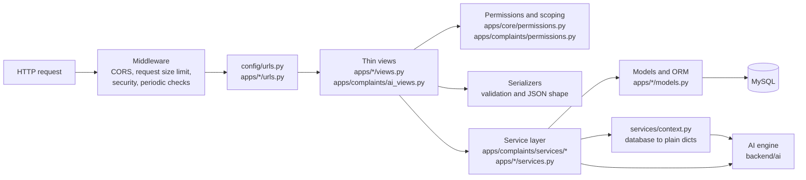
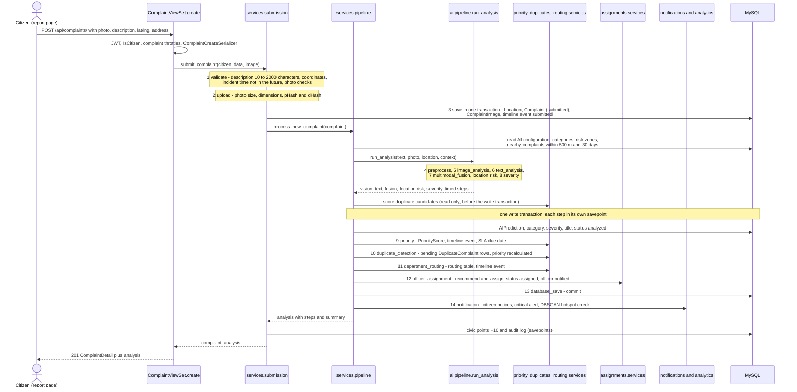
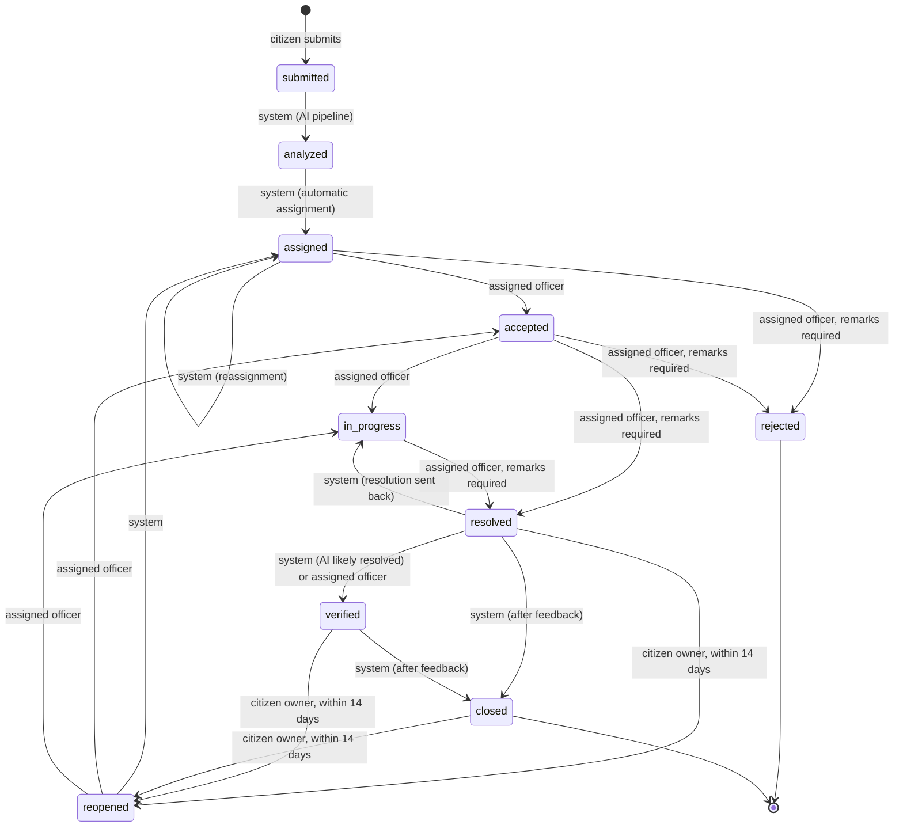
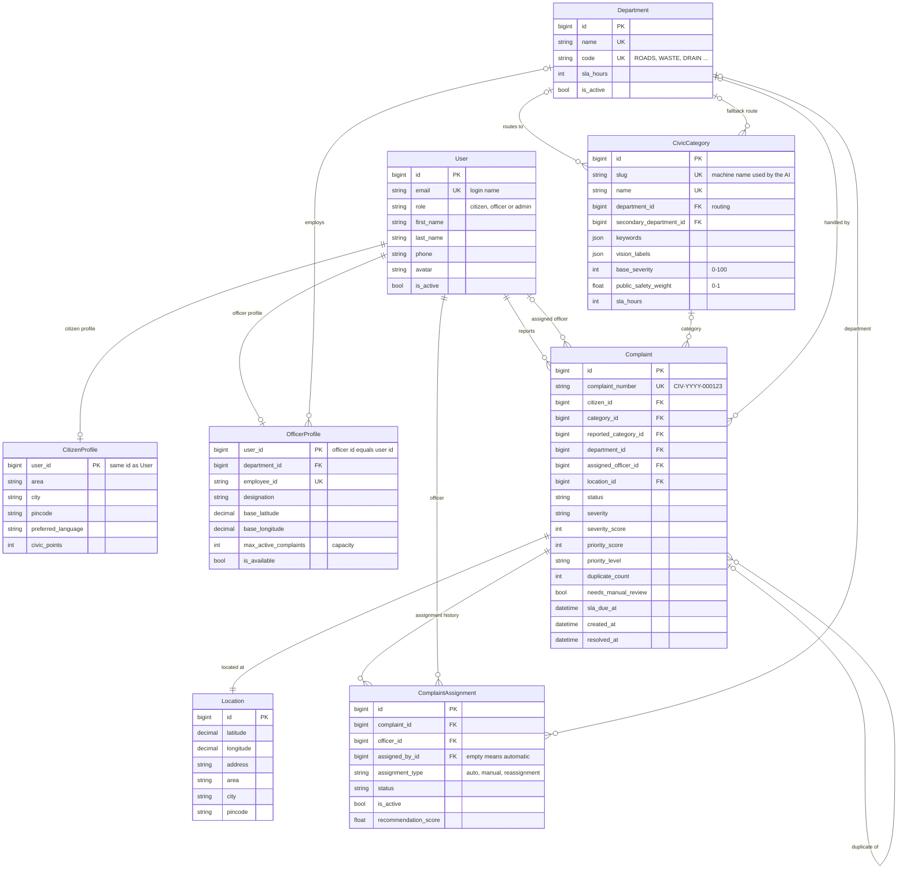
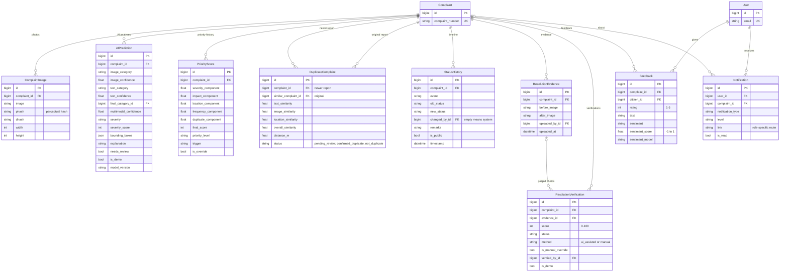
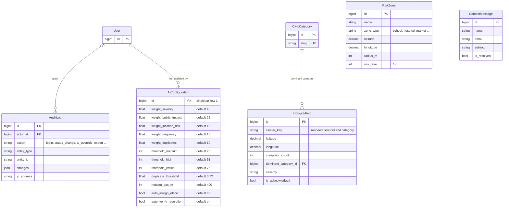
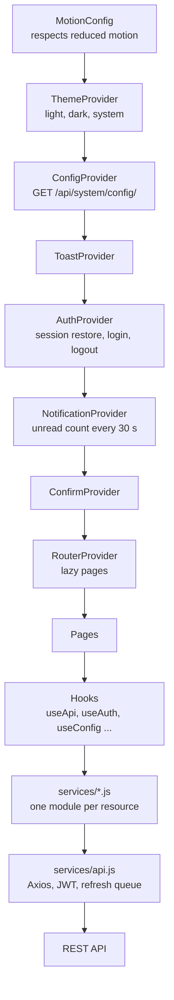

# CivicAI architecture

This document describes how CivicAI is built: the parts of the system and how they talk to each other, the layers
inside the backend, the complaint submission flow and lifecycle, the data model, notifications, security, the
frontend, background work and the decisions that keep the backend compatible with MySQL.

It is written for the student, the examiners and anyone who maintains the code later. Every module name, number and
rule below was checked against the code on 18 October 2026. Related documents:

- [AI_ENGINE.md](AI_ENGINE.md): every AI module, its formulas and its evaluation.
- [API_ENDPOINTS.md](API_ENDPOINTS.md): all 117 REST endpoints with their permission levels.
- [DEPLOYMENT.md](DEPLOYMENT.md), [TESTING.md](TESTING.md), [USER_GUIDE.md](USER_GUIDE.md),
  [REQUIREMENTS_TRACEABILITY.md](REQUIREMENTS_TRACEABILITY.md), [VIVA_GUIDE.md](VIVA_GUIDE.md).
- [REQUIREMENTS.md](REQUIREMENTS.md) (the original specification) and [BUILD_SPEC.md](BUILD_SPEC.md) (the
  engineering contract derived from it).

## Contents

1. [System context](#1-system-context)
2. [Runtime parts](#2-runtime-parts)
3. [Repository layout](#3-repository-layout)
4. [Backend layering](#4-backend-layering)
5. [Django apps](#5-django-apps)
6. [Complaint submission flow](#6-complaint-submission-flow)
7. [Complaint lifecycle](#7-complaint-lifecycle)
8. [Data model](#8-data-model)
9. [Notification matrix](#9-notification-matrix)
10. [Security model](#10-security-model)
11. [Frontend architecture](#11-frontend-architecture)
12. [Background work](#12-background-work)
13. [MySQL compatibility decisions](#13-mysql-compatibility-decisions)
14. [Architectural limitations](#14-architectural-limitations)

## 1. System context

Three kinds of people use one web application. The browser talks only to the CivicAI REST API, except for map
tiles and web fonts, which it loads directly from their providers. The AI engine is a Python package that runs
inside the API process; it is not a separate service.

```mermaid
flowchart TB
    citizen(["Citizen"])
    officer(["Field officer"])
    admin(["Administrator"])

    subgraph browser["Browser"]
        spa["React 19 web app<br/>installable PWA (Vite build)"]
    end

    subgraph backend["Backend server"]
        api["Django 5.2 + Django REST Framework<br/>REST API under /api/"]
        engine["AI engine<br/>backend/ai, in-process Python package"]
        media[("Uploaded photos<br/>backend/media")]
    end

    db[("MySQL 8<br/>database civicai")]
    redis[("Redis<br/>optional")]
    worker["Celery worker and beat<br/>optional"]
    tiles["OpenStreetMap tile servers"]
    nominatim["OpenStreetMap Nominatim<br/>geocoding"]
    fonts["Google Fonts"]
    hub["Hugging Face Hub<br/>production models, first load only"]

    citizen --> spa
    officer --> spa
    admin --> spa
    spa -->|"JSON over HTTPS, JWT bearer token"| api
    spa -->|"map tiles"| tiles
    spa -->|"Overpass and Public Sans"| fonts
    api --> engine
    api -->|"Django ORM"| db
    api --> media
    api -->|"proxied, cached 24 h"| nominatim
    engine -.->|"download once"| hub
    api -.->|"task queue"| redis
    redis -.-> worker
    worker -.->|"Django ORM"| db
```



- **Deployment targets** (see [DEPLOYMENT.md](DEPLOYMENT.md)): the web app on Vercel (`frontend/vercel.json`), the API
  on Render (`render.yaml`, gunicorn) and a MySQL 8 server given as `DATABASE_URL`.
- **Geocoding** goes through the API (`/api/geo/reverse/`, `/api/geo/search/`, `apps/core/geocoding.py`) because
  Nominatim's usage policy asks for an identifying User-Agent, at most about one request per second and caching,
  which a browser cannot guarantee. Lookups time out after 5 s and fall back to the raw coordinates
  (`"source": "fallback"`), so the report form keeps working offline.
- **Celery and Redis are optional.** With `USE_CELERY=False` (the default, and the setting in `render.yaml`) tasks run
  in-process and a built-in scheduler starts the periodic checks (section 12).

## 2. Runtime parts

| Part | Technology | Development address | Responsibility |
|---|---|---|---|
| Web app | React 19, Vite 7, Tailwind CSS 4, React Router 7, Axios, Recharts, Leaflet, Framer Motion | `http://localhost:5173` | All screens for citizens, officers and admins; installable PWA |
| REST API | Django 5.2, Django REST Framework, simplejwt, django-filter, django-cors-headers | `http://localhost:8000/api` | Authentication, permissions, business rules, AI orchestration, analytics, reports |
| AI engine | NumPy, OpenCV, scikit-learn, pandas, ImageHash; PyTorch, sentence-transformers, transformers, ultralytics in production mode | Inside the API process | Classification, severity, priority, duplicates, verification, sentiment, hotspots |
| Database | MySQL 8 through the Django ORM (`DB_ENGINE=mysql`); SQLite as a local fallback (`DB_ENGINE=sqlite`) | `127.0.0.1:3306`, database `civicai` | All persistent data |
| Media storage | Django `FileSystemStorage` | `backend/media/` | Complaint photos, before/after evidence, avatars |
| Background jobs | Built-in scheduler middleware, or Celery 5 + Redis | | Hourly SLA check, six-hourly city-wide hotspot scan |

The development servers are started by `start-dev.ps1`. In production the API runs `gunicorn config.wsgi -c
gunicorn.conf.py` with `WEB_CONCURRENCY` worker processes (1 in `render.yaml`) of `GUNICORN_THREADS` threads each
(4) and a 120-second timeout, because a submission runs the whole AI pipeline. Every worker process holds its own
copy of the AI models.

## 3. Repository layout

```text
backend/
  config/            settings.py, urls.py, celery.py, wsgi.py, asgi.py
  apps/              ten Django apps (section 5)
  ai/                framework-independent AI engine (see AI_ENGINE.md)
  scripts/           training, evaluation, sample-image generation, MySQL setup, API smoke test
  sample_data/       synthetic demo photos, 134 credited real street photos (real_images/), vision evaluation reports
  ml_models/         model caches and NLP evaluation reports (weights are git-ignored)
  media/             uploads (git-ignored)
frontend/
  src/               App.jsx (routes), context/, services/, hooks/, utils/, components/, pages/
  public/            manifest.webmanifest, sw.js (service worker), icons
e2e/                 Playwright browser tests (see TESTING.md)
docs/                this documentation
```

## 4. Backend layering

Every request passes through the same layers. Views stay thin: they authenticate, scope and validate the request,
call **one** service function that holds the business rules, and serialize the fresh database state. The AI engine
sits below the service layer and never imports Django.



| Layer | Rule | Example (submitting a complaint) |
|---|---|---|
| URLs | `SimpleRouter` or explicit `path()`, every URL ends with `/`, numeric ids only | `apps/complaints/urls.py` registers `complaints/` |
| Views | Authentication, permission classes, throttles, serializer validation, one service call | `ComplaintViewSet.create` |
| Serializers | Input validation and the documented JSON shapes | `ComplaintCreateSerializer`, `ComplaintDetailSerializer` |
| Services | Business rules, transactions, status changes, notifications, audit log | `services.submission.submit_complaint` → `services.pipeline.process_new_complaint` |
| Context adapter | Reads configuration, categories, risk zones and nearby complaints as plain dicts | `services.context.engine_config()`, `nearby_complaints()` |
| AI engine | Pure Python, no database, no Django | `ai.pipeline.run_analysis()` |

Conventions that hold everywhere:

- **Errors** have one shape, `{"detail", "errors"?, "code"}` (`apps/core/exceptions.py`). Services raise
  `ServiceError` (HTTP 400) or `TransitionNotAllowed` (HTTP 409); a missing AI component gives HTTP 503
  `service_unavailable`.
- **Cross-app imports are lazy** (inside functions), so the Django apps never import each other in a cycle.
- **Side effects never break the main action.** Notifications, civic points, audit rows and hotspot checks run
  through `run_side_effect()` in their own database savepoint: if one fails, only its own writes are rolled back.
- **Single write path for status.** Every status change, from any entry point, goes through
  `services.status.change_status()` (section 7).

## 5. Django apps

| App | Models | Main responsibilities | Main modules | URL prefixes |
|---|---|---|---|---|
| `core` | AIConfiguration, RiskZone, ContactMessage | Shared infrastructure: permissions, pagination, error handler, upload validation and re-encoding, throttles, request size limit, scheduler, geocoding proxy, system and AI configuration, risk zones, contact form, demo data | `permissions.py`, `validators.py`, `images.py`, `throttles.py`, `middleware.py`, `scheduler.py`, `geocoding.py`, `warmup.py`, `demo_data.py`; commands `seed_demo`, `warmup_ai`, `api_endpoints` | `/api/system/`, `/api/ai/config/`, `/api/risk-zones/`, `/api/contact/`, `/api/geo/` |
| `accounts` | User, CitizenProfile | E-mail login, registration (always citizen), JWT issue and revocation, profile, password change, user administration; a signal creates the citizen profile | `views.py`, `serializers.py`, `tokens.py`, `password_validation.py`, `signals.py` | `/api/auth/`, `/api/users/` |
| `departments` | Department, CivicCategory | Departments, civic categories and the routing table (a category's department **is** the route) | `defaults.py`, command `init_civicai` | `/api/departments/`, `/api/departments/routing/`, `/api/categories/` |
| `officers` | OfficerProfile | Officer accounts with department, capacity, base location and live workload | `views.py`, `serializers.py` | `/api/officers/` |
| `complaints` | Location, Complaint, ComplaintImage, AIPrediction, PriorityScore, DuplicateComplaint, StatusHistory, ResolutionEvidence, ResolutionVerification | The core domain: submission, AI pipeline, lifecycle, duplicates, evidence and verification, overrides, SLA | `services/` (submission, pipeline, context, priority, duplicates, status, verification, routing, overrides, sla, notify, helpers), `ai_views.py`, `tasks.py`, command `check_sla` | `/api/complaints/`, `/api/duplicates/`, `/api/ai/` |
| `assignments` | ComplaintAssignment | Officer recommendation, automatic and manual assignment, reassignment history, workload figures | `services.py` | `/api/assignments/` |
| `feedback` | Feedback | Citizen rating and comment after resolution, sentiment analysis, closing the complaint | `services.py` | `/api/feedback/` |
| `notifications` | Notification | In-app notifications with role-aware links | `services.py` (`notify`, `notify_many`, `notify_admins`) | `/api/notifications/` |
| `analytics` | HotspotAlert | Dashboards, KPIs, trends, sentiment and AI analytics, DBSCAN hotspots and alerts, CSV/PDF reports | `services.py`, `reports.py`, `tasks.py` | `/api/analytics/` |
| `audit` | AuditLog | Audit trail of security-relevant and administrative actions | `services.py` (`log_action`) | `/api/audit-logs/` |

`GET /api/health/` (defined in `config/urls.py`) is the liveness probe for the deployment.

## 6. Complaint submission flow

When a citizen presses "Analyze & Submit", the browser sends one multipart `POST /api/complaints/`. The whole AI
pipeline runs synchronously in that request, and the response contains the stored complaint plus
`analysis = {steps, summary}`: the 14 timed steps below, which the report page replays as its "AI analysis"
animation.

| # | Step key | Label shown to the user | Where |
|---|---|---|---|
| 1 | `validate` | Input validation | `services/submission.py` |
| 2 | `upload` | Image upload | `services/submission.py` |
| 3 | `save` | Complaint registration | `services/submission.py` |
| 4 | `preprocess` | Data preprocessing | `ai/pipeline.py` |
| 5 | `image_analysis` | Image AI analysis | `ai/vision` |
| 6 | `text_analysis` | Text NLP analysis | `ai/nlp` |
| 7 | `multimodal_fusion` | Multimodal classification | `ai/multimodal` |
| 8 | `severity` | Severity assessment (location risk is folded into this step) | `ai/geospatial`, `ai/severity` |
| 9 | `priority` | Priority scoring | `services/priority.py`, `ai/priority` |
| 10 | `duplicate_detection` | Duplicate detection | `services/duplicates.py`, `ai/duplicate` |
| 11 | `department_routing` | Department routing | `services/routing.py` |
| 12 | `officer_assignment` | Officer assignment | `apps/assignments/services.py` |
| 13 | `database_save` | Database save | `services/pipeline.py` |
| 14 | `notification` | Notifications | `services/pipeline.py`, `apps/analytics/services.py` |



Design choices in this flow:

- **Validation before any write.** Input errors answer HTTP 400 and nothing is stored.
- **The AI engine runs outside any transaction**, so no database lock is held while models compute. The
  CPU-heavy part of duplicate detection (text embeddings, image features) also runs before the write transaction.
- **All AI results are written in one transaction**, with each optional step (priority, duplicates, routing,
  assignment) in its own savepoint. If one step fails, only its writes are undone, the step is reported as
  `failed` and the remaining steps still run.
- **An AI failure never loses the complaint.** If the engine fails, the complaint stays `submitted` with
  `needs_manual_review = true`, the citizen still gets "Complaint submitted", the administrators get an
  "AI analysis failed" notice, and the response is still HTTP 201 with the failed steps listed.
- **The citizen's notifications follow the lifecycle order:** complaint submitted, AI analysis completed,
  department assigned, officer assigned.

Three other entry points reuse the same engine without writing to the database: `POST /api/ai/analyze/`
(full preview), `POST /api/ai/classify/` (the report form's live category suggestion) and the public landing-page
demo `POST /api/ai/demo/`. An admin can re-run the stored flow with `POST /api/complaints/{id}/reanalyze/`.

## 7. Complaint lifecycle

`apps/complaints/services/status.py` implements the lifecycle as a finite-state machine. `TRANSITIONS` lists every
legal edge and the roles allowed to take it. Roles are relative to the complaint: **system** (no user: the AI
pipeline, scheduled tasks, automatic verification), **assigned officer** and **citizen owner**. Administrators may
take any transition, for example reassigning an accepted complaint (it goes back to `assigned` for the new officer),
closing a resolved one or reopening a rejected one.



| From → to | Allowed for (besides administrators) |
|---|---|
| submitted → analyzed | system |
| analyzed → assigned, reopened → assigned, assigned → assigned | system (admins assign manually through their any-transition right) |
| assigned → accepted, reopened → accepted | assigned officer |
| reopened → in_progress, accepted → in_progress | assigned officer |
| assigned → rejected, accepted → rejected | assigned officer (remarks required) |
| accepted → resolved, in_progress → resolved | assigned officer (remarks required) |
| resolved → verified | system (AI "likely resolved" with auto-verification on), assigned officer (manual verification) |
| resolved → in_progress | system (a verification that sends the work back) |
| resolved → reopened, verified → reopened, closed → reopened | citizen owner within `REOPEN_WINDOW_DAYS` (default 14) of `resolved_at`, reason required |
| verified → closed, resolved → closed | system (after citizen feedback) |

Rules around the table:

- **One write path.** `change_status()` locks the complaint row (`SELECT ... FOR UPDATE`), re-reads the current
  status, validates the edge, sets the lifecycle timestamp, writes the `StatusHistory` row, keeps the active
  `ComplaintAssignment` in step and only then applies consequences and notifications. Two officers cannot race.
- **Timestamps.** `accepted_at` (first acceptance only), `resolved_at`, `verified_at`, `closed_at`. A reopen
  increments `reopen_count`, clears the resolved, verified and closed timestamps, recalculates the priority
  (+5 points per reopen, at most +10) and notifies the assigned officer and the admins.
- **Service flows that bypass the role table** (`force=True`, actor still recorded): confirming a duplicate closes
  the newer complaint ("Merged into ..."), and a manual verification of "partially" or "not resolved" sends a
  resolved or verified complaint back to `in_progress`.
- **Allowed actions drive the UI.** `get_allowed_actions(complaint, user)` returns the buttons a user may press
  (`accept`, `reject`, `start_work`, `upload_evidence`, `resolve`, `verify`, `manual_verify`, `reopen`, `feedback`,
  `assign`, `reassign`, `override_ai`, `close` ...), and the web app shows exactly those. A citizen can edit or
  delete a complaint only while it is submitted, analyzed or assigned and not yet accepted.
- **Status groups** used by dashboards: pending = submitted, analyzed, assigned, reopened; in progress = accepted,
  in_progress; resolved = resolved, verified, closed.

Every status change and lifecycle event (AI analysis, priority, routing, assignment, evidence, verification,
duplicate flags, remarks, feedback) is a `StatusHistory` row with `event`, `old_status`, `new_status`, `changed_by`
(empty means "CivicAI Engine"), `remarks`, `metadata`, `is_public` and `timestamp`. Citizens see only public
events; officers can add internal remarks.

## 8. Data model

The specification requires 18 models; CivicAI has all 18 plus 4 more (HotspotAlert, AIConfiguration, RiskZone,
ContactMessage). The specification's single "Resolution" model is split in two: `ResolutionEvidence` (the
before/after photos) and `ResolutionVerification` (each AI or manual judgement of that evidence), so every
verification points at the exact photos it judged and the history is kept. simplejwt's token blacklist tables
(`OutstandingToken`, `BlacklistedToken`) are third-party and not shown.

### People, organisation and complaints



### Records attached to a complaint



### System and analytics tables



The diagrams show the key fields; the full field lists are in `backend/apps/*/models.py` and summarised in
[BUILD_SPEC.md](BUILD_SPEC.md) section 1. Other relations not drawn above: `PriorityScore.created_by`,
`DuplicateComplaint.reviewed_by` and `AIPrediction` raw output (`raw_output`, JSON) for auditing.

### Indexes and constraints

| Table | Indexes (besides primary keys and the automatic foreign-key indexes) |
|---|---|
| Complaint | `status`, `severity`, `priority_score`, `priority_level`, `created_at`; composite `(status, -priority_score)`, `(department, status)`, `(category, status)`, `(assigned_officer, status)`, `(severity, created_at)`, `(priority_level, created_at)`; unique `complaint_number` |
| Location | `latitude`, `longitude`, `area`, `city`; composite `(latitude, longitude)` |
| DuplicateComplaint | `overall_similarity`, `status`; unique pair `(complaint, similar_complaint)` |
| Notification | `notification_type`, `is_read`, `created_at`; composite `(user, is_read, -created_at)` |
| ComplaintAssignment | `status`, `is_active`; composite `(officer, is_active)`, `(complaint, is_active)` |
| Others | `User (role, is_active)`, `OfficerProfile (department, is_available)`, `AuditLog (entity_type, entity_id)`, `StatusHistory` `event` and `timestamp` |

`Complaint.created_at` uses a default instead of `auto_now_add`, so the demo seeder can back-date the history, and
`complaint_number` (`CIV-<year>-<id padded to 6>`) is filled right after the first save.

## 9. Notification matrix

Notifications are rows in the `Notification` table, shown in the bell menu, on the dashboards and on the
notifications page (the web app polls the unread count every 30 seconds). The link of each notification points to
the recipient's own complaint page (`/citizen/complaints/12`, `/officer/complaints/12`, `/admin/complaints/12`).
The reporting citizen and the assigned officer are not notified about actions they took themselves; notices to
administrators go to every active administrator.

| Event | Citizen (reporter) | Assigned officer | Administrators | Notification type(s) | Sent by |
|---|---|---|---|---|---|
| Complaint submitted | ✓ | | | `complaint_submitted` | `services/pipeline.py` |
| AI analysis completed | ✓ | | | `ai_analysis_completed` | `services/pipeline.py` |
| AI analysis failed | ✓ (submitted notice) | | ✓ | `complaint_submitted`, `system` | `services/pipeline.py` |
| Department assigned or changed by an admin override | ✓ | | | `department_assigned` | `services/pipeline.py`, `services/overrides.py` |
| Officer assigned | ✓ | ✓ new assignment | | `officer_assigned`, `new_assignment` | `apps/assignments/services.py` |
| Reassignment | ✓ | ✓ new and previous officer | | `officer_assigned`, `reassignment` | `apps/assignments/services.py` |
| Complaint becomes critical | | ✓ (once) | ✓ (once per complaint) | `critical_complaint` | `services/notify.py`, `apps/assignments/services.py` |
| Possible duplicate flagged, or merged into an original | ✓ | | | `duplicate_detected` | `services/duplicates.py` |
| Status changed (accepted, in progress, rejected, closed by an admin ...) | ✓ | | | `status_changed` | `services/status.py` |
| Complaint resolved | ✓ | | | `complaint_resolved` | `services/status.py` |
| Resolution verified | ✓ (plus a feedback request) | | | `resolution_verified`, `feedback_requested` | `services/status.py` |
| AI verification says partially or not resolved | | ✓ | ✓ | `manual_review_requested` | `services/verification.py` |
| AI verification needs review, could not run, or an officer asks for review | | | ✓ | `manual_review_requested` | `services/verification.py` |
| Manual verification sends the work back | | ✓ | | `status_changed` | `services/verification.py` |
| Complaint reopened by the citizen | | ✓ | ✓ | `complaint_reopened` | `services/status.py` |
| Citizen feedback received | | ✓ every feedback | ✓ negative sentiment or rating ≤ 2 | `feedback_received` | `apps/feedback/services.py` |
| High or critical complaint past its SLA (at most once per complaint per 24 h) | | ✓ | ✓ | `high_priority_unresolved` | `services/sla.py` |
| New hotspot (DBSCAN cluster of at least 5 open complaints, at most once per cluster per 24 h) | | | ✓ | `hotspot_alert` | `apps/analytics/services.py` |

Every notification function is a safe wrapper: it runs in its own savepoint and never raises, so a failed
notification can neither block nor undo the action that caused it.

## 10. Security model

### Authentication

- **Passwords** are hashed by Django (PBKDF2) and checked by five validators: minimum length 8, not too similar to
  the user's details, not a common password, not only digits and not only whitespace. Login is by e-mail.
- **JWT with rotation and blacklisting** (`djangorestframework-simplejwt`). Login and registration return an access
  token (60 minutes, `JWT_ACCESS_MINUTES`) and a refresh token (7 days, `JWT_REFRESH_DAYS`), signed with HS256 using
  `JWT_SECRET` (or `SECRET_KEY`). Every refresh rotates the refresh token and blacklists the old one, so a stolen
  refresh token works at most once.
- **Server-side session control** (`apps/accounts/tokens.py`): logout blacklists both the refresh token and the
  access token of the session; every token carries a fingerprint of the password hash, so a password change ends
  every existing session at once (the response returns a fresh pair for the current device).
- **The web app** keeps both tokens in `localStorage` (`civicai.access`, `civicai.refresh`), adds the bearer header
  to every request, refreshes once on a 401 with a single shared refresh request, and sends the user to
  `/login?next=...` when the refresh token is rejected.

### Authorisation

Three layers protect every endpoint:

1. **Role permissions.** Every view declares permission classes from `apps/core/permissions.py` (`IsCitizen`,
   `IsOfficer`, `IsAdmin`, `IsOfficerOrAdmin`, `IsAdminOrPublicReadOnly` ...). The wrong role gets HTTP 403. The
   permission level of every endpoint is listed in [API_ENDPOINTS.md](API_ENDPOINTS.md), and
   `apps/core/test_api_contract.py` fails if the code and that file disagree.
2. **Object scoping returns 404.** Querysets are filtered before lookup (`scope_complaints()`): citizens see only
   their own complaints, feedback and notifications; officers see complaints assigned to them, plus read access to
   their department's complaints; admins see everything. A complaint outside the user's scope does not exist for
   them, so the API answers 404 instead of a 403 that would reveal that the id exists.
3. **Object permissions and lifecycle rules.** An officer may read a department colleague's complaint but act only
   on complaints assigned to them: only the assigned officer may accept, start work or request a manual
   verification, and only the assigned officer or an admin may reject, resolve, upload evidence or verify.
   `services/status.py` then validates every status change again, whatever the entry point.

Citizens never see other people's personal data: contact details of officers, admins and other citizens, and the
contents of other citizens' reports (for example a nearby report matched by the duplicate check), are withheld in
their responses (`withholds_personal_data()`).

### Input and upload protection

- **Serializer validation** at the API boundary; ids must be plain whole numbers and dates `YYYY-MM-DD`.
- **Request size limit.** `RequestBodyLimitMiddleware` answers 413 for a request body over 20 MB (two maximum-size
  photos plus 4 MB) before reading it.
- **Photo uploads** (`apps/core/validators.py`, `apps/core/images.py`): extension whitelist (jpg, jpeg, png, webp),
  at most 8 MB, the real format detected by Pillow must be JPEG, PNG or WebP, 32 to 8,000 px per side, at most
  25 megapixels for JPEG and 12 for PNG/WebP (checked before decoding). Stored copies are re-encoded: EXIF
  orientation applied, EXIF/GPS/XMP metadata removed, longest side at most 2,560 px, saved under a random 80-bit name.
- **Report exports** prefix cells that start with `= + - @` to prevent spreadsheet formula injection.

### Rate limits

| Scope | Default | Applies to |
|---|---|---|
| `auth` | 20/min | register, login |
| `contact` | 5/min | public contact form |
| `ai` | 60/min | every POST under `/api/ai/` except the public demo |
| `ai_public` | 12/min | public landing-page demo |
| `complaint_burst`, `complaint_daily` | 6/min, 40/day per citizen | new complaints (each runs the whole AI pipeline) |
| `anon`, `user` | 120/min, 600/min | everything else |

All rates can be changed with `THROTTLE_*` environment variables. Clients are identified by `REMOTE_ADDR` unless
`NUM_PROXIES` trusted proxies are configured (1 on Render), so a forged `X-Forwarded-For` cannot reset a limit.

### Configuration, transport and audit

- **Secrets live in `backend/.env`** (git-ignored; `.env.example` lists every variable). `SECRET_KEY` is required
  when `DEBUG=False`; on Render `SECRET_KEY` and `JWT_SECRET` are generated by the platform and the database URL is
  entered in the dashboard, never stored in the repository.
- **CORS** allows only `CORS_ALLOWED_ORIGINS` (default `http://localhost:5173` and `http://127.0.0.1:5173`) and
  exposes only `Content-Disposition` and `Retry-After`.
- **Production hardening** when `DEBUG=False`: HTTPS redirect, HSTS for one year, secure session and CSRF cookies,
  `X-Content-Type-Options: nosniff`, `X-Frame-Options: DENY`. The Vercel configuration adds `nosniff`,
  `Referrer-Policy` and a `Permissions-Policy` that allows geolocation and camera only for the app itself.
- **Audit log.** Registration, sign-ins (including failed attempts on existing accounts), logout, profile and
  password changes, new complaints, status changes, assignments, AI overrides, verifications, duplicate reviews,
  changes to users, departments, categories, routing, risk zones and the AI configuration, and report exports are
  written to `AuditLog` with actor, IP address and user agent; admins read them at `/admin/audit-logs`.

## 11. Frontend architecture

### Routing per role

`frontend/src/App.jsx` builds one `createBrowserRouter` table. Every page is loaded on demand with `React.lazy`, and
each role area is wrapped in `ProtectedRoute`, which waits for the session to be restored, sends visitors to
`/login?next=...` and users of another role to `/unauthorized`. `GuestRoute` sends a signed-in user away from
`/login` and `/register` to their dashboard (or a safe `?next=`).

| Area | Layout and guard | Routes |
|---|---|---|
| Public | `PublicLayout` | `/`, `/about`, `/features`, `/how-it-works`, `/contact`, `/login`, `/register`, `/unauthorized` |
| Citizen | `ProtectedRoute roles=['citizen']` + `DashboardLayout` | `/citizen/dashboard`, `/citizen/report`, `/citizen/complaints`, `/citizen/complaints/:id`, `/citizen/complaints/:id/track`, `/citizen/feedback` |
| Officer | `ProtectedRoute roles=['officer']` + `DashboardLayout` | `/officer/dashboard`, `/officer/complaints`, `/officer/complaints/:id`, `/officer/complaints/:id/resolve`, `/officer/complaints/:id/verify` |
| Admin | `ProtectedRoute roles=['admin']` + `DashboardLayout` | `/admin/dashboard`, `/admin/complaints`, `/admin/complaints/:id`, `/admin/duplicates`, `/admin/users`, `/admin/officers`, `/admin/departments`, `/admin/ai-analytics`, `/admin/hotspots`, `/admin/feedback`, `/admin/reports`, `/admin/settings`, `/admin/audit-logs` |
| Every role | inside its area | `profile`, `notifications`; `/<role>` redirects to `/<role>/dashboard` |

The sidebar, top bar title and the citizen's mobile tab bar (Home, Complaints, a raised yellow Report button,
Alerts, Profile) all read from `components/layout/navigation.js`. The backend enforces the same rules again, so
hiding a route in the browser is a convenience, not the security boundary.

### Providers, services and hooks



- **Contexts** (`src/context/`): theme (persisted as `civicai.theme` and applied by an inline script before the first
  paint, so there is no flash), system configuration (AI mode for the "Demo AI Mode" badge, map centre, upload
  limits, reopen window), toasts, authentication (also syncs logins and logouts across tabs) and notifications.
- **Services** (`src/services/`): `api.js` plus 13 resource modules (`complaintService`, `aiService`,
  `analyticsService`, `assignmentService`, `authService`, `categoryService`, `departmentService`,
  `duplicateService`, `feedbackService`, `notificationService`, `officerService`, `systemService`, `userService`).
  Every function returns `response.data`; AI calls use a 180-second timeout because the first call may load a model.
- **Data fetching** goes through `useApi(() => service.fn(args), [deps])`, which compares dependencies by value,
  ignores responses that arrive after a newer request, and keeps the previous data on error.
- **Components** are grouped as `ui/` (38 design-system primitives such as Button, DataTable, Modal, FileDropzone),
  `layout/`, `complaints/` (timeline, priority breakdown, duplicate panel, evidence slider, analysis replay),
  `ai/` (analysis panel, boxes drawn over the photo, confidence bars, model info), `maps/` (Leaflet map, location
  picker, marker clusters, hotspot layer) and `charts/` (Recharts wrappers with a chart/table toggle).

### Design system: "civic signage"

The visual identity borrows from road infrastructure. The tokens are defined once in `src/index.css` with Tailwind
CSS 4 (`@theme`):

- **Palettes:** highway-sign green `sign-*` (primary, `#0b6e4f`), road-marking yellow `marking-*` (accent, focus
  outline `#f5b700`), asphalt neutrals `asphalt-*`, signal red `signal-*` (critical), hazard orange `hazard-*`
  (high) and guide blue `guide-*` (information).
- **Semantic, theme-aware tokens** (`bg-bg`, `bg-surface`, `border-line`, `text-ink`, `bg-primary` ...) switch with
  the `.dark` class, so both themes come from one set of components.
- **Type:** Overpass (derived from highway-sign lettering) for headings and large numbers, Public Sans for interface
  text, tabular numerals for data.
- **Motifs:** the dashed yellow lane line (`lane-line`) for the timeline connector and the active navigation item,
  and the `sign-panel` treatment for the logo and the landing headline.
- **Colour means something:** status, severity, priority and sentiment colours come from `utils/constants.js`
  (`STATUS_META`, `LEVEL_META` ...), never decoration. Panels have borders, not shadows; only floating layers
  (menus, dialogs, toasts) cast a shadow.

### Installable PWA

- `public/manifest.webmanifest` makes the app installable (standalone display, theme colour `#0B6E4F`, shortcuts to
  "Report an issue" and "My complaints").
- `public/sw.js`, registered only in production builds, caches the app shell: page loads are network-first with the
  cached `index.html` as offline fallback, hashed `/assets/*` files are cache-first, and shell files are
  stale-while-revalidate. **`/api/*` and `/media/*` responses are never cached**, so data is always live.
- `vite.config.js` stamps a build id into `sw.js` after every build, so each deployment installs a new service
  worker that deletes the previous shell cache. Vendor code is split into long-lived chunks (`react`, `vendor`,
  `charts`, `maps`, `motion`).

## 12. Background work

Two checks run periodically, and a few commands run on demand.

| Job | What it does | Celery beat schedule | Without Celery |
|---|---|---|---|
| `apps.complaints.tasks.check_sla_breaches` | Alerts admins and the assigned officer about open high or critical complaints past their SLA due date or open longer than `sla_alert_hours` (48 h), at most once per complaint per 24 h | Every hour at minute 0 | Built-in scheduler every 60 minutes; `manage.py check_sla` |
| `apps.analytics.tasks.scan_hotspots` | City-wide DBSCAN over the open complaints of the last 30 days; raises de-duplicated hotspot alerts | Every 6 hours at minute 15 | Built-in scheduler every 360 minutes |
| `apps.complaints.tasks.reanalyze_complaint_task` | Re-runs the AI pipeline for one complaint | Not scheduled; available for background use | The API's re-analysis endpoint currently runs the pipeline synchronously |
| `POST /api/analytics/run-checks/` | Runs both checks immediately (admin button "Run checks now") | | |

**Built-in scheduler.** When `USE_CELERY=False` (the default), `apps.core.scheduler.PeriodicChecksMiddleware`
checks after every request whether a check is due and, if so, starts it in a background thread, so the request is
not delayed; a cache entry claimed with `cache.add` lets only one run start per interval. Both checks de-duplicate
their alerts in the database, so running them from several processes is harmless. Settings: `PERIODIC_CHECKS`
(default on without Celery), `SLA_CHECK_INTERVAL_MINUTES` (60), `HOTSPOT_SCAN_INTERVAL_MINUTES` (360). Without
incoming requests (a sleeping free-tier server) no check runs.

**With Celery** (`USE_CELERY=True`, `REDIS_URL`): run `celery -A config worker -l info --pool=solo` (Windows needs the
solo pool) and `celery -A config beat -l info`. In production AI mode the worker preloads the models when it starts.

**Management commands:** `init_civicai` (departments, categories, routing, risk zones, AI configuration; idempotent),
`seed_demo` (the demo dataset, produced through the real services), `check_sla`, `warmup_ai` (load and check the AI
models of the current mode), `api_endpoints` (prints the live endpoint inventory).

## 13. MySQL compatibility decisions

MySQL 8 is the production database; SQLite (`DB_ENGINE=sqlite`) remains a local fallback, and the same code runs on
both (the test suites are run on both, see [TESTING.md](TESTING.md)). These decisions keep the SQL portable:

| Decision | Why | Where |
|---|---|---|
| **No database date truncation.** Analytics never use `TruncDate`, `TruncMonth`, `Extract*` or `__date` lookups. Raw UTC timestamps are fetched, converted to `TIME_ZONE` (Asia/Kolkata) with pandas `tz_convert`, and bucketed by local day, ISO week (Monday) or month in Python. Empty buckets are filled with zeros. | On MySQL these functions need `CONVERT_TZ` and the time-zone tables, which are often missing; the result would silently be NULL. | `apps/analytics/services.py` (`to_local`, `bucket_dates`, `bucket_range`) |
| **Date filters as explicit ranges.** A calendar day becomes `created_at >= local midnight` and `< next local midnight`, built in Python. | Same time-zone problem, and the range query can use the `created_at` index. | `apps/complaints/filters.py`, `apps/analytics/serializers.py`, `apps/audit/filters.py`, `apps/feedback/views.py` |
| **Timestamp arithmetic in Python.** Resolution times (`resolved_at - created_at`) and SLA compliance are computed in pandas, not in SQL aggregates. | Date arithmetic inside SQL aggregates behaves differently on MySQL and SQLite. | `resolution_frame()` in `apps/analytics/services.py`, `apps/officers/serializers.py` |
| **No GIS extension.** Nearby searches use a bounding-box range query on the indexed latitude/longitude columns, then the exact haversine distance in Python. | Works identically on MySQL and SQLite without spatial types. | `apps/complaints/services/context.py`, `apps/analytics/services.py` |
| **JSON values made plain.** NumPy numbers, tuples and NaN from the AI engine are converted (`json_safe`) before they are stored. | MySQL's JSON column accepts only strict JSON. | `apps/complaints/services/helpers.py` |
| **No `COALESCE` with date literals.** Pending feedback uses two nested `NOT EXISTS` sub-selects. | MySQL returned such an annotation as a string and crashed Django's datetime converter. | `apps/feedback/services.py` |
| **Unsigned columns.** Civic points are taken back with the row locked and the new balance computed in Python. | `civic_points - 10` on a balance below 10 is an out-of-range error on MySQL's unsigned column. | `apps/complaints/services/helpers.py` |
| **Counters as sub-selects.** Several counters per row use one correlated `COUNT(*)` sub-select each. | Several `Count()` joins in one query multiply rows and inflate the numbers. | `apps/core/views.py` (`subquery_count`) |
| **Plain features only.** No JSONField `__contains`, no `distinct(*fields)`, no PostgreSQL-only features; `SELECT ... FOR UPDATE` row locks for status changes, assignments and feedback. | Portability and correctness under concurrency. | Throughout |
| **Connection settings.** `utf8mb4`, `STRICT_TRANS_TABLES`; the `mysqlclient` driver, with `PyMySQL` as a stand-in where it cannot be installed; `DATABASE_URL` support for cloud MySQL. | Full Unicode (Telugu, Hindi, emoji) and strict data checks. | `config/settings.py` |

`scripts/setup_mysql.py` creates the database with `utf8mb4_unicode_ci`, can create a dedicated MySQL user, runs the
migrations and can copy an existing SQLite installation (`--copy-sqlite`) with every row and primary key unchanged.

## 14. Architectural limitations

- **Synchronous AI.** The AI pipeline runs inside the submission request. This keeps the flow simple and lets the
  citizen see the real result immediately, but a slow production model makes the request slow. A Celery task for
  background re-analysis exists, but the API runs both the first analysis and re-analysis synchronously.
- **Media on local disk.** Uploads are stored on the server's disk. On Render's free plan that disk is ephemeral:
  photos disappear on every redeploy or restart, while the database rows that point to them remain. A real
  deployment needs object storage (for example S3-compatible) behind Django's storage API.
- **Media access control.** Stored photos have unguessable names and no metadata, but `/media/` is served without a
  per-request permission check.
- **Process-local cache.** Rate limits, geocoding results and scheduler claims use Django's local-memory cache, so
  they are per process; several API processes would each count separately until a shared cache such as Redis is
  configured.
- **Polling, not push.** Notifications reach the browser by polling every 30 seconds; there are no WebSockets.
- **Tokens in localStorage.** Simple and works across tabs, but a successful cross-site scripting attack could read
  them; the short access-token lifetime and server-side revocation limit the damage.
- **Single-city defaults.** The default map centre, risk zones and demo data are for Hyderabad; another city needs
  its own risk zones and settings.
