# CivicAI user guide

This guide walks through CivicAI task by task for each of its three roles: **citizens** who report civic problems,
**officers** who fix them, and **administrators** who run the platform. It also covers the public pages and how to
install the web app on a phone.

Every screenshot was taken on 18 October 2026 at a browser width of 1440 px from the seeded demo data (the MySQL
database `civicai` filled by `manage.py seed_demo`). Your own copy will show other relative times ("4 hours ago",
"Due in 2 h") and, after a new seed or new reports, other numbers. Taking the screenshots did not change the demo
data: forms were filled but not submitted, and the one result screen that needs a submission (the AI work order in
[section 3.3](#33-report-an-issue)) comes from an identical private copy of the database. The hotspot map screenshot
in [section 5.7](#57-hotspot-map) was retaken later the same day, after the badge fix, from another identical copy.

For how the system works inside, see [ARCHITECTURE.md](ARCHITECTURE.md) and [AI_ENGINE.md](AI_ENGINE.md); for the
API, [API_ENDPOINTS.md](API_ENDPOINTS.md); for installing and hosting, [DEPLOYMENT.md](DEPLOYMENT.md).

## Contents

1. [Before you start](#1-before-you-start)
2. [Public pages, registration and login](#2-public-pages-registration-and-login)
3. [Citizen guide](#3-citizen-guide)
4. [Officer guide](#4-officer-guide)
5. [Administrator guide](#5-administrator-guide)
6. [Using CivicAI on a phone (installable app)](#6-using-civicai-on-a-phone-installable-app)
7. [Troubleshooting](#7-troubleshooting)

---

## 1. Before you start

### Opening the web app

| Where | Address |
|---|---|
| On your computer, after `.\setup.ps1` and `.\start-dev.ps1` (see [README.md](../README.md)) | Web app `http://localhost:5173`, API `http://localhost:8000/api` |
| A deployed copy (Vercel + Render, see [DEPLOYMENT.md](DEPLOYMENT.md)) | The HTTPS address of the Vercel site |

### Demo accounts

`manage.py seed_demo` creates these accounts. All officers share one password, and so do all citizens.

| Role | E-mail | Password | Who it is in the demo data |
|---|---|---|---|
| Administrator | `admin@civicai.local` | `Admin@12345` | Anita Rao |
| Officer | `roads.officer1@civicai.local` | `Officer@12345` | Ravi Kumar, Roads Department (employee id RD-1001) |
| Other officers | `roads.officer2`, `roads.officer3`, `waste.officer1`-`3`, `drain.officer1`-`2`, `elec.officer1`-`2`, `water.officer1`-`2`, `parks.officer1`-`2`, `gen.officer1`-`2` `@civicai.local` | `Officer@12345` | 16 officers in 7 departments; `waste.officer3` is marked unavailable |
| Citizen | `citizen@civicai.local` | `Citizen@12345` | Rahul Verma, the main demo citizen |
| Other citizens | `citizen1@civicai.local` ... `citizen15@civicai.local` | `Citizen@12345` | 15 more citizens |

On the development server (`npm run dev`) the login page shows a **Demo accounts** panel whose **Fill in** buttons
copy an account into the form. A production build (`npm run build`) never contains these passwords, so the panel is
not shown on a deployed site.

### What "Demo AI Mode" means

A yellow **Demo AI Mode** badge in the top bar (a slim strip under the top bar on phones) tells you that the AI
engine runs its lightweight demo techniques: OpenCV image heuristics, a TF-IDF text classifier, a sentiment lexicon
and OpenCV image comparison. Every result is still computed from the real photo, description and location, and
every result is labelled with the mode that produced it. With `MODEL_MODE=production` the server uses deep-learning
models instead (CLIP, Sentence-Transformers, a RoBERTa sentiment model) and the badge disappears. The
[administrator's Model information tab](#511-system-settings) shows which models are answering.

### Things that work the same on every page

- **Light and dark theme**: the sun / moon button in the top bar. The choice is remembered in the browser.
- **Notifications**: the bell in the top bar shows the unread count, refreshed every 30 seconds.
- **Filters live in the address bar**: a filtered list, a report or a map view can be bookmarked or shared, and the
  browser's back button restores it.
- **Charts have a Chart / Table switch**, so every number behind a chart can be read exactly.
- **Search**: officers and administrators can search complaints by number, title or area from the top bar.
- **Buttons follow the rules of the server**: a button only appears when the server allows that action for your role
  and the complaint's current status, so you never see an action that would be refused.

### The life of a complaint

Every complaint moves through the same statuses. The diagram shows who takes each step; an administrator may move a
complaint to any status (with remarks) from the complaint management page.

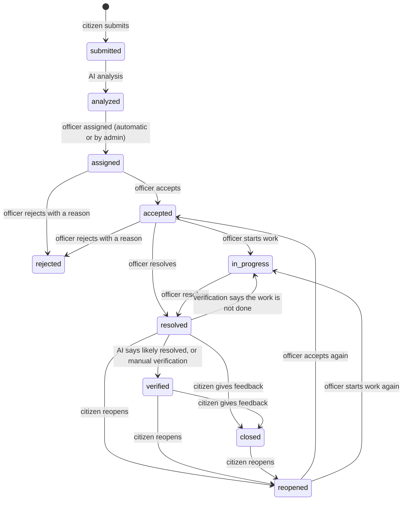

The screens group these statuses: **Pending** = submitted, AI analyzed, assigned or reopened; **In progress** =
accepted or in progress; **Resolved** = resolved, verified or closed.

---

## 2. Public pages, registration and login

Anyone can open these pages without an account:

- **Landing page** (`/`): the headline "AI-Powered Civic Issue Management", the buttons **Report an Issue** and
  **Explore Dashboard**, and nine sections (How CivicAI Works, AI Issue Detection, Multimodal AI, Smart
  Prioritization, Duplicate Detection, Automatic Department Routing, Resolution Verification, Citizen Feedback, Smart
  City Analytics). The hero runs a live analysis of a sample photo, and **Try your own photo** lets a visitor send a
  photo and/or a description to the public demo (`POST /api/ai/demo/`). The demo stores nothing, ignores file names
  and is limited to 12 requests a minute per visitor. Live numbers on the page come from the database.
- **About**, **Features**, **How it works** and **Contact** (`/contact`). The contact form goes to the administrators'
  inbox ([Contact messages](#511-system-settings)); it accepts 5 messages a minute per visitor.

**Register** (`/register`): first name, last name (optional), e-mail, phone (optional), password, confirm password,
and the terms checkbox, then **Create account**. Every new account is a citizen account; officer and administrator
accounts are created by an administrator. Passwords must pass Django's checks (at least 8 characters, not too common,
not only digits, not too similar to your details).

**Log in** (`/login`): e-mail and password, then **Log in**. You land on your role's dashboard: `/citizen/dashboard`,
`/officer/dashboard` or `/admin/dashboard`. If you opened a protected page first, you go back to it after logging in.
Opening another role's pages sends you to an "unauthorized" page.

**Sessions**: you stay signed in for up to 7 days of inactivity (the 60-minute access token renews itself in the
background). **Log out** in the account menu (your name, top right) ends the session on the server too. Changing your
password signs out every other browser where you were logged in.

---

## 3. Citizen guide

### 3.1 Your dashboard

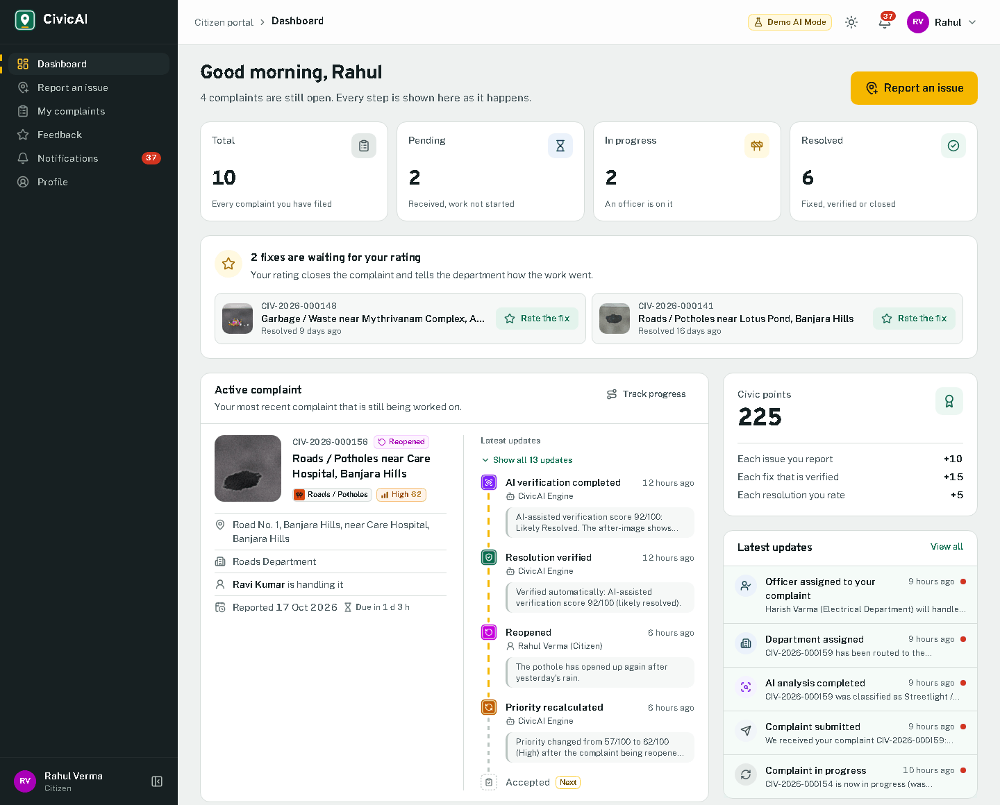

The dashboard (`/citizen/dashboard`) answers "what needs my attention?":

- **Total, Pending, In progress, Resolved**: your complaints by status group. Each tile opens the filtered list.
- **Fixes waiting for your rating**: resolved complaints you have not rated yet, each with **Rate the fix**.
- **Active complaint**: your most recent open complaint with its latest timeline events and **Track progress**.
- **Civic points**: +10 for each issue you report, +15 when a fix of yours is verified, +5 for each rating you give.
- **Latest updates**: your five newest notifications.
- **Recent complaints**: your five newest complaints with number, category, priority, status and date.

The yellow **Report an issue** button starts a new report.

### 3.2 What happens when you report

You add a photo (optional but helpful), a description and a map pin. When you press **Analyze & Submit**, the
server runs the whole pipeline in one request: it classifies the photo and the text, fuses both into one category,
scores severity and priority, looks for duplicates nearby, routes the complaint to a department, assigns an officer
and notifies everyone involved. You see each step with the time it took. Details: [AI_ENGINE.md](AI_ENGINE.md).

### 3.3 Report an issue

Open **Report an issue** in the sidebar (or the raised yellow **Report** button on a phone). The report is a
four-step wizard: **Photo, Details, Location, Review**. On wide screens the checklist on the right shows what is still
missing.

**Step 1 - Photo**

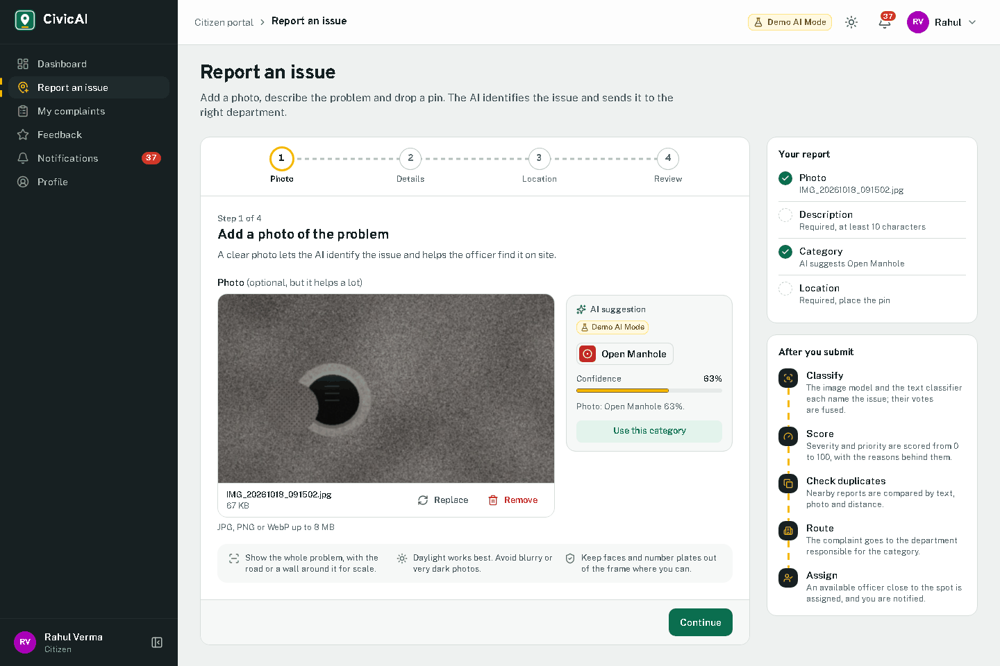

1. Drag a photo onto the box, or click to browse. On a phone, **Take photo** opens the rear camera.
2. JPG, PNG or WebP up to 8 MB. The server checks the real file format (a renamed file is refused), removes the
   photo's location and camera metadata, and stores a re-encoded copy under a random file name.
3. **Replace** and **Remove** change the photo. No photo? Choose **Continue without a photo**; the text and location
   then drive the analysis.

As soon as there is a photo, an **AI suggestion** appears: the category the engine would pick, its confidence and
what the photo alone said. **Use this category** copies it into the form. Nothing is stored at this point (the
suggestion calls `POST /api/ai/classify/`). If the AI is unsure (under 50 %), or flags its result for review (for
example when a confident photo and a confident description disagree), the suggestion says so.

> In Demo AI Mode the image heuristics may use a class word in the file name (for example `pothole_3.jpg`) as a
> hint. Such a hint is always disclosed in the analysis explanation. Phone camera names such as `IMG_1234.jpg` give
> no hint, and the public landing-page demo never uses file names.

**Step 2 - Details**

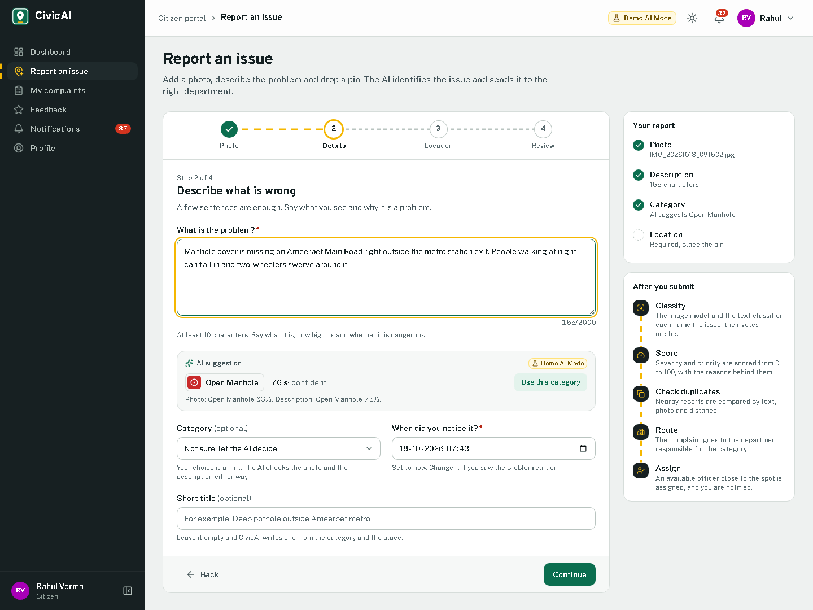

1. **What is the problem?** (required): 10 to 2000 characters. Say what it is, how big and whether it is dangerous.
   Hindi and Telugu words written in English letters (for example *gaddha*, *kachra*, *bijli*) are understood.
2. The **AI suggestion** now combines the photo and the description, for example "Photo: Open Manhole 63 %.
   Description: Open Manhole 75 %."
3. **Category** (optional): leave "Not sure, let the AI decide" or pick one. Your choice is only a hint; the AI
   checks the photo and the text either way.
4. **When did you notice it?**: set to now; change it if you saw the problem earlier. It cannot be in the future.
5. **Short title** (optional): leave it empty and CivicAI writes one from the category and the place, such as "Open
   Manhole near Ameerpet Metro Station, Ameerpet".

**Step 3 - Location**

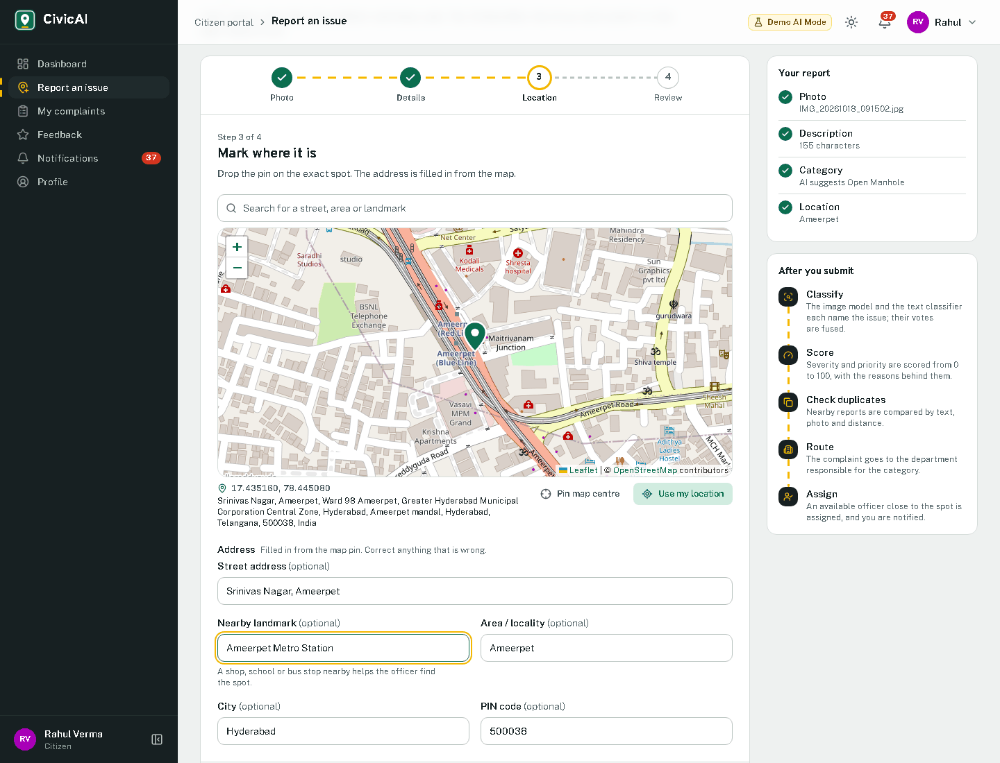

Put the pin on the exact spot in one of four ways:

- **Search for a street, area or landmark** (at least 3 characters, results from OpenStreetMap);
- **Use my location** (your browser asks for permission; phones need the HTTPS site, see
  [section 6](#6-using-civicai-on-a-phone-installable-app));
- click the map, or drag the pin;
- with the keyboard: move the map with the arrow keys and press **Pin map centre**.

The address fields (street address, nearby landmark, area / locality, city, PIN code) are filled in from the pin by
the backend's OpenStreetMap lookup. All are editable. "Approximate address from the map. Please check it." means
the lookup service was not reachable and a rough address was used. A landmark (a shop, school or bus stop) helps the
officer find the spot.

**Step 4 - Review**

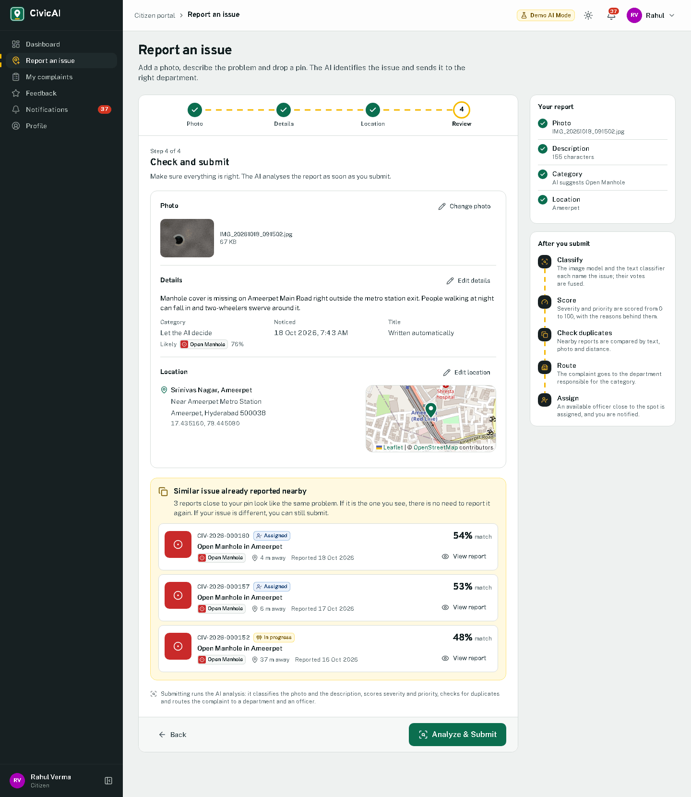

Check the photo, details and location; **Change photo**, **Edit details** and **Edit location** take you back.

If reports close to your pin look like the same problem, a yellow panel **Similar issue already reported nearby**
lists them with their overall match. The check compares your text, photo and distance with complaints within 300 m
from the last 30 days (`POST /api/ai/duplicates/`, nothing is stored) and lists matches of 45 % or more. It is
advice only: if your issue is different you can still submit. Reports by other citizens are shown without their
description, photo or exact address.

Press **Analyze & Submit**.

**The result: your AI work order**

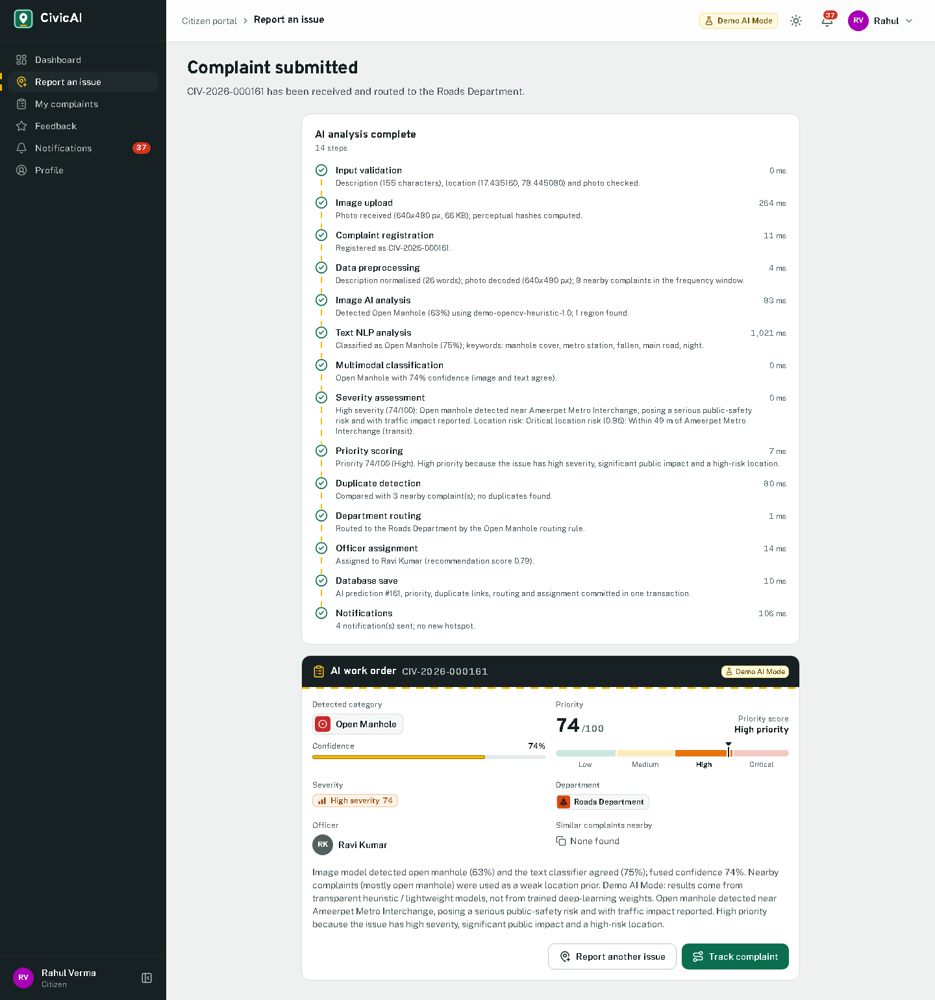

While the request runs, the page shows that the analysis is in progress. When the answer arrives it replays the real
pipeline: **Input validation, Image upload, Complaint registration, Data preprocessing, Image AI analysis, Text NLP
analysis, Multimodal classification, Severity assessment, Priority scoring, Duplicate detection, Department routing,
Officer assignment, Database save, Notifications**, each with its measured time and what it found. **Skip to
result** jumps to the end. The **AI work order** then shows:

- the detected category and the fused confidence;
- the severity (low / medium / high / critical with a 0-100 score) and the priority score on its 0-100 scale;
- the department and the officer it was assigned to;
- similar complaints nearby that were linked as possible duplicates (or "None found");
- the explanation in plain English.

**Track complaint** opens the tracking page; **Report another issue** starts a new wizard. You receive notifications
for the submission, the completed AI analysis, the department and the officer.

> This screenshot was taken on a private copy of the demo database, so that the demo data stayed unchanged; the same
> report on the demo system would receive the next free complaint number.

Good to know:

- Leaving the wizard with unsent input asks for confirmation.
- If the AI engine fails, the complaint is still saved and marked for manual review, and the administrators are told.
- By default a citizen can file at most 6 new complaints a minute and 40 a day.

### 3.4 Your complaints and the complaint page

**My complaints** (`/citizen/complaints`) lists everything you filed, with search, status, category, severity,
priority and date filters and a sort order. On a phone the table becomes cards.

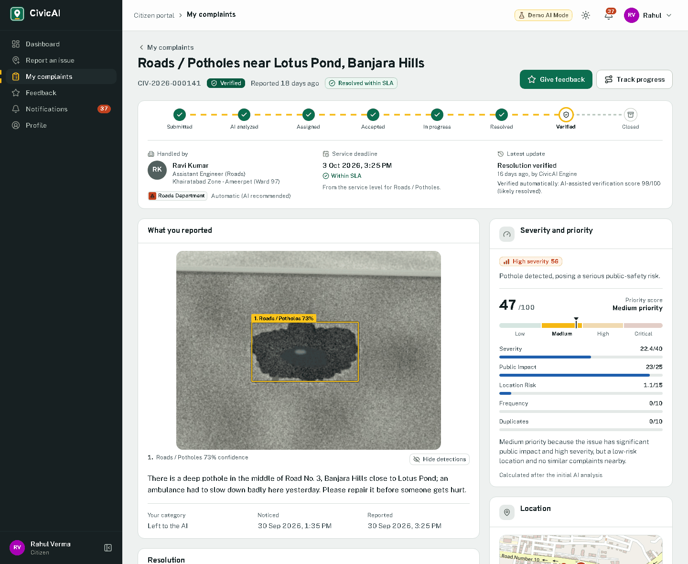

Opening a complaint (`/citizen/complaints/<id>`) shows:

- the **progress strip**: the lifecycle stops reached so far, who handles the complaint, the service deadline ("Within
  SLA" or overdue) and the latest update;
- **What you reported**: your photo with the regions the image model detected (**Hide detections** turns them off),
  your description, the category you chose and the times;
- **Severity and priority**: the severity reason, the priority score with its five components (Severity, Public
  Impact, Location Risk, Frequency, Duplicates, each as points out of its maximum) and the sentence that explains it;
- **Location**: a small map with **Open in OpenStreetMap** and **Directions**;
- **Updates**: the timeline (only events meant for you; officers' internal notes are hidden);
- further down, **AI analysis** (how the image model and the text classifier voted, how much weight each piece of
  evidence got, the severity factors, the location risk, keywords and impacts) and **Possible duplicates**.

Buttons at the top depend on the status: **Track progress**, **Give feedback**, **Reopen complaint**, and **Edit
complaint** / **Delete complaint** while the complaint is still waiting for an officer (submitted, AI analyzed or
assigned). Editing the description re-runs the AI analysis.

### 3.5 Track a complaint

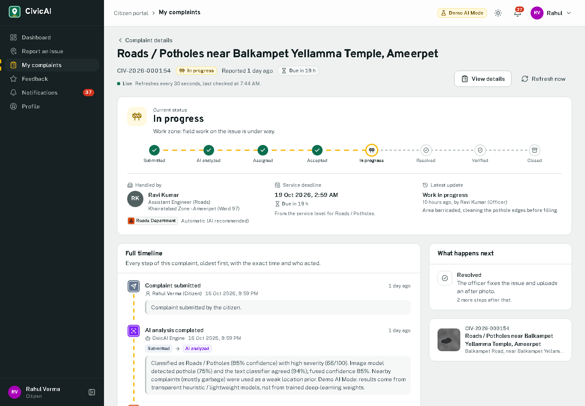

**Track progress** opens `/citizen/complaints/<id>/track`, a page made for following one complaint:

- the current status in words, the lifecycle road and who is handling it;
- the service deadline (for example "Due in 20 h") and the latest update;
- **What happens next**;
- the **full timeline**, oldest first, with the exact time and who acted ("CivicAI Engine" for automatic steps).

The page checks for news every 30 seconds while it is open ("Live - Refreshes every 30 seconds"), announces new
events, and has **Refresh now**.

### 3.6 Notifications

You are notified when your complaint is submitted, analysed, routed to a department and given an officer, when its
status changes, when it is resolved and verified, when your feedback is requested, when it looks similar to an
earlier report nearby, and when an officer or administrator merges it into that report.

- **The bell** shows the unread count and the five newest notifications, with **Mark all read** and **View all**.
- **Notifications** (`/citizen/notifications`): **All** and **Unread** tabs, grouped by day. Choosing a notification
  marks it read and opens its complaint; each row can also be marked read or deleted. **Mark all as read** clears
  the count.

> The profile's "Email me about my complaints" switch is stored, but this version sends in-app notifications only;
> no e-mail is sent.

### 3.7 See how your complaint was fixed

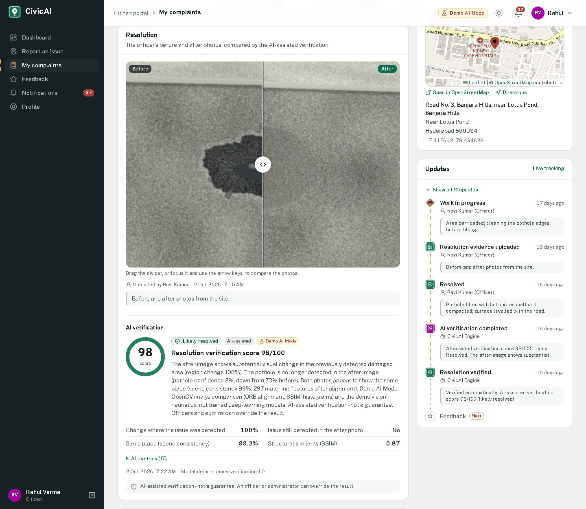

When the officer marks the complaint resolved, the complaint page shows a **Resolution** card:

- **Before / After** photos on a slider (drag the divider, or focus it and use the arrow keys);
- the officer's remarks;
- the **AI verification**: a score out of 100, a verdict (Likely resolved, Partially resolved, Not resolved or Needs
  manual review), the reasons, the key measurements, and the note "AI-assisted verification - not a guarantee".

A "likely resolved" result verifies the complaint automatically; other results go to a person (the officer or an
administrator) for a manual decision.

### 3.8 Rate the fix (feedback)

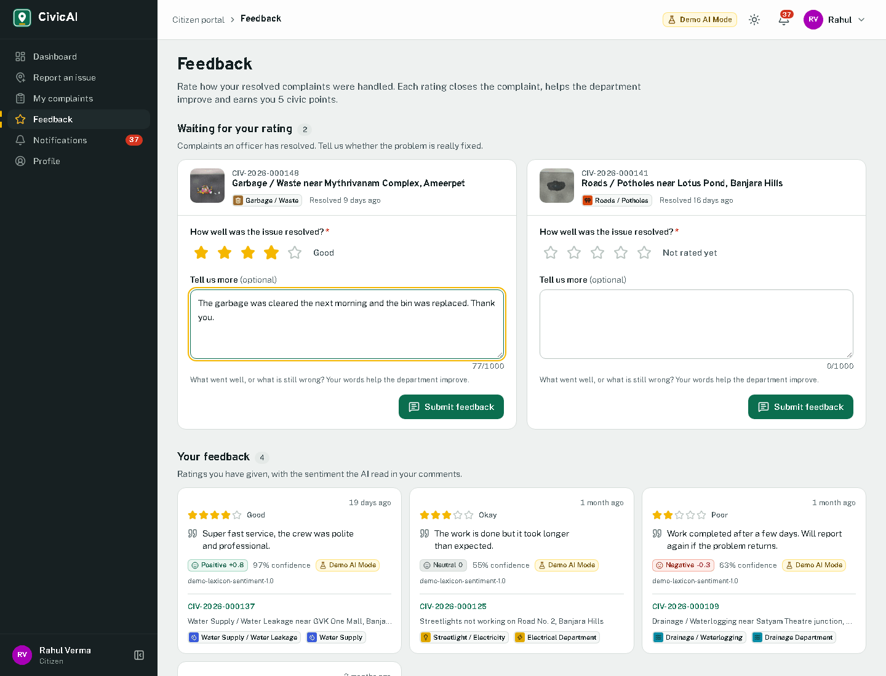

Complaints that are resolved or verified wait for your rating on **Feedback** (`/citizen/feedback`), on the dashboard
(**Rate the fix**) and on the complaint page (**Give feedback**).

1. Choose 1 to 5 stars (required).
2. Optionally tell what went well or what is still wrong (up to 1000 characters).
3. Press **Submit feedback**.

Your rating closes the complaint and earns 5 civic points. The comment's sentiment (positive, neutral or negative) is
analysed and shown with your feedback under **Your feedback**. With 1 or 2 stars the page offers to reopen the
complaint (while the 14-day reopen window is open), and the administrators are alerted; negative comments alert them
too.

### 3.9 Reopen a complaint

If the problem is not fixed or comes back, use **Reopen complaint** on the complaint page. It is offered for
resolved, verified and closed complaints for 14 days after the resolution (`REOPEN_WINDOW_DAYS`).

1. Explain **What is still wrong?** (required).
2. Confirm. The complaint returns to the officer with your reason, the officer and the administrators are notified,
   and its priority rises by 5 points per reopen (counted at most twice).

After the officer fixes it again, you can rate the new resolution.

### 3.10 Your profile

**Profile** (`/citizen/profile`): upload, change or remove a profile photo; edit your name and mobile number (the
e-mail is your login and cannot be changed here); fill in your address, area, city, PIN code, date of birth, gender
and preferred language; and change your password (current password, new password, confirm).

---

## 4. Officer guide

Officers see the complaints assigned to them and, on request, the other complaints of their department. Ravi Kumar
(`roads.officer1@civicai.local`) has a mixed queue in the demo data, including three critical open-manhole reports at
Ameerpet Metro Station.

### 4.1 Your dashboard

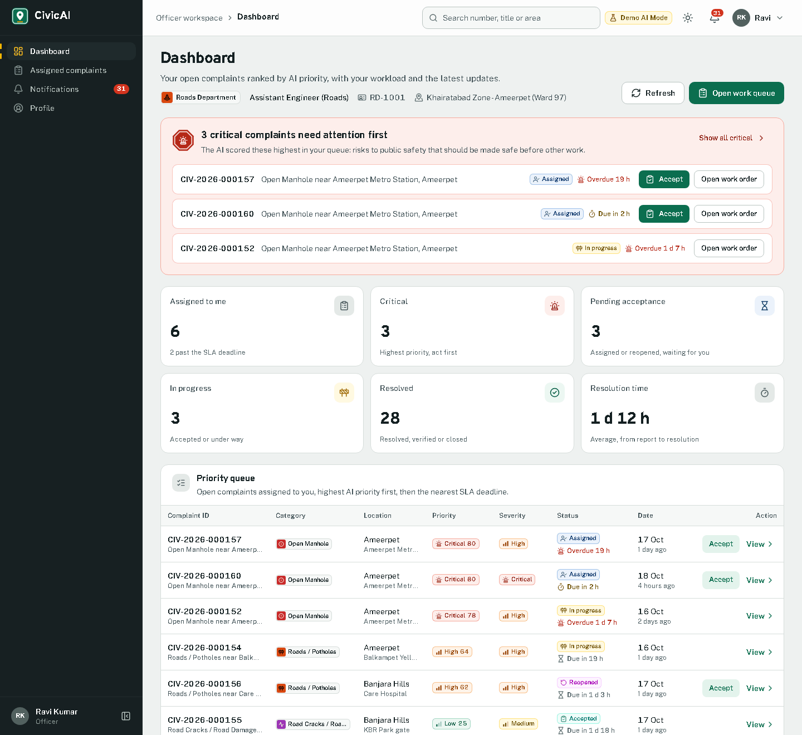

`/officer/dashboard` puts the riskiest work first:

- a red panel **critical complaints need attention first**, with **Accept** and **Open work order** buttons;
- **Assigned to me** (with how many are past the deadline), **Critical**, **Pending acceptance**, **In progress**,
  **Resolved** and the average **Resolution time**;
- the **Priority queue**: your open complaints, highest AI priority first, then the nearest deadline, with ID,
  category, location, priority, severity, status, date and action;
- **Recent activity** on your complaints, your **Workload** (open complaints against your capacity) and **Duplicates
  to review**.

### 4.2 Your work queue

**Assigned complaints** (`/officer/complaints`) is the full queue:

- tabs **Assigned to me** and **My department**;
- search, status, category, severity, priority and time filters, a sort order (**Highest priority** by default), and
  the switches **Overdue only**, **Has possible duplicates**, **Needs manual review** and **No officer assigned**;
- **List** or **Map**: the map shows the same complaints as clustered pins;
- **Accept** directly in the list for complaints waiting for you.

### 4.3 The work order

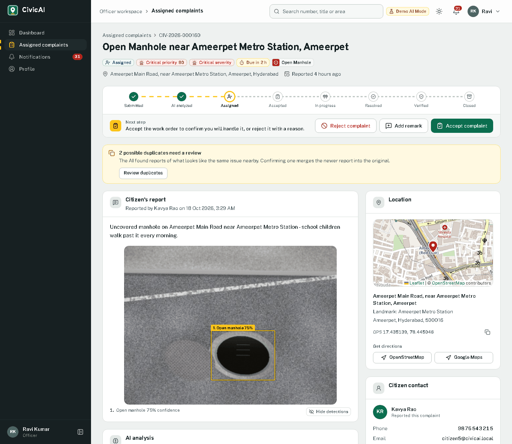

Opening a complaint (`/officer/complaints/<id>`) gives you everything you need on site:

- the **Next step** strip with the buttons for the next action (for a new assignment: **Reject complaint**, **Add
  remark**, **Accept complaint**);
- a yellow notice when **possible duplicates need a review**, with **Review duplicates**;
- the **Citizen's report**: description and photo with the AI's detection boxes;
- **Location** with the GPS position and **Get directions** buttons for OpenStreetMap and Google Maps;
- **Citizen contact** (**Call citizen**, **Email citizen**) and **Service level and dates**;
- the **AI analysis**, the **Priority** breakdown, **Possible duplicates**, **Resolution evidence**, the **Timeline**
  (including internal notes) and the **Assignment**, with the reasons the recommendation engine chose you.

### 4.4 Accept, reject, start work and remarks

| Button | When | What happens |
|---|---|---|
| **Accept complaint** | assigned or reopened | Status "accepted"; the citizen is told. |
| **Reject complaint** | assigned or accepted | A reason is required; the citizen and the administrators read it. |
| **Start work** | accepted or reopened | Status "in progress". |
| **Add remark** | any time | A note on the timeline. Switch **Visible to citizen** off for an internal note that only officers and administrators see. |

Only the officer the complaint is assigned to can take these steps. Department colleagues can read the complaint and
add remarks.

### 4.5 Record the resolution

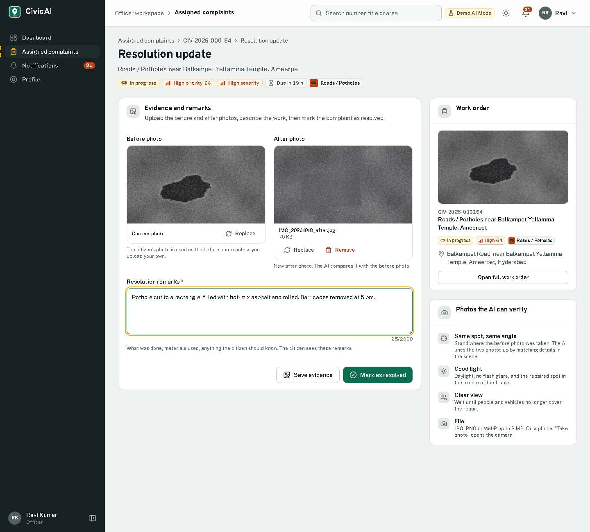

**Mark as resolved** (or the work order's resolve button) opens `/officer/complaints/<id>/resolve`:

1. **Before photo**: the citizen's photo is used unless you upload your own (**Replace**).
2. **After photo**: take it from the same spot and angle as the before photo; on a phone **Take photo** opens the
   camera. The **Photos the AI can verify** card lists what makes a good after photo (same spot and angle, good
   light, clear view).
3. **Resolution remarks** (required): what was repaired, the materials used, when the site was safe again. The
   citizen sees these remarks.
4. Choose:
   - **Save evidence** stores the photos without resolving (for example the before photo at the start of the work);
   - **Mark as resolved** stores the photos and resolves the complaint.

With an after photo, the AI-assisted verification runs immediately and the result appears on the page:

| AI result | What the platform does |
|---|---|
| Likely resolved (score 70 or more by default) | The complaint becomes **verified**; the citizen is asked for feedback. |
| Partially resolved (45-69) or Not resolved | The complaint is flagged for manual review; you and the administrators are notified. |
| Needs manual review (poor photo quality, or the photos may not show the same place) | The administrators are asked to decide. |

The thresholds are administrator settings ([section 5.11](#511-system-settings)); automatic verification can be
switched off there.

### 4.6 Verification and manual decisions

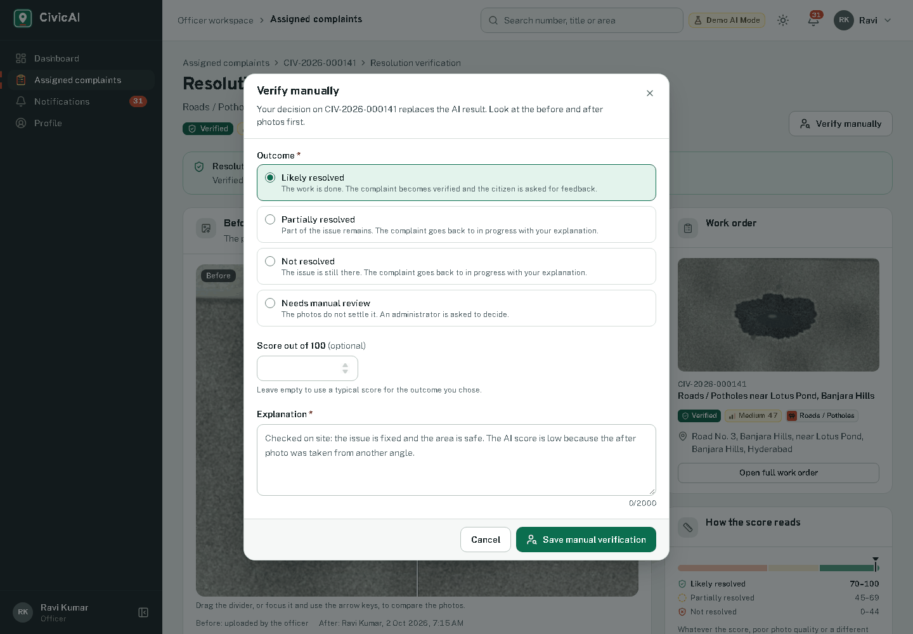

`/officer/complaints/<id>/verify` shows the before / after photos the verification judged, the latest result, the
score bands with the live thresholds, and the history of every verification. Depending on the status you can:

- **Run AI verification** again (a resolved complaint with an after photo);
- **Verify manually**: choose an outcome and explain it. **Likely resolved** verifies the complaint and asks the
  citizen for feedback; **Partially resolved** and **Not resolved** send the work back to "in progress" with your
  explanation; **Needs manual review** passes the decision to the administrators. The score is optional (a typical
  value for the outcome is used when it is left empty);
- **Request manual review**: ask an administrator to look at the evidence (for example when you disagree with the AI).

You can record a manual decision while the complaint is resolved, and also after an AI result verified it (until the
citizen's feedback closes it). A decision an administrator made is not yours to change.

### 4.7 Reviewing duplicates

When the AI links reports that look like the same problem, the work order and the dashboard show them. For each pair
you see the description, photo and location similarity and the distance. **Confirm duplicate** merges the newer
report into the original (it is closed with the remark "Merged into <number>" and its citizen is told), **Not a
duplicate** keeps both open. Nothing is ever deleted. Officers review pairs that involve their own or their
department's complaints; administrators see all of them ([section 5.4](#54-duplicate-review)).

### 4.8 What officers are notified about

New assignments, reassignments, critical complaints assigned to you, reopened complaints, high-priority complaints
past their deadline (the SLA check), verification results that need a manual decision, and citizens' feedback.

---

## 5. Administrator guide

Administrators see every complaint and run the reference data, the AI settings and the analytics.

### 5.1 Dashboard

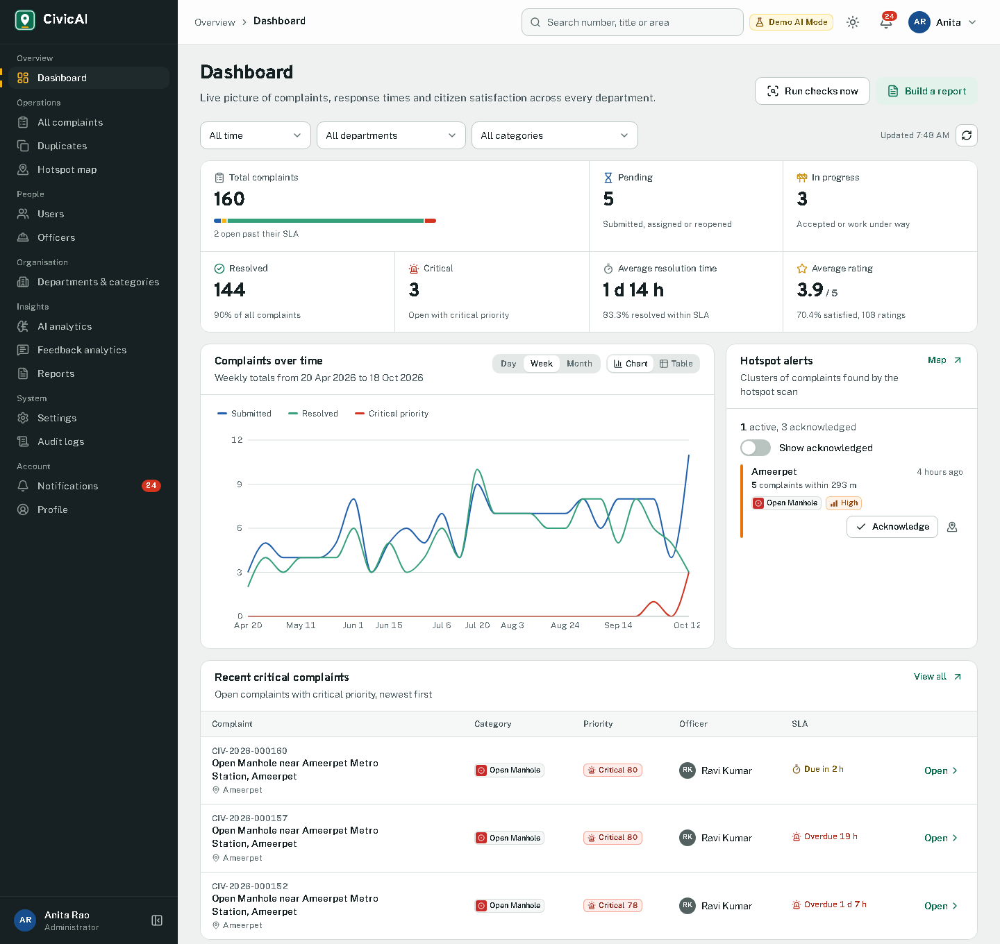

`/admin/dashboard` is the live picture of the city. One filter row (date range, department, category) drives every
number, and every number comes from the analytics API.

- **Key figures**: total complaints (with a bar split by status group), pending, in progress, resolved, open critical
  complaints, average resolution time (and the share resolved within the SLA), average rating (and the satisfaction
  rate).
- **Complaints over time**: submitted, resolved and critical-priority lines by **Day**, **Week** or **Month**.
- **Hotspot alerts** from the hotspot scan: **Acknowledge** an alert or open it on the map; **Show acknowledged**
  shows the older ones.
- **Recent critical complaints**, newest first.
- Further down: a **Hotspots** mini map, and charts of complaints by category and department, status, severity and
  priority distributions, resolution time, citizen sentiment and satisfaction.

**Run checks now** runs the SLA breach check and the city-wide hotspot scan immediately and reports how many alerts
they raised. Normally a built-in scheduler runs them every hour and every 6 hours (`PERIODIC_CHECKS`, see
[backend/README.md](../backend/README.md), section 5). **Build a report** opens Reports.

### 5.2 All complaints and the map

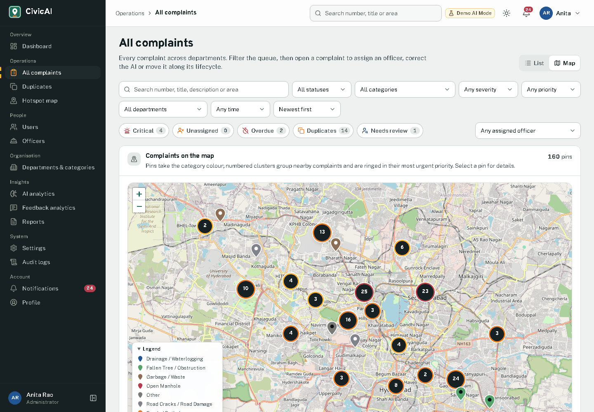

`/admin/complaints` lists every complaint across departments:

- filters: search, statuses (several at once), category, severity, priority, department, reported date range, sort
  order and assigned officer;
- quick chips **Critical**, **Unassigned**, **Overdue**, **Duplicates** and **Needs review**, each with the number of
  complaints it would show together with the other filters;
- **List** (priority, severity and date sort on the server) or **Map**: pins in the category colour, numbered
  clusters ringed in their most urgent priority, and a popup per pin with a link to the complaint.

### 5.3 Complaint management

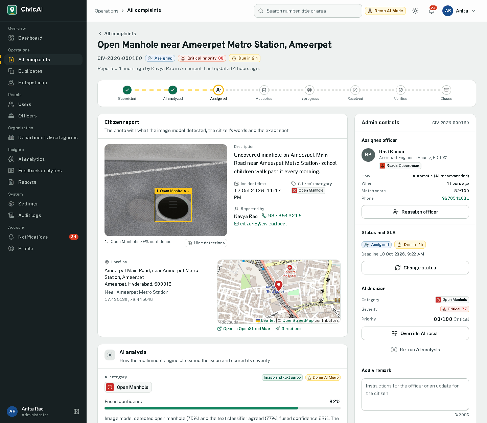

`/admin/complaints/<id>` shows the whole record (citizen report, AI analysis, priority breakdown, evidence and
verification, feedback, duplicates) next to the **Admin controls**:

- **Assigned officer** and **Reassign officer** (see below).
- **Status and SLA** and **Change status**: administrators may move a complaint to any status; remarks are required
  because the citizen and the officer read them. **Close complaint** and **Reopen complaint** appear when they apply.
- **AI decision** and **Override AI result**: correct the category, the severity and/or set the priority score by
  hand, with a required reason. A new category re-routes the complaint to that category's department; without a
  manual score the priority is recalculated. The old and new values go to the timeline and the audit log, and a
  manual priority stays until it is explicitly replaced.
- **Re-run AI analysis**: runs the pipeline again and replays its steps. It stores a new prediction, keeps your
  overrides and keeps the assigned officer.
- **Add remark**, with **Show to the citizen** to choose between a public remark and an internal note.
- For resolved complaints: **Run AI verification** and **Verify manually** (as in
  [section 4.6](#46-verification-and-manual-decisions)).

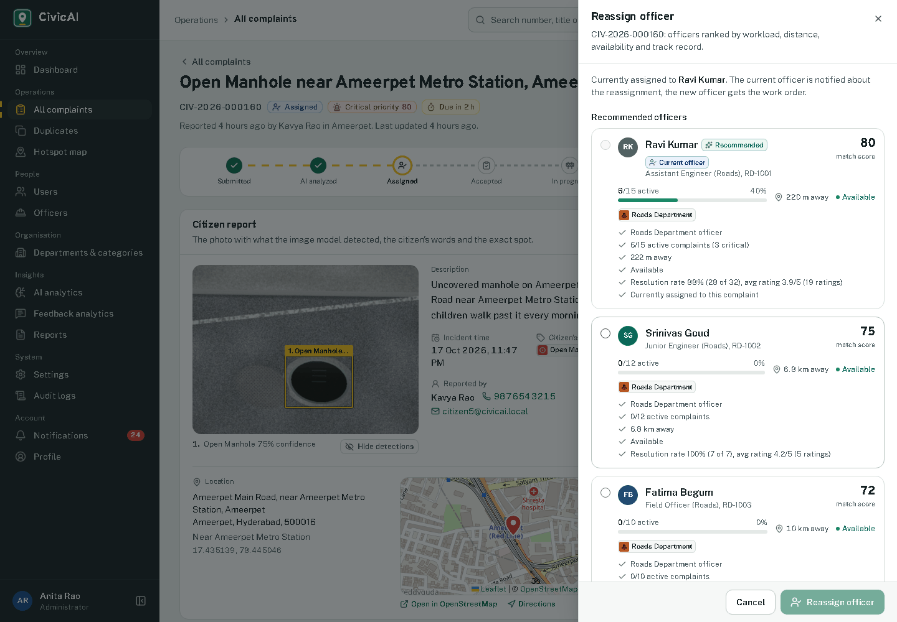

**Reassign officer** opens a panel that ranks the officers with the recommendation engine. Each candidate shows a
match score, the workload bar (active complaints against capacity), the distance from the officer's base, the
availability and the reasons. The score is 0.40 x spare capacity + 0.25 x proximity + 0.15 x availability + 0.20 x
track record (for critical complaints track record counts 0.30 and capacity 0.30); officers at or over capacity are
ranked last. The top candidate carries the **Recommended** badge, but you may pick anyone. The previous officer, the
new officer and the citizen are notified.

### 5.4 Duplicate review

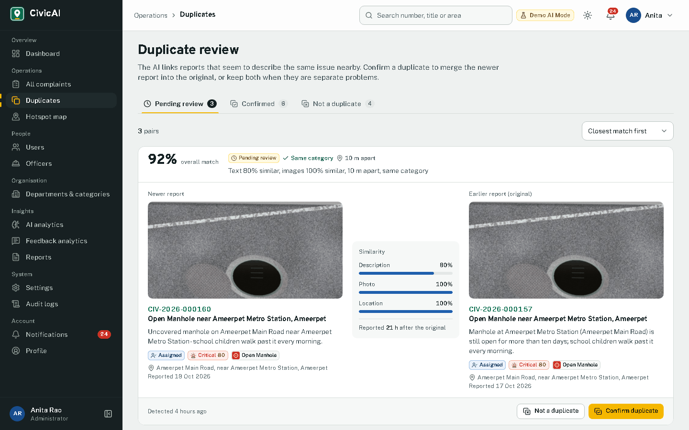

`/admin/duplicates` is the queue of report pairs the AI thinks describe the same issue, with the tabs **Pending
review**, **Confirmed** and **Not a duplicate**. Each pair shows the newer report and the earlier original side by
side, the overall match and the description, photo and location similarity, the distance and the time between them.

- **Confirm duplicate**: the newer report is closed with the remark "Merged into <original>" and points to the
  original; its citizen is notified; the original's priority is recalculated (more reports, higher priority).
- **Not a duplicate**: both stay open.

Both decisions accept an optional note and are audit-logged. A report cannot be merged into an original that is
already resolved, verified or closed: the problem has come back, so the newer report should stay open (or the
original should be reopened first).

### 5.5 Users and officers

- **Users** (`/admin/users`): every account with search and role / status filters, the number of complaints and the
  civic points. **Create user** makes citizen or administrator accounts. Opening a row shows the details, with
  **Deactivate** / **Activate**. Deactivating keeps the account and its history but blocks sign-in; you cannot
  deactivate yourself.
- **Officers** (`/admin/officers`): the field officers with department, workload bar ("Over capacity" when active work
  exceeds capacity), resolved count, rating and an availability switch that saves immediately. **Add officer** creates
  the account and the officer profile in one step (department, employee id, designation, zone, base location on a
  map, capacity, skills). The workload panel lists an officer's open complaints. Deactivating an officer keeps the
  history and reports the open complaints that need a new officer.

### 5.6 Departments, categories and routing

**Departments & categories** (`/admin/departments`) has three tabs.

- **Departments**: create and edit departments with their SLA hours and contacts, and see the live counts. Deleting a
  department that still has complaints or officers deactivates it instead.
- **Categories**: what citizens report and what the AI predicts.

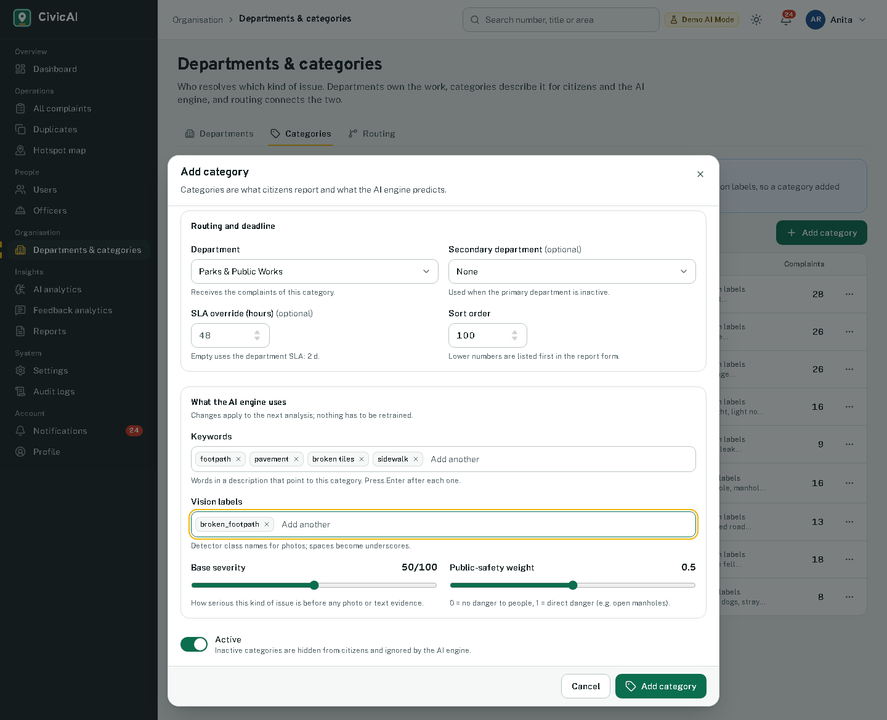

**Add category** asks for a name (the slug, the AI class name, is derived from it and cannot change later), a
description, icon and colour, the **Department** that receives it and an optional **Secondary department**, an SLA
override, the sort order, and **What the AI engine uses**: **Keywords** (press Enter after each), **Vision labels**,
**Base severity** and **Public-safety weight**. As the form says, changes apply to the next analysis and nothing has
to be retrained: the text classifier blends in the keywords and the fusion and routing use the new category at once.
A category in use is deactivated rather than deleted.

- **Routing**:

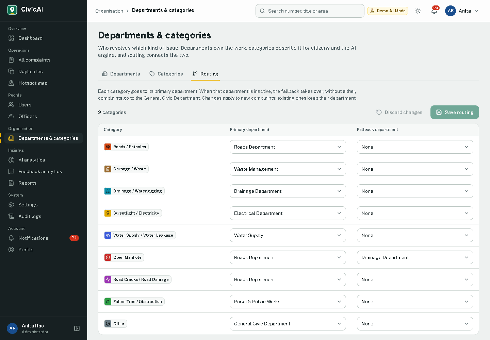

Each category goes to its **Primary department**; if that department is inactive the **Fallback department** takes
over, and without either the complaint goes to the General Civic Department. **Save routing** applies to new
complaints; existing ones keep their department. The defaults follow the requirements: potholes, road cracks and open
manholes to Roads (open manholes fall back to Drainage), garbage to Waste Management, drainage to Drainage,
streetlights to Electrical, water leaks to Water Supply, fallen trees to Parks & Public Works and "Other" to the
General Civic Department.

### 5.7 Hotspot map

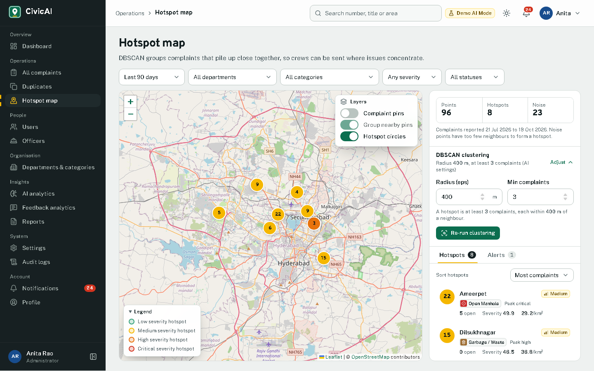

`/admin/hotspots` shows where complaints pile up, found with DBSCAN clustering on latitude and longitude.

- **Filters**: period (**Last 90 days** by default, or a date range), department, category, severity and status.
- **Layers**: **Hotspot circles** (coloured by severity, sized by radius) are on by default; **Complaint pins** adds
  the individual complaints, optionally grouped (**Group nearby pins**). When two hotspots are close together at the
  current zoom, their count badges are moved apart just enough that both stay readable and clickable; the circles
  stay on the true positions.
- The panel shows the **Points** analysed, the **Hotspots** found and the **Noise** (complaints with too few
  neighbours), and lists the hotspots with their size, dominant category, open complaints, average severity and
  density. Choosing one flies the map to it. The **Alerts** tab lists the hotspot alerts.
- **DBSCAN clustering > Adjust**: **Radius (eps)** in metres (50 to 5000) and **Min complaints** (2 to 50), then
  **Re-run clustering**. "A hotspot is at least N complaints, each within R m of a neighbour." The values only change
  this view (they are kept in the address bar); **Use defaults** returns to the AI settings (400 m and 3 complaints
  by default).

The map analyses whatever period you choose. Hotspot **alerts** are different: they consider open complaints of the
last 30 days and are raised when a cluster reaches 5 complaints (the "Alert from" setting), at most once a day per
place.

### 5.8 AI analytics

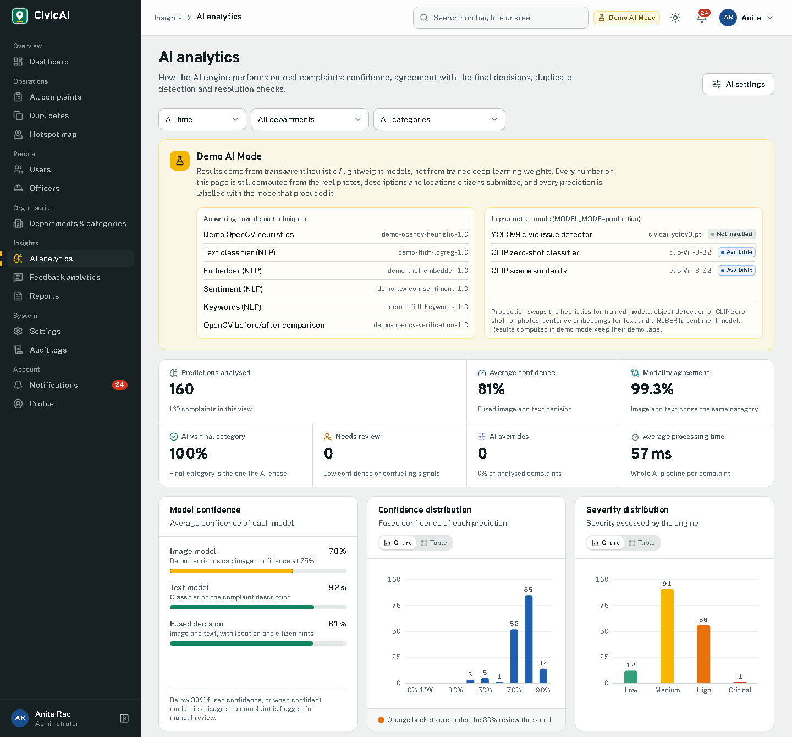

`/admin/ai-analytics` shows how the AI engine performs on the complaints in the chosen period: which models answer
now and which take over in production mode; the number of predictions, average confidence, how often the image and
text models agreed, how often the final category is the AI's, how many predictions needed review or were overridden,
and the average processing time; model confidence, the confidence distribution (buckets under the 30 % review
threshold in orange), the severity distribution, predictions by category, an **AI category vs final category**
matrix, duplicate detection precision, resolution verification outcomes, and officer workload and department
performance tables (including SLA compliance).

> The demo data was generated with matching photos and texts, so figures such as "image and text agree 99.3 %" describe
> the generator, not real-world accuracy. See [AI_ENGINE.md](AI_ENGINE.md), section 13, for the evaluation.

### 5.9 Feedback analytics

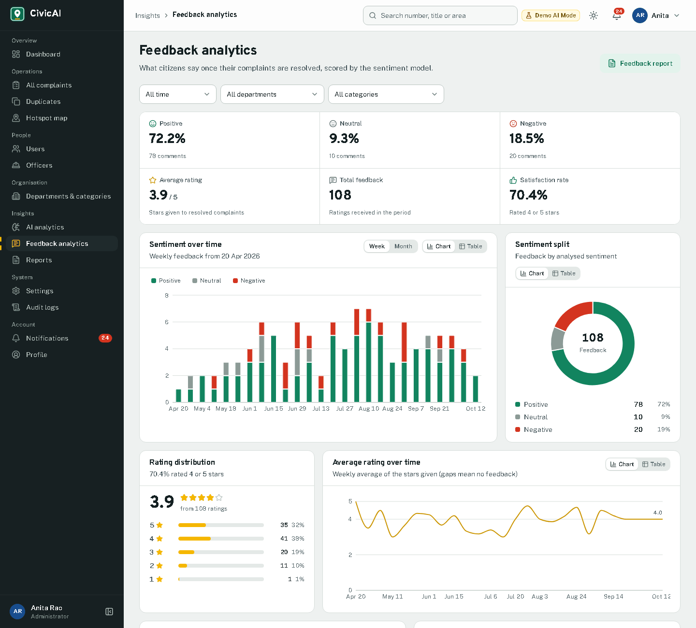

`/admin/feedback` summarises what citizens say after a fix: positive / neutral / negative shares, average rating,
number of ratings and satisfaction rate (4 or 5 stars); sentiment over time by week or month; the sentiment split;
the rating distribution and average rating over time; sentiment by department and by category (as shares or counts);
the top words and phrases in praise and in complaints; and a table of recent feedback with its own sentiment and
rating filters, each row linking to its complaint.

### 5.10 Reports

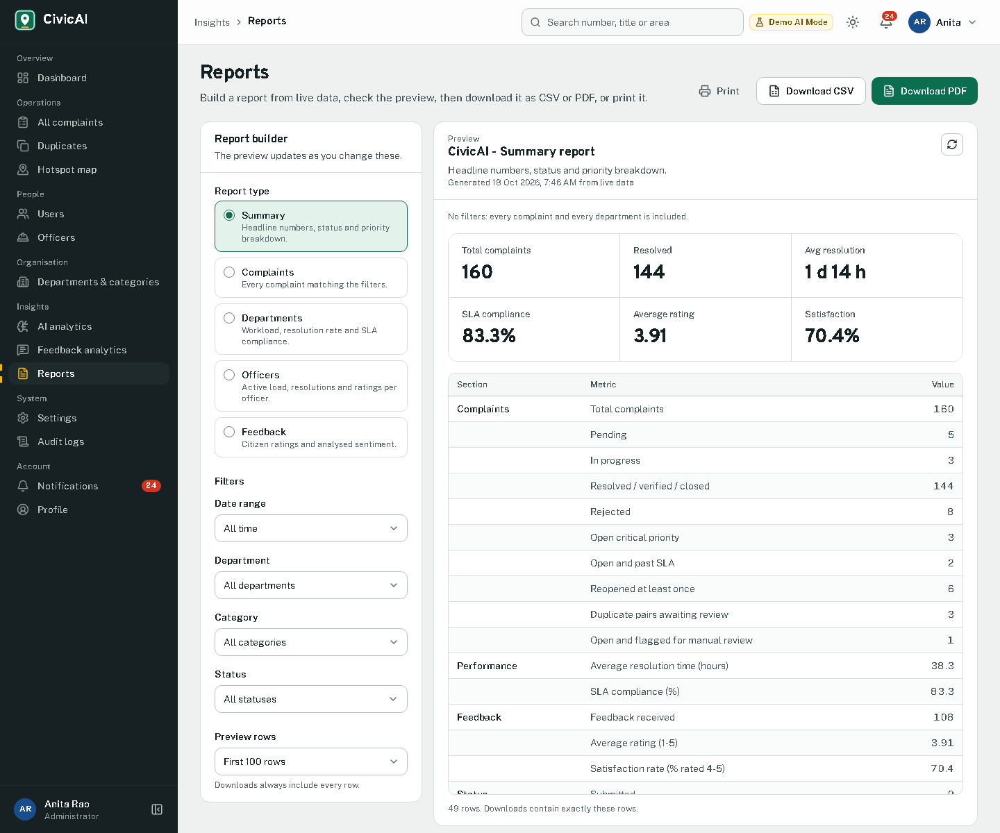

`/admin/reports` builds a report from live data:

1. Choose the **Report type**: **Summary**, **Complaints**, **Departments**, **Officers** or **Feedback**.
2. Set the filters (date range, department, category, status) and the number of preview rows.
3. Check the preview, then **Download CSV** (up to 50,000 rows), **Download PDF** (up to 1,500 rows) or **Print**.

Downloads always contain every matching row up to those limits, and each download is recorded in the audit log.

### 5.11 System settings

`/admin/settings` has six tabs.

**AI configuration**

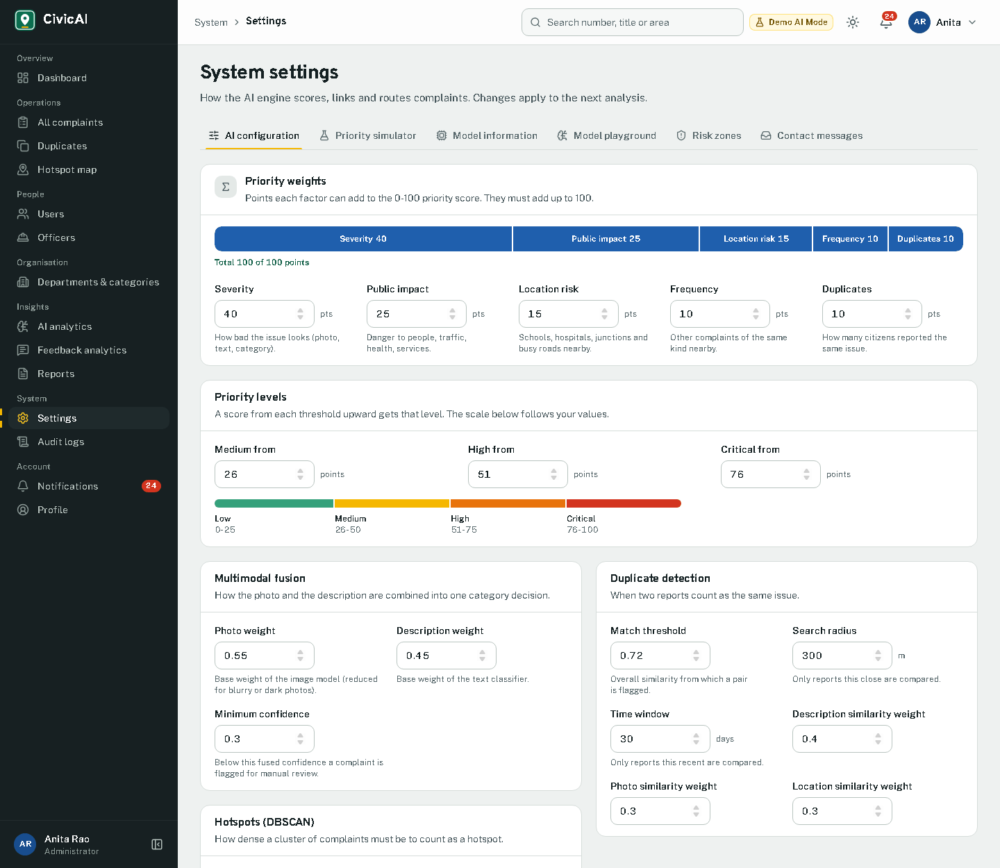

- **Priority weights**: the points each factor can add to the 0-100 priority score (Severity 40, Public impact 25,
  Location risk 15, Frequency 10, Duplicates 10 by default). They must add up to 100; the bar shows the total live.
- **Priority levels**: Medium from 26, High from 51, Critical from 76 (also used for severity levels).
- **Multimodal fusion**: photo weight 0.55, description weight 0.45, minimum confidence 0.3 (below it a complaint is
  flagged for review).
- **Duplicate detection**: match threshold 0.72, search radius 300 m, time window 30 days, and the description /
  photo / location similarity weights 0.4 / 0.3 / 0.3.
- **Hotspots (DBSCAN)**: neighbourhood radius 400 m, minimum complaints 3, alert from 5 complaints.
- **Resolution verification**: likely resolved from 70, partially resolved from 45.
- **Automation and alerts**: assign officers automatically, verify resolutions automatically, nearby radius 500 m,
  frequency window 30 days, high-priority alert after 48 hours.

**Save** applies the settings to the next analyses; **Save & recalculate open complaints** also re-scores the
priority of every open complaint with the new weights. Invalid values (weights that do not add up to 100, thresholds
out of order) are refused with a message. Every change is audit-logged with the old and new values; **Discard
changes** reverts the form.

**Priority simulator**

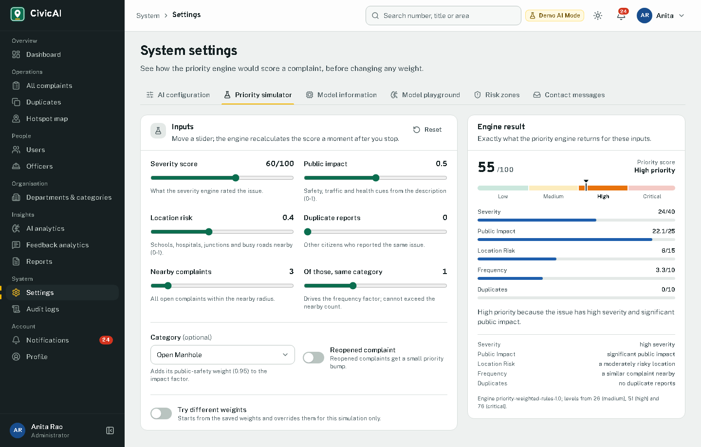

Move the sliders (severity score, public impact, location risk, duplicate reports, nearby complaints and how many of
them have the same category), pick a category (it adds its public-safety weight) and the **Reopened complaint**
switch; the **Engine result** shows the score, the level, the five components and the explanation exactly as the
priority engine computes them. **Try different weights** tests other weights for this simulation only. Nothing is
stored.

**Model information**: the mode with its explanation, the models answering now and the production models with their
status (for example "Not installed" for the YOLO detector, whose weights are not shipped, and "Available" for CLIP),
the engine components with their live settings, the models this server process has loaded, and the steps to switch to
production mode.

**Model playground**

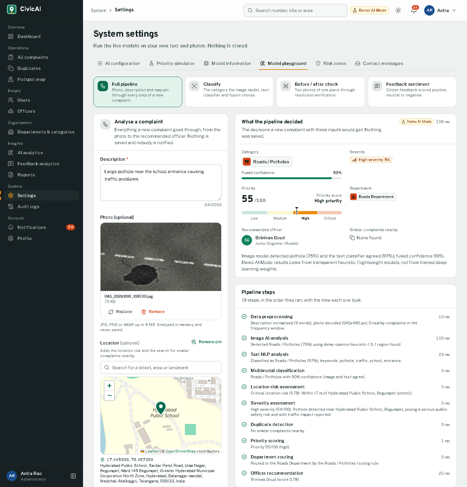

Try the live engines on your own input without creating any data (60 requests a minute per user):

- **Full pipeline**: a description, an optional photo, an optional map pin and citizen category go through every step
  a new complaint would, up to the recommended officer. The screenshot runs the requirements' example, "Large pothole
  near the school entrance causing traffic problems.", with a pothole photo pinned at a school: Roads / Potholes,
  high severity, high priority, Roads Department.
- **Classify**: the fused category of a description and/or photo, with each model's vote.
- **Before / after check**: two photos through the resolution verification.
- **Feedback sentiment**: feedback text with an optional star rating.

**Risk zones**: the schools, hospitals, markets, junctions and stations the location-risk factor uses, on a map and in
a table, with **Add risk zone**, edit and delete. The demo has 12 zones in Hyderabad.

**Contact messages**: the public contact form's inbox, with **Mark resolved** / **Reopen**; replies go out from your
own e-mail program.

### 5.12 Audit logs

`/admin/audit-logs` records who did what, when and from which address: sign-ins (failed ones too), registrations,
password changes, creations, edits and deletions, status changes, assignments and reassignments, AI overrides,
verifications, duplicate reviews, configuration changes and report exports. Filter by action, entity, date range or
search text; each entry expands to show its recorded changes as old and new values.

---

## 6. Using CivicAI on a phone (installable app)

CivicAI is a progressive web app (PWA): it works in a phone browser and can be installed like an app.

**On a phone the layout changes**: citizens get a bottom tab bar (**Home**, **Complaints**, a raised yellow
**Report** button, **Alerts** and **Profile**), tables become cards, filters open in a drawer, and the Demo AI Mode
notice becomes a strip under the top bar.

**Use the HTTPS address.** Browsers only allow installing a web app and reading the GPS position ("Use my location")
on secure (HTTPS) sites, with `localhost` on the computer itself as the only exception. Use the deployed site (see
[DEPLOYMENT.md](DEPLOYMENT.md)); the service worker that makes the app installable is registered only by the
production build (`npm run build`), not by the development server. ("Take photo" is an ordinary file input, so the
camera works on any address.)

**Install on Android (Chrome)**

1. Open the site and log in once.
2. Open the browser menu and choose **Install app** or **Add to Home screen** (the wording depends on the Chrome
   version).
3. Start CivicAI from the home screen icon; it opens without the browser's address bar. A long press on the icon
   offers the shortcuts **Report an issue** and **My complaints**.

**Install on iPhone or iPad (Safari)**: open the site, tap **Share**, then **Add to Home Screen**.

**Reporting from a phone**

1. Tap **Report**.
2. **Take photo** opens the rear camera; take the photo in daylight with the whole problem in view.
3. Type the description, tap **Continue**, and use **Use my location** at the spot (allow location access when asked),
   or drag the pin.
4. Review and tap **Analyze & Submit**.

**Offline behaviour**: once opened, the app shell (the start page, icons and the scripts you have already loaded) is
cached, so the app starts without a connection; without any cached copy it shows a "You're offline" page. Complaint
data and photos always come from the server and are never cached, so reporting and tracking need a connection. A new
deployment updates the installed app automatically and clears the old cache.

---

## 7. Troubleshooting

| Problem | Why it happens and what to do |
|---|---|
| **Use my location** fails | Location permission was refused, the site is not HTTPS, or the GPS fix timed out. Search for the place or click the map instead. |
| The address says "Approximate address from the map" | The OpenStreetMap lookup was not reachable (or geocoding is switched off on the server). Correct the fields by hand. |
| "AI suggestion unavailable" or "Too many suggestions in a short time" | The AI endpoints allow 60 requests a minute per user. Wait a minute or choose the category yourself; submitting still works. |
| Cannot submit more reports | New complaints are limited to 6 a minute and 40 a day per citizen (server defaults). |
| **Edit complaint** is missing | Citizens can edit or delete only until an officer accepts the complaint. |
| **Reopen complaint** is missing | Reopening is possible for 14 days after the resolution. Ask an administrator after that. |
| An officer cannot accept or resolve | Only the officer the complaint is assigned to can; department colleagues can read it and add remarks. Administrators can reassign it. |
| Confirming a duplicate fails | The original is already resolved, verified or closed. Mark the pair "Not a duplicate" (the problem came back) or reopen the original first. |
| You were signed out | Sessions end after 7 days without activity, and changing a password signs out every other session. Log in again. |
| A photo is refused | Only real JPEG, PNG or WebP files up to 8 MB and 8000 px per side are accepted. |
