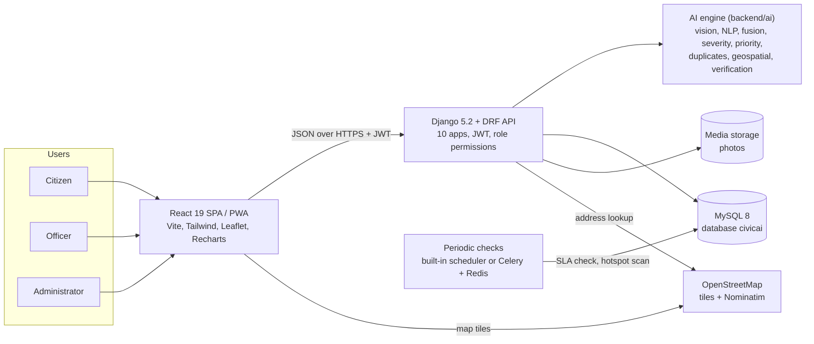
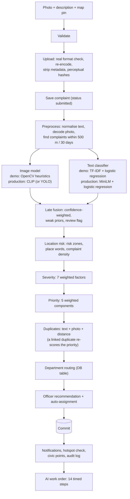

# CivicAI viva guide

Preparation notes for the project defence of **CivicAI - A Multimodal AI-Based Multi-Department Civic Issue
Detection, Prioritization and Resolution Platform**. The answers are grounded in this codebase; every number was
checked on 18 October 2026 against the code, the evaluation reports in the repository, the test run or the running
demo system (MySQL `civicai`, Demo AI Mode). File paths are relative to the repository root.

Deeper references: [ARCHITECTURE.md](ARCHITECTURE.md), [AI_ENGINE.md](AI_ENGINE.md),
[REQUIREMENTS_TRACEABILITY.md](REQUIREMENTS_TRACEABILITY.md), [TESTING.md](TESTING.md),
[USER_GUIDE.md](USER_GUIDE.md), [DEPLOYMENT.md](DEPLOYMENT.md).

## Contents

1. [The 2-minute pitch](#1-the-2-minute-pitch)
2. [The architecture in five sentences](#2-the-architecture-in-five-sentences)
3. [How a complaint flows through the AI pipeline](#3-how-a-complaint-flows-through-the-ai-pipeline)
4. [Numbers to know](#4-numbers-to-know)
5. [Likely examiner questions](#5-likely-examiner-questions)
6. [Demo script (about 10 minutes)](#6-demo-script-about-10-minutes)
7. [Where things are in the code](#7-where-things-are-in-the-code)

---

## 1. The 2-minute pitch

> City corporations receive a constant stream of civic complaints: potholes, garbage dumps, dark streetlights, open
> manholes. They usually arrive as phone calls or free-text forms. Someone has to read each one, work out which
> department owns it and how urgent it is, and the same pothole is often reported again and again. CivicAI automates
> that triage with AI, and keeps a person in charge of every decision that matters.
>
> A citizen reports a problem from a phone with a photo, one sentence and a pin on the map. Within a second or two
> the backend runs an AI pipeline. An image model and a text classifier each predict the category, and a late-fusion
> step combines them and flags disagreement. A severity engine scores how dangerous the issue is from seven factors,
> and a priority engine turns severity, public impact, location risk, recurrence and duplicate reports into a score
> from 0 to 100, with a sentence that explains it. A duplicate detector compares the report with nearby complaints by
> text, photo and distance. The complaint is routed to the right department, and a recommendation engine assigns the
> best-placed officer by workload, distance, availability and track record.
>
> The officer accepts the work order, fixes the problem and uploads an after photo. The system compares the before
> and after photos and verifies the repair, or asks a person to check. The citizen rates the fix, the comment is
> sentiment-analysed, and administrators get live dashboards, DBSCAN hotspot maps, AI analytics and PDF reports.
>
> It is a complete, running system: a Django REST API on MySQL, a React web app that installs on a phone,
> 117 API endpoints, 707 backend tests and 112 browser tests. The AI runs in an honest "Demo AI Mode" with lightweight
> models, and switches to deep-learning models (CLIP, Sentence-Transformers, RoBERTa) in production mode. Every AI
> output is explained, labelled with the model that produced it, and can be overridden by a person.

(About 320 words: two minutes at a calm pace. Shorten the third paragraph if you run long.)

## 2. The architecture in five sentences

1. CivicAI is a three-tier web application: a React 19 single-page app (also an installable PWA) talks JSON over
   HTTPS to a Django 5.2 + Django REST Framework API, which stores everything in MySQL 8 through the Django ORM.
2. The API is split into ten Django apps (accounts, departments, officers, complaints, assignments, feedback,
   notifications, analytics, audit, core); the business rules live in service modules, not in views, and every
   endpoint has role-based permissions plus object-level scoping.
3. The AI engine is a separate, framework-independent Python package (`backend/ai/`: vision, NLP, multimodal fusion,
   severity, priority, duplicates, geospatial, verification) that receives plain dictionaries from Django and returns
   plain dictionaries, so it is tested without a database and can be replaced module by module.
4. One switch, `MODEL_MODE`, selects the demo techniques (OpenCV, TF-IDF + scikit-learn, lexicons) or the production
   models (CLIP, Sentence-Transformers, RoBERTa), and any production model that cannot load falls back to the demo
   technique with a reported `fallback_reason`.
5. Periodic work (SLA breach alerts and the city-wide DBSCAN hotspot scan) runs in a built-in scheduler or optionally
   in Celery with Redis, and authentication is stateless JWT, so more API instances can be added behind a load
   balancer.

## 3. How a complaint flows through the AI pipeline

`POST /api/complaints/` runs everything synchronously (`backend/apps/complaints/services/submission.py` and
`pipeline.py`, engine in `backend/ai/pipeline.py`). The AI engine runs outside any database transaction (pure CPU
work); its results are then written in one transaction in which each optional step (priority, duplicates, routing,
assignment) has its own savepoint, so one failing step is reported as "failed" without undoing the others.

If no modality can be analysed, the complaint stays "submitted", is flagged for manual review, the administrators are
notified, and the citizen still gets HTTP 201. A failing photo alone does not stop the analysis: it continues with the
text.

### Worked example from the demo data: CIV-2026-000160

"Uncovered manhole on Ameerpet Main Road near Ameerpet Metro Station - school children walk past it every morning",
with a photo and a pin 48 m from the mapped risk zone "Ameerpet Metro Interchange". Values from
`GET /api/complaints/160/`:

| Stage | Result | How it was computed |
|---|---|---|
| Image model | open manhole, 75 % | Demo heuristic: dark elliptical hole with a bright rim (the demo cap is 75 %) |
| Text classifier | open manhole, 77 % | TF-IDF + logistic regression; keywords uncovered, manhole, metro station, main road, child, school |
| Fusion | open manhole, 82 %, "image and text agree" | Weights: photo 0.44, text 0.37, citizen's chosen category 0.12, nearby reports 0.07; agreement raises the confidence |
| Location risk | 0.92, critical | Probabilistic OR of three sources: zone 0.76 (risk level 4 of 5, 48 m inside a 300 m zone), place words "main road" + "school" 0.58, density 0.17 (7 complaints nearby): 1 - (1 - 0.761)(1 - 0.58)(1 - 0.172) = 0.917 |
| Severity | 77, critical | 14.7 (photo 0.59 x 0.25) + 17.0 (issue type 0.85 x 0.20) + 19.4 (public safety 0.97 x 0.20) + 9.2 (location 0.92 x 0.10) + 8.7 (impact 0.87 x 0.10) + 5.5 (nearby 0.69 x 0.08) + 2.8 (frequency 0.39 x 0.07) = 77.3 |
| Priority | 75 at analysis, 80 (critical) after two duplicates were linked | Severity 30.8/40 + Public Impact 24.8/25 + Location Risk 13.8/15 + Frequency 5.5/10 + Duplicates 5.5/10 = 80.4 |
| Explanation | "Critical priority because the issue has critical severity, significant public impact and a high-risk location." | `build_explanation()` names the strongest components |
| SLA | due 6 hours after the report | Open-manhole SLA 12 h, halved for critical priority |
| Routing and officer | Roads Department; Ravi Kumar, recommendation score 0.82 | Routing table; capacity, proximity, availability, track record |

Public impact 0.992 = 0.7 x max(1.0, 0.95) + 0.3 x mean(1.0, 0.95), where 1.0 is the text impact and 0.95 the open
manhole's public-safety weight. Frequency 0.55 = 1 - e^(-0.4 x 2) for two same-category complaints nearby.

## 4. Numbers to know

| What | Value | Source |
|---|---|---|
| Demo data | 160 complaints over 180 days (137 with a photo), 16 officers in 7 departments, 16 citizens, 108 ratings | `manage.py seed_demo` summary; API |
| Demo data quality figures | SLA compliance 83.3 %, average resolution 38.3 h, average rating 3.91, satisfaction 70.4 % | `/api/analytics/overview/` |
| Tests | 707 backend tests (224 of them for the AI engine without Django), 112 Playwright browser tests | `manage.py test`; [TESTING.md](TESTING.md) |
| API | 117 endpoints, each with a permission level | [API_ENDPOINTS.md](API_ENDPOINTS.md), checked by `apps/core/test_api_contract.py` |
| Text classifier | 91.1 % (demo, TF-IDF) and 92.2 % (production, MiniLM) on 90 hand-written challenge complaints; 100 % / 98.8 % on the synthetic template hold-out | `backend/ml_models/nlp/report_demo.json`, `report_production.json` |
| Sentiment | 86.7 % (demo lexicon) and 96.7 % (RoBERTa) on 60 held-out feedback texts | Same reports |
| Vision | 98.9 % demo heuristics on 90 generated sample photos (no file-name hints); CLIP zero-shot 61.1 % on the same photos. On 134 real street photos: demo heuristics 22.4 %, CLIP 64.2 % | `backend/sample_data/vision_eval.json`, `vision_eval_real.json`; [AI_ENGINE.md](AI_ENGINE.md), section 13 |
| Verification (demo, 90 synthetic scenes) | repaired: 86 likely resolved, 3 partially, 1 not resolved; unchanged: 90 of 90 not resolved; different place: 90 of 90 need manual review | Sweep script in [AI_ENGINE.md](AI_ENGINE.md), re-run for this guide |
| Priority | weights 40 / 25 / 15 / 10 / 10; levels from 26 (medium), 51 (high), 76 (critical) | AI configuration |
| Fusion | photo 0.55, text 0.45, review below 30 % confidence; priors 0.12 (citizen category) and up to 0.08 (nearby) | `backend/ai/multimodal/fusion.py` |
| Duplicates | flagged at 0.72 overall within 300 m and 30 days; weights text 0.4, photo 0.3, location 0.3 | AI configuration |
| Hotspots | DBSCAN eps 400 m, 3 complaints; 8 hotspots among 96 complaints of the last 90 days (23 noise) | `/api/analytics/hotspots/` |
| Verification thresholds | likely resolved from 70, partially from 45 | AI configuration |
| Other rules | reopen within 14 days; SLA alert after 48 h for high / critical; 6 complaints a minute and 40 a day per citizen | Settings and AI configuration |

---

## 5. Likely examiner questions

### Project and design

**1. What problem does CivicAI solve, and for whom?**
Municipal complaint handling is slow because every report has to be read, classified, prioritised and routed by hand,
and duplicates waste effort. CivicAI serves three roles: citizens report and track issues, field officers get a
prioritised work queue and record fixes with photos, and administrators supervise departments, the AI and the
analytics. The AI does the triage; people confirm duplicates, verify doubtful repairs and can override any AI
decision.

**2. Why Django + Django REST Framework and React?**
Django gives the ORM with migrations for MySQL, authentication with salted PBKDF2 password hashing, and mature
security defaults; DRF adds serializers, permission classes, throttling and pagination, which this project uses on
every endpoint. Because the backend is Python, the API calls the AI engine (OpenCV, scikit-learn, PyTorch models)
in-process, without a second service in another language. React suits the interactive screens: the four-step report
wizard, Leaflet maps with clustering, Recharts dashboards and live tracking. Keeping the SPA and the API separate lets
them deploy independently (Vercel and Render) and keeps the API stateless with JWT. Flask or FastAPI would have needed
the ORM, migrations, auth and admin assembled by hand.

**3. Why MySQL, and did it cause any problems?**
MySQL was a requirement and suits this relational data (complaints, assignments, timelines, feedback). The code
avoids database-specific functions: analytics fetch timestamps and bucket them in Python in the `Asia/Kolkata` time
zone, because MySQL's time-zone conversion needs time-zone tables that are often missing and then returns NULL. JSON
`__contains` lookups and Postgres-only features are not used. The demo data runs on MySQL 8.0.42, SQLite remains a
zero-setup option, and the test suite passes on both ([TESTING.md](TESTING.md)).

**4. Why is the AI engine a separate package with no Django imports?**
Separation of concerns and testability. `backend/ai/` takes plain inputs (photo, text, coordinates, a configuration
dict, the active categories) and returns plain dictionaries, so its 224 unit tests run without a database in about 20
seconds, scripts can train and evaluate it directly, and any module (for example the vision model) can be replaced
without touching the API. Django gathers the facts (nearby complaints, risk zones, the AI configuration) and stores
the results.

**5. Walk me through what happens when a citizen presses "Analyze & Submit".**
One multipart request: validate, upload (real image format, re-encoding, metadata removed, perceptual hashes), save
the complaint as "submitted", then the AI pipeline (preprocess, image model, text classifier, late fusion, location
risk, severity), then in one transaction priority, duplicate detection, department routing, SLA due date and officer
auto-assignment, then notifications, the hotspot check, +10 civic points and an audit entry. The response contains
the complaint and `analysis.steps` (14 steps with measured durations), which the web app replays as the "AI work
order".

**6. What happens if the AI fails in the middle of a submission?**
The citizen's report is never lost. A photo that cannot be analysed is reported as a failed step and the analysis
continues with the text. If no modality can be analysed, the complaint stays "submitted", `needs_manual_review` is
set, administrators are notified and the API still returns 201; an administrator can later press "Re-run AI
analysis". Priority, duplicates, routing and assignment run in separate savepoints, so one failure does not undo the
others. Tests: `SubmissionTests::test_ai_failure_keeps_complaint_submitted_and_alerts_admins`,
`FailureHandlingTests::test_image_failure_continues_with_text`.

### The AI engines

**7. How does image classification work?**
Demo mode uses hand-crafted OpenCV features, one per issue class (`backend/ai/vision/heuristics.py`; "other" is the
fallback class): a dark irregular textured blob with a broken rim (pothole), a dark elliptical hole with a bright rim
confirmed by `HoughCircles` (open manhole), a network of thin dark lines found with black-hat filtering and
`HoughLinesP` (road crack), many small saturated blobs of different colours (garbage), green vegetation plus a
horizontal trunk (fallen tree), a dark scene with a pole and no lit lamp (streetlight), a large smooth water-coloured
region (drainage), and thin bright jets near a pipe (water leak). A softmax turns the scores into probabilities, the
confidence is capped at 75 %, and the boxes come from the contours that produced the decision. Production mode uses a
YOLOv8 detector when trained weights exist (none are shipped) and otherwise CLIP ViT-B/32 zero-shot classification:
the photo's embedding is compared with the mean embedding of several text prompts per class ("prompt ensembling"),
and admin categories get prompts from their name, vision labels and description.

**8. How does the text classifier work, and how accurate is it?**
Demo: TF-IDF features (word unigrams and bigrams after synonym normalisation, plus character 3-5 grams for typos)
and a multinomial logistic regression with balanced class weights. Production: all-MiniLM-L6-v2 sentence embeddings
with a logistic-regression head. Preprocessing maps common Hinglish and romanised Telugu words to English (gaddha to
pothole, kachra and chetta to garbage, nala to drain, bijli to electricity, chettu to tree). Keywords of
admin-created categories are blended into the probabilities, so a new category works without retraining. Training
data is 864 synthetic, template-generated complaints, so the honest accuracy is on 90 hand-written challenge
complaints never used for training: 91.1 % (demo) and 92.2 % (production).

**9. Why late fusion instead of early fusion?**
Early fusion (one model on joint image + text features) needs a large dataset of paired photos and descriptions with
labels, which does not exist for these civic categories. Late fusion lets each modality be trained, evaluated and
replaced on its own, handles a missing photo or description naturally (the remaining modality takes all the weight),
and stays explainable: the UI shows how the image model and the text classifier each voted and how much weight each
got. It also allows reliability adjustments per complaint: a blurry or dark photo counts less.

**10. How exactly does the fusion decide, and what if the photo and the text disagree?**
It is a linear opinion pool: P(c) = w_img P_img(c) + w_txt P_txt(c) + w_rep [c = citizen's category] + w_loc P_loc(c).
The image and text weights start at 0.55 and 0.45, are scaled by each model's confidence and by photo quality
(blurry x 0.6, dark x 0.7, unsure demo heuristic x 0.6), and each modality keeps at least 20 % (the trust floor), so
the system never trusts one modality blindly. The citizen's chosen category is a weak prior (0.12) and the categories
of nearby complaints another (up to 0.08). When both models are confident (over 0.6) but disagree, or the top two
classes are less than 10 points apart, or the fused confidence is below 30 %, the complaint is flagged for review.
When they agree, the confidence is raised slightly, because two independent sources agreeing are more reliable.

**11. What is the difference between severity and priority?**
Severity says how bad the problem itself is: a 0-100 weighted sum of seven factors (photo 0.25, issue type 0.20,
public safety 0.20, location 0.10, potential impact 0.10, nearby complaints 0.08, recurrence 0.07). Priority says how
soon the city should act: severity is its largest component (40 points), but public impact, location risk,
recurrence and duplicate reports add the rest. The same pothole therefore gets a higher priority at a school gate or
when five citizens have reported it. A missing photo or description does not lower severity: its weight is
redistributed to the other factors. Open manholes are never rated below "high" (a hazard floor).

**12. How were the priority weights chosen, and how are they configured?**
The defaults (severity 40, public impact 25, location risk 15, frequency 10, duplicates 10) are the weights the
requirements suggested; each weight is the maximum points of its component, so the breakdown reads "Severity 35/40".
They are expert-chosen, not learned, because there is no history of real decisions to learn from. They are stored in
the `AIConfiguration` table and edited on the admin "AI configuration" tab, which checks that they add up to 100; the
engine also rescales any set proportionally. "Save & recalculate open complaints" re-scores every open complaint, the
"Priority simulator" shows the effect of other weights without storing anything, and every change is audit-logged.
With real data I would calibrate them against officers' and supervisors' rankings.

**13. Why saturating functions such as 1 - e^(-0.4n) for frequency and duplicates?**
Diminishing returns: the first reports carry the most information. One report gives 0.33 of the component, two 0.55,
three 0.70, four 0.80, six 0.91. However many reports arrive, the duplicates component never adds more than its 10
points (and frequency its 10), so a pile of reports cannot outweigh severity and public impact, and the score stays
bounded.

**14. The requirements' example says 87/100 is "High priority", but your system says "Critical". Why?**
The same requirements define 76-100 as Critical. The engine follows the level table and reproduces the example's
breakdown exactly (35/40, 25/25, 12/15, 8/10, 7/10 = 87), so the sentence reads "Critical priority because the issue
has critical severity, significant public impact and a high-risk location". The test
`ai/tests/test_priority.py::SpecExampleTests` checks this.

**15. How do you detect duplicates, and why not delete them?**
Candidates are earlier complaints within 300 m and 30 days (rejected and already merged ones excluded). Each pair is
scored on text similarity (embedding cosine), photo similarity (perceptual hashes and a colour histogram, plus CLIP in
production) and location similarity (a smooth distance curve: 1.0 at 0 m, about 0.96 at 40 m, 0.80 at 100 m, 0.13 at
300 m, 0 from 450 m). Overall = 0.4 text + 0.3 photo + 0.3 location (renormalised when a photo is missing), times 0.85
if the categories differ unless the texts are over 80 % similar; 0.72 or more within the radius is a potential
duplicate. Nothing is deleted, because two reports may be different problems or a recurrence, and each citizen
deserves an answer: the pair is stored as "pending review", shown on both complaints, and an officer or
administrator decides. "Confirm duplicate" closes the newer report as "Merged into <original>" with a link and tells
its citizen; "Not a duplicate" keeps both open. Merging into an already resolved original is refused, because the
problem has come back. The requirements' example pair scores 90 % at 40 m.

**16. Why perceptual hashes for photos instead of comparing pixels?**
Two photos of the same pothole are never pixel-identical: they differ in size, compression and small shifts. A
perceptual hash (pHash: the low frequencies of a DCT; dHash: brightness gradients; aHash: brightness against the mean)
is a 64-bit fingerprint that survives resizing and re-compression, and similarity is 1 - Hamming distance / 64 (about
0.5 for unrelated photos). Hashes are cheap to store and compare. Their weakness is a different camera angle, which is
why production mode adds CLIP image embeddings.

**17. Why DBSCAN with the haversine metric, and how was eps chosen?**
DBSCAN needs no number of clusters (we do not know how many hotspots exist, unlike k-means), finds clusters of any
shape (a damaged stretch of road is long and thin), and labels isolated complaints as noise instead of forcing them
into a cluster. Coordinates are angles on a sphere, so Euclidean distance on degrees is wrong (one degree of
longitude is shorter than one degree of latitude by the cosine of the latitude); scikit-learn's haversine metric on
radians gives great-circle distance, with eps = eps_m / 6 371 000 and a ball tree for fast neighbour queries. The
default eps of 400 m with at least 3 complaints is a neighbourhood scale (a few city blocks) set as a configurable
default, not fitted to data. On the demo data the result is stable: 9 hotspots at 250 m and 8 at both 400 m and
800 m over the last 90 days. On real data I would choose eps from a k-distance plot (the elbow of the sorted distances
to the 3rd nearest neighbour) and check the clusters with officers. Hotspot alerts use the open complaints of the last
30 days and fire at 5 complaints, at most once a day per place.

**18. How does before/after verification work?**
`backend/ai/verification/verifier.py` combines three kinds of evidence. Same place: ORB feature matching with a RANSAC
homography aligns the after photo onto the before photo; the scene consistency is the inlier ratio scaled by how
many inliers were found (full confidence from 30), and CLIP similarity can veto it in production. Change where the
defect was: SSIM, brightness and colour change are measured inside the defect boxes the vision model stored at
submission, relative to the rest of the scene. Is the issue still visible: the vision model re-analyses both photos
and only the relative drop counts. The score (0-100) gives "likely
resolved" from 70, "partially resolved" from 45, otherwise "not resolved"; poor quality or a probable different place
gives "needs manual review", and an issue that is still detected is capped at "not resolved". With auto-verification
on, "likely resolved" verifies the complaint; anything else goes to a person.

**19. What are the limits of that verification, and can an officer cheat it?**
It is decision support, labelled "AI-assisted verification - not a guarantee". It sees appearance, not quality: it
cannot tell how deep a patch is or whether it will last; strong changes in angle, lighting or weather lower its
confidence; and it was evaluated only on synthetic photos (demo sweep: 86 of 90 repairs recognised, every unchanged
photo and every photo of a different place rejected). Cheating with an unrelated photo is caught by the same-place
check (needs manual review) and an unchanged photo by the change measurement. Beyond that, the citizen rates the fix
and can reopen it within 14 days, manual decisions and overrides are audit-logged, and administrators see the number
of manual overrides on the AI analytics page.

**20. How does sentiment analysis work, and how good is it?**
Demo: a VADER-style lexicon written for civic feedback, with phrases ("resolved quickly" positive, "still not fixed"
negative), negation ("not a waste of time" turns positive), intensifiers, "but" clauses, Hinglish and Telugu words,
squashed into a score from -1 to 1 (neutral below 0.2 in absolute value). Production: the
`cardiffnlp/twitter-roberta-base-sentiment-latest` transformer. The star rating is blended in: an empty comment uses
the rating, and a strong conflict keeps the text's label with lower confidence. On 60 held-out feedback texts: 86.7 %
(lexicon) and 96.7 % (RoBERTa). "The issue was resolved quickly." scores +0.59, positive.

**21. How does the officer recommendation work?**
Candidates come from the complaint's department (then the secondary department, the General Civic Department and
finally everyone). Score = 0.40 x spare capacity + 0.25 x proximity (e^(-d/5 km) from the officer's base) + 0.15 x
availability + 0.20 x track record; for critical complaints track record counts 0.30 and capacity 0.30. The track
record is a smoothed resolution rate and rating (Bayesian prior of 0.5 with two pseudo-observations, so a new officer
is neutral). Officers at or over capacity are ranked last. Auto-assignment takes the top available officer;
administrators see the ranking with reasons and can choose anyone.

**22. How is location risk computed?**
Three sources combined with a probabilistic OR, 1 - product of (1 - s): mapped risk zones (schools, hospitals,
markets, junctions, stations, each with a radius and a risk level 1-5, contributing risk_level / 5 x proximity),
place words in the address and text (highway, main road, junction, bus stop, metro, market, school, hospital; capped
at 0.6 and not counted twice when a zone of that type is already mapped), and a small density bonus for many nearby
complaints. Zones are managed by administrators on the "Risk zones" tab; the demo has 12 in Hyderabad.

**23. How does the system handle SLAs?**
Each category has a service level (or inherits its department's), halved for critical priority (at least 4 h) and
reduced to 75 % for high priority (at least 8 h). The SLA check alerts administrators and the assigned officer about
open high or critical complaints that are past due or open for more than 48 hours, at most once per complaint per 24
hours. It runs hourly in the built-in scheduler (or Celery beat), and on demand through "Run checks now".

### Honesty, data and evaluation

**24. What is "Demo AI Mode", and why is it honest?**
`MODEL_MODE=demo` runs the complete pipeline without trained deep-learning weights, using transparent techniques
(OpenCV heuristics, TF-IDF + logistic regression, a sentiment lexicon, perceptual hashes). It is honest because it
never pretends otherwise: every result carries `is_demo: true`, the mode and a demo model version; explanations end
with the demo disclaimer; demo image confidence is capped at 75 %; a file-name hint, when used, is disclosed; the UI
shows a "Demo AI Mode" badge; and the model information page lists which models answer now and which are "Not
installed". Production mode loads CLIP, Sentence-Transformers and RoBERTa and falls back to the demo technique with a
`fallback_reason` if a model cannot load. Demo mode exists so the whole system runs on any laptop or on a 512 MB free
server; production models need about 0.9 GB of memory per worker (plan about 2 GB for an instance with one worker,
see [DEPLOYMENT.md](DEPLOYMENT.md)).

**25. Your accuracy figures are very high. Are they real?**
They are real measurements, but on synthetic data, and I separate them. The text classifier scores 100 % on its
template hold-out only because test and training sentences come from the same templates; the number I stand behind is
91.1 % on 90 hand-written complaints it never saw. The vision heuristics reach 98.9 % on 90 photos drawn by the
project's own generator, which shows that the pipeline works, not that it would work on real streets; CLIP, a general
model, gets 61.1 % on those drawings. On 134 real street photos the picture is different: the demo heuristics fall to
22.4 % (barely above chance), CLIP reaches 64.2 %. Because a confident but wrong demo heuristic used to outvote a
correct description, the fusion now counts the demo heuristic half; in demo mode the description decides and the
photo corroborates. That is also why the AI analytics page shows a low image-text agreement on the demo data: it is
the demo heuristic failing on real photos, shown honestly. For real photos, production mode (CLIP) is the right one.

**26. What are the limitations of synthetic data?**
No real-world estimate: synthetic photos lack real clutter, lighting, occlusion and camera variety, and template text
lacks real phrasing, spelling and script (Telugu or Devanagari letters). Models can learn the generator rather than
the problem. Small test sets give wide confidence intervals (for 91.1 % on 90 complaints the 95 % interval is roughly
83 % to 95 %). Severity and priority have no ground truth at all. That is why every number is labelled with what it
was measured on.

**27. How would you evaluate CivicAI on real data?**
Collect a pilot dataset from a municipality: several hundred photos per class with officer-confirmed labels and defect
boxes, real complaint texts in the languages people use, and real before/after pairs judged by inspectors. Split by
time and by area so test cases are not near copies of training cases. Report per-class precision, recall, F1 and the
confusion matrix for vision, text and the fused decision, with confidence intervals and calibration (reliability
diagrams). The platform already records useful labels: administrator overrides give "AI versus final category",
duplicate reviews give duplicate precision, and manual verification decisions give verification agreement. For
priority, compare the engine's ranking with experienced officers' rankings (rank correlation). Finally a field trial:
time to the right department, duplicate work avoided, SLA compliance before and after.

**28. Where does the demo data come from? Is it faked?**
`manage.py seed_demo` creates 160 complaints over 180 days by calling the real services, the same ones the API uses:
submission with real JPEG uploads (so the AI computes every category, severity, priority and duplicate), officer
assignment, acceptance, start of work, evidence upload, resolution with automatic verification, manual verification,
feedback with sentiment analysis, reopening, rejection and duplicate reviews. The only trick is a simulated clock,
so that history spread over six months gets consistent timestamps. The texts are synthetic. The citizens' photos are
134 real street photos (`sample_data/real_images/`, credited photo by photo in its `CREDITS.md`): Pune potholes and
garbage and Bangladeshi open manholes from CC BY 4.0 research datasets, road cracks from the dataset I supplied, and
Wikimedia Commons photos for the other categories. Real photos have no "after repair" photo of the same spot, so
those repairs are verified by the administrator on a site visit; about a tenth of the reports keep generated
before/after scenes so the AI verification can be shown, and their evidence is labelled "Demo data: generated sample
photos". The outputs are what the engine produced. `--seed` and `--anchor` reproduce the same dataset, and
`apps/core/test_seed.py` checks its consistency.

### Security and privacy

**29. How is security handled?**
- Authentication: JWT access tokens (60 minutes) and refresh tokens (7 days) that rotate on use, with the used one
  blacklisted; logout blacklists both; every token carries a password fingerprint, so a password change ends all
  other sessions.
- Passwords: Django's salted PBKDF2 hashing and validators (length, common passwords, numeric, similarity).
- Authorisation: explicit permission classes on every endpoint, object scoping (citizens see only their own data,
  officers their assigned or department complaints; anything outside the scope answers 404), and lifecycle actions
  checked by one state machine.
- Uploads: real format check (JPEG, PNG, WebP), 8 MB and pixel limits checked before decoding (decompression bombs),
  re-encoding with all metadata removed, random file names; request bodies over 20 MB are refused.
- Abuse: rate limits on login and registration (20/min), AI endpoints (60/min), the public demo (12/min), the contact
  form and new complaints (6/min, 40/day per citizen); a forged `X-Forwarded-For` header cannot reset them.
- Configuration: secrets only in `.env` (git-ignored), CORS allow-list, HTTPS and HSTS settings when `DEBUG` is off,
  CSV exports protected against formula injection, and an audit log of logins, edits, assignments, overrides,
  configuration changes and exports.

**30. How do you stop one citizen from seeing another citizen's data?**
Scoping happens in the queryset, not in the UI: a citizen's list and detail endpoints only return their own
complaints, and another citizen's complaint id answers 404. Where other people's data must appear (the officer
assigned to my complaint, or a nearby report found by the duplicate check), phone numbers, e-mail addresses,
descriptions, photos and exact addresses are withheld (`withholds_personal_data` in `apps/core/permissions.py`, tested
by `apps/complaints/test_audit_fixes.py::ContactPrivacyTests`). Citizens also see only public timeline events, not
officers' internal notes.

**31. Photos from phones contain GPS metadata. What happens to it?**
It is removed. Every accepted photo is re-encoded: the EXIF orientation is applied to the pixels and all EXIF, GPS and
XMP metadata (location, phone model, capture time) is dropped before storage. The complaint's location comes only from
the pin the citizen placed.

### Scale, deployment and testing

**32. How does the system scale, and what would break first?**
The API is stateless (JWT; the token blacklist is in the database), so more gunicorn workers and instances can be
added behind a load balancer. Lists are paginated, the map endpoint is capped at the newest 3,000 points, database
indexes cover the common filters, and tests check that list endpoints do not run a query per row. The duplicate
check and the per-complaint hotspot check only look at a local window (300 m or a 2 km box, 30 days), so they grow
with local density, not city size. What breaks first: (1) AI inference runs inside the request; each worker holds its
own models (about 230 MB in demo mode, about 0.9 GB in production), so analysis should move to Celery workers or a
separate inference service;
(2) the cache is per process (`LocMemCache`), so rate limits and the geocoding cache should move to Redis; (3) photos
are on local disk and should move to object storage; (4) analytics are computed per request and would need cached or
pre-aggregated tables at city scale.

**33. How is it deployed?**
The API on Render (`render.yaml`: `build.sh` installs, collects static files, migrates and loads reference data;
gunicorn with WhiteNoise), the web app on Vercel (`frontend/vercel.json` with the SPA rewrite), and a cloud MySQL
database through `DATABASE_URL`. `GET /api/health/` is a liveness endpoint for post-deploy checks. One caveat: the
free Render plan has no persistent disk, so uploaded photos are lost on a redeploy unless a disk or object storage is
added. Details in [DEPLOYMENT.md](DEPLOYMENT.md).

**34. How did you test it?**
707 backend tests (Django test client and services, plus 224 AI engine tests that need no database) cover the API
contract, permissions, every lifecycle transition, the AI formulas and the requirements' worked examples; they pass on
SQLite and MySQL. `apps/core/test_api_contract.py` fails if the documented endpoint list and the live URL
configuration differ. 112 Playwright browser tests drive the real web app, API and database for each role and check
that what the page shows equals what the API returned; the smoke test opens every page at 1440 px and on a phone.
Evaluation scripts measure the models. [TESTING.md](TESTING.md) has the latest results: all 112 browser tests pass on
a copy of the final data. The last bug they caught was two hotspot count badges overlapping at the map's opening
zoom; the map now moves badges that would touch apart, while the circles stay on the true centroids.

**35. Why compute analytics in Python instead of SQL?**
Correctness across databases: bucketing by day or week needs time-zone conversion, which MySQL does only with its
time-zone tables loaded, otherwise it silently returns NULL. Fetching the filtered timestamps and bucketing them with
pandas in the configured time zone gives the same answer on MySQL and SQLite. Counts and averages still run in SQL
(`annotate`, `aggregate`). At much larger scale this would move to pre-computed daily aggregates.

### Reflection

**36. What would you improve with more time?**
1. Real data: a labelled pilot dataset, a YOLOv8 detector trained on real photos (the script and dataset notes for
   RDD2022, Roboflow pothole sets and TACO are ready), and a text model trained on real complaints including Telugu
   and Devanagari script.
2. Calibrate the priority weights against officers' decisions and validate them in a field trial.
3. Run the AI asynchronously (Celery) so production models do not slow the submission request.
4. Object storage for photos and a shared Redis cache.
5. E-mail, SMS or push notifications (the profile already stores an e-mail preference, but only in-app notifications
   are sent).
6. Offline reporting in the PWA (queue the report and send it when the connection returns).
7. A multilingual interface (Telugu, Hindi).
8. Continuous integration that runs both test suites on every commit (the repository has no commits yet).

**37. What was the hardest part?** (Answer in your own words; good candidates from this project)
Making the AI pipeline robust so that no failure ever loses a citizen's report (savepoints, failed steps reported, the
complaint flagged for review); designing the late fusion so that it is explainable and never trusts one modality
blindly; the before/after verification (aligning photos taken from slightly different positions and deciding when not
to decide); and generating a realistic six-month demo history through the real services with a simulated clock.

**38. Are there ethical risks or biases?**
Yes. Areas where more people own smartphones report more, so hotspot maps and frequency-based priority reflect
reporting as well as real need. Location risk deliberately favours schools, hospitals and busy roads, which is a
policy choice that should be made openly by the city. The language support covers English plus a word list of
Hinglish and Telugu terms (mostly romanised), so some citizens are understood better than others. Mitigations in the
design: every score is explained, administrators can override any AI decision, SLAs apply to every complaint whatever
its priority, the audit log records every change, and photos are stripped of personal metadata.

---

## 6. Demo script (about 10 minutes)

### Before the viva

- **Start the system**: `.\start-dev.ps1` (API on port 8000, web app on 5173), or the two servers by hand. Check
  `http://localhost:8000/api/health/` answers `{"status": "ok", ...}`.
- **Open three browser windows** (for example one normal and two private windows), logged in as the citizen, the
  officer and the administrator, so you never log in and out during the demo. On the development server the login
  page's **Demo accounts** panel fills in the credentials.
- **Prepare two photos**: copy `frontend/public/samples/open-manhole.jpg` and
  `frontend/public/samples/open-manhole-after.jpg` to the desktop and rename them `IMG_0412.jpg` and `IMG_0413.jpg`. In
  Demo AI Mode a class word in a file name is used as a disclosed hint; neutral names make the result come from the
  pixels alone.
- **Warm up the AI** with one "AI suggestion" before the examiners arrive: the first analysis after a server start
  loads the text model and takes about a second longer.
- **Internet**: map tiles and address lookup come from OpenStreetMap. Without internet the maps stay grey and
  addresses are approximate; everything else works (drag the pin instead of searching).
- **Freshness of the data**: the demo history ends on 18 October 2026 at 06:48. Relative information ("Due in 2 h",
  "last 30 days", the 30-day duplicate window) ages with the clock. If the viva is days later, consider rebuilding the
  data shortly before: `venv\Scripts\python.exe manage.py seed_demo --reset` from `backend\` (one to two minutes). The
  stories stay the same, but the complaint numbers change (they come from database ids), so find the complaints below
  by title and area.
- **Rehearse on a copy**: the demo changes data (a new complaint, a resolution, a duplicate decision). After a
  rehearsal, `seed_demo --reset` restores a clean dataset.

The expected results below were rehearsed on a private copy of the current demo data; small differences (a few
percent) are normal.

### The script

| Time | Account and page | What to do and say |
|---|---|---|
| 0:00 - 1:00 | Guest: landing page `/` | Point out the "Demo AI Mode" badge and the hero, which analyses a sample photo live (`POST /api/ai/demo/`, nothing stored). Scroll past the nine sections (How CivicAI Works ... Smart City Analytics); the numbers come from the database. |
| 1:00 - 1:45 | Citizen `citizen@civicai.local`: dashboard | Rahul Verma has 10 complaints (2 pending, 2 in progress, 6 resolved), 2 fixes waiting for his rating, an active complaint with its timeline, and civic points. |
| 1:45 - 4:00 | Citizen: **Report an issue** | Step 1: add `IMG_0412.jpg`; the AI suggestion says Open Manhole. Step 2: type "Open manhole without a lid outside Ameerpet Metro Station on the main road. School children walk past it every morning." and show that photo and text agree. Step 3: search "Ameerpet Metro Station" (or drag the pin to the station); the address fills in. Step 4: the yellow panel "Similar issue already reported nearby" lists the earlier Ameerpet reports. Press **Analyze & Submit** and narrate the replayed steps. Expected: Open Manhole (about 88 %, image and text agree), critical severity, critical priority (about 84 once the duplicates are linked), Roads Department, Ravi Kumar, about 3 similar complaints. Open **Track complaint** and show the timeline. |
| 4:00 - 6:30 | Officer `roads.officer1@civicai.local`: dashboard | The red panel lists the critical Ameerpet manhole complaints, now including the new one. Show the KPIs and the workload. Open the in-progress, overdue one, **CIV-2026-000152**: photo with the detection box, directions, AI analysis, priority breakdown, possible duplicates. Press **Mark as resolved**, keep the citizen's before photo, add `IMG_0413.jpg` as the after photo, type remarks ("New manhole cover fixed and cemented") and press **Mark as resolved**. Expected: AI-assisted verification "Likely resolved" (about 94/100) and the complaint becomes verified. Show the before / after slider and explain the three kinds of evidence. |
| 6:30 - 7:30 | Admin `admin@civicai.local`: dashboard | KPIs, complaints over time, the Ameerpet hotspot alert and the recent critical complaints, all from the analytics API. |
| 7:30 - 8:15 | Admin: **Duplicates** | Pending review now contains the new report's pairs. Confirm the pair new report vs **CIV-2026-000160** (still open): the new report is closed as "Merged into CIV-2026-000160", nothing is deleted. Optional: try to confirm the pair with 152 and show the refusal ("already verified ... the problem seems to have come back"), the recurrence rule. |
| 8:15 - 9:00 | Admin: **Hotspot map** | 8 hotspots among 96 complaints of the last 90 days with the default 400 m and 3 complaints (expect the counts to move by one or two after the demo's new report). Open **Adjust**, set the radius to 250 m and **Re-run clustering** (9 hotspots on the original data), then **Use defaults**. Explain DBSCAN, haversine and noise. |
| 9:00 - 9:45 | Admin: **Settings** | **AI configuration**: priority weights 40 / 25 / 15 / 10 / 10 (must add up to 100) and the thresholds. **Priority simulator**: choose Open Manhole and move the severity slider. **Model information**: demo versus production, YOLO "Not installed", CLIP "Available". |
| 9:45 - 10:00 | Admin: **AI analytics** or **Reports** | Either the honest AI figures (with the synthetic-data caveat) or **Download PDF** of the summary report. |

If time allows, switch back to the citizen: the bell shows the notification that the new report was merged into
CIV-2026-000160, and **Feedback** lets Rahul rate a fix (5 stars with a comment gives a positive sentiment).

### If something goes wrong

| Problem | Recovery |
|---|---|
| No internet | Skip the place search, drag the pin onto the map; addresses are approximate. |
| The new report is not linked as a duplicate | Place the pin closer to the metro station and keep the description about the open manhole; or show the existing pending pairs on the Duplicates page. |
| A submission fails | Show complaint CIV-2026-000160 instead, which went through the same pipeline when the data was seeded. |
| The AI is slow | The first call after a server start loads the models; say so and continue. |
| You are logged out | Use the login page's **Demo accounts** panel. |

---

## 7. Where things are in the code

| Topic | File |
|---|---|
| Submission flow | `backend/apps/complaints/services/submission.py`, `pipeline.py` |
| AI pipeline | `backend/ai/pipeline.py` |
| Vision (demo heuristics, CLIP / YOLO) | `backend/ai/vision/heuristics.py`, `model.py`, `inference.py` |
| Text classifier, preprocessing, sentiment | `backend/ai/nlp/classifier.py`, `text_preprocessor.py`, `sentiment.py` |
| Late fusion | `backend/ai/multimodal/fusion.py` |
| Severity | `backend/ai/severity/severity_engine.py`, `severity_config.py` |
| Priority | `backend/ai/priority/priority_engine.py`, `priority_rules.py`, `priority_config.py` |
| Duplicates | `backend/ai/duplicate/duplicate_engine.py`; review in `backend/apps/complaints/services/duplicates.py` |
| Location risk, DBSCAN | `backend/ai/geospatial/location_risk.py`, `hotspots.py` |
| Verification | `backend/ai/verification/verifier.py`, `metrics.py`; consequences in `backend/apps/complaints/services/verification.py` |
| Lifecycle state machine | `backend/apps/complaints/services/status.py` |
| Officer recommendation | `backend/apps/assignments/services.py` |
| Routing | `backend/apps/complaints/services/routing.py` |
| AI settings model | `backend/apps/core/models.py` (`AIConfiguration`) |
| Permissions and privacy | `backend/apps/core/permissions.py` |
| Upload hardening | `backend/apps/core/validators.py`, `backend/apps/core/images.py` |
| Analytics and reports | `backend/apps/analytics/services.py`, `reports.py` |
| Demo data generator | `backend/apps/core/management/commands/seed_demo.py` |
| Web app routes | `frontend/src/App.jsx` |
| Report wizard | `frontend/src/pages/citizen/SubmitComplaint.jsx` |
